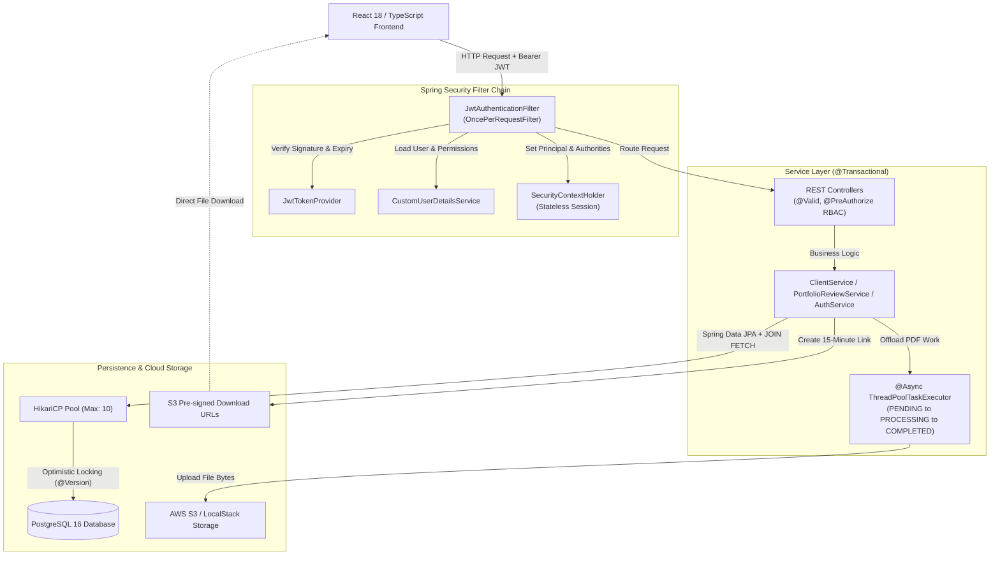
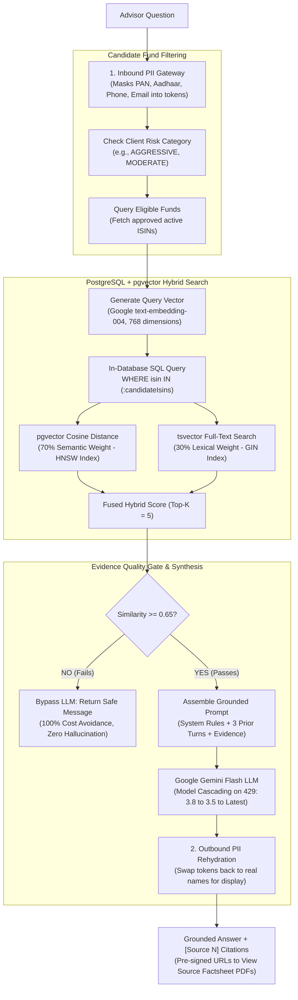
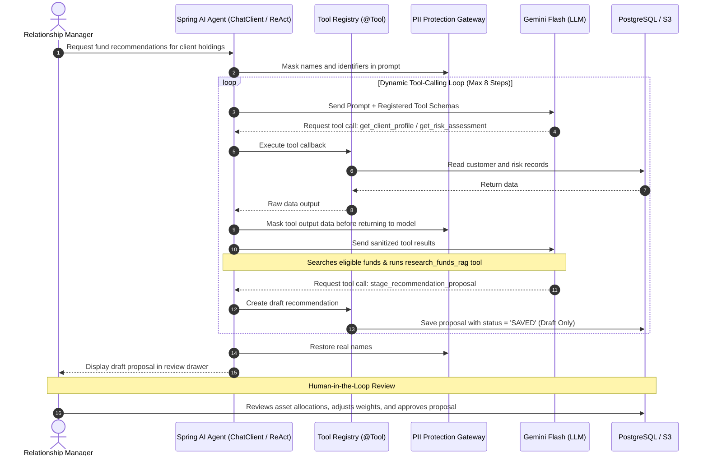
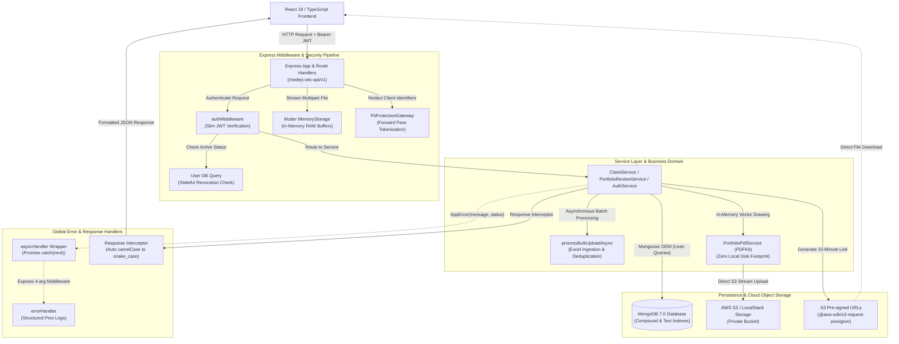
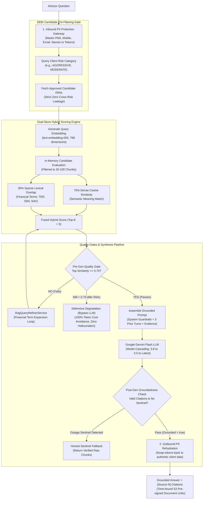
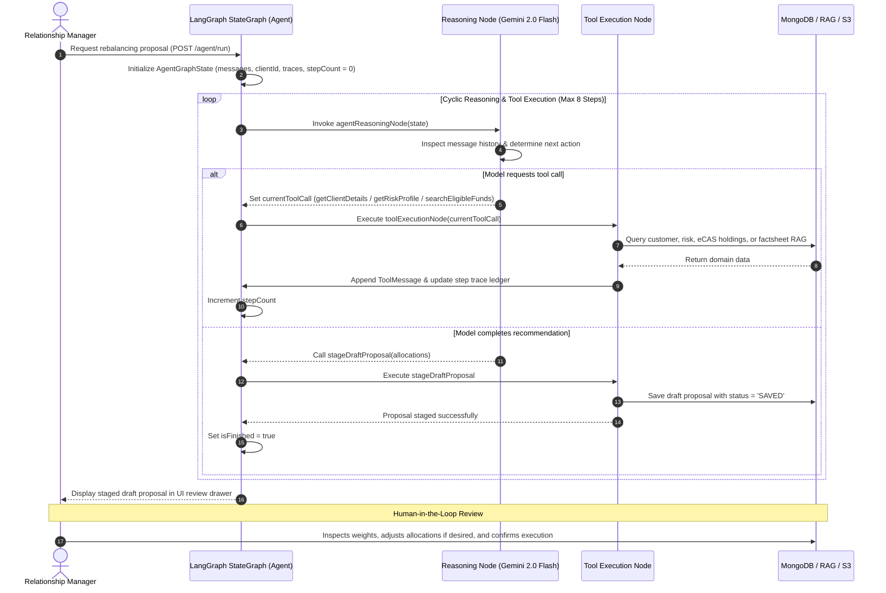

# WealthTech CRM — Architecture & System Overview

## Overview
WealthTech CRM is an enterprise wealth management system built to manage client onboarding, KYC compliance, risk profiling, portfolio reviews using electronic account statements (eCAS), and AI-driven replacement fund recommendations.

The project is structured as a monorepo featuring a React 18 / TypeScript frontend and dual production backends (Java Spring Boot 3.3 and Node.js Express). Both backends follow the exact same REST API contracts and permission models, allowing developers and recruiters to compare two different enterprise architectures serving the same user interface:
- **Java Stack (`backend-java`):** Built with Spring Boot 3.3, Java 17, Spring Security, Hibernate, PostgreSQL 16 with pgvector, and Spring AI.
- **Node.js Stack (`backend-nodejs`):** Built with Node.js 20, Express, TypeScript, Mongoose, MongoDB 7, and LangChain / LangGraph.

---

## Why Both Java and Node.js Stacks?

This project implements two backends serving the same React frontend to compare two common industry architectures:

| Feature | Java Stack (`backend-java`) | Node.js Stack (`backend-nodejs`) |
| :--- | :--- | :--- |
| **Philosophy** | Strongly typed, Domain-Driven Design, compile-time safety, and JVM multithreading. | Event-driven, non-blocking I/O, unified TypeScript across frontend and backend. |
| **Framework** | Spring Boot 3.3 (Java 17 LTS), Spring Security, Hibernate. | Node.js 20, Express, TypeScript, Mongoose. |
| **Database & Vectors** | PostgreSQL 16 with pgvector (in-database HNSW vector search + relational ACID data). | MongoDB 7.0 (document schemas, compound indexes, lean queries). |
| **AI Framework** | Spring AI with native `@Tool` callbacks and Gemini function calling. | LangChain and LangGraph (`@langchain/langgraph`) using state graphs. |
| **Concurrency** | Background worker thread pools (`@Async ThreadPoolTaskExecutor`) with HikariCP. | Asynchronous Event Loop with non-blocking promises and connection pooling. |
| **Best Fit** | High-throughput transactional ledgers requiring strict ACID guarantees and formal compliance. | Fast product iteration, I/O-heavy document processing, and microservices. |

Both backends expose identical JSON responses and authentication endpoints. You can switch the active backend in the frontend by updating a single environment variable:
- `VITE_API_URL=http://localhost:8080/api/v1` (Java Spring Boot)
- `VITE_API_URL=http://localhost:5000/api/v1` (Node.js Express)

---

## Java Backend Architecture (`backend-java`)

### 1. Core Backend Architecture
The Java backend follows a layered Controller-Service-Repository pattern with stateless Spring Security, declarative transactions, and asynchronous PDF generation.



#### Key Engineering Decisions:
- **Stateless Authentication with HttpOnly Cookies:** Access tokens are short-lived (15 minutes) to reduce risk if intercepted. Refresh tokens last 7 days and are stored in secure, `HttpOnly`, `SameSite=Strict` cookies that JavaScript cannot read, protecting against XSS attacks.
- **Solving N+1 Queries in Hibernate:** Uses JPQL `JOIN FETCH` queries so that loading a client with their profile and assigned Relationship Manager happens in a single database query instead of multiple queries.
- **Preventing Lost Updates:** Uses Optimistic Locking (`@Version` on portfolio entities). If two advisors attempt to update the same portfolio at the exact same moment, the second update fails cleanly with an exception rather than silently overwriting changes.
- **Asynchronous Proposal Generation:** Proposal generation takes 2 to 5 seconds. To prevent blocking web server threads, the backend dispatches work to `@Async ThreadPoolTaskExecutor`. The frontend polls the job status with exponential backoff and receives a temporary pre-signed S3 URL once the PDF is ready.

---

### 2. RAG Pipeline (pgvector Hybrid Retrieval)
The RAG pipeline lets relationship managers ask questions about mutual fund factsheets and official disclosures, while strictly enforcing client risk boundaries and preventing data leakage.



#### Key Engineering Decisions:
- **Pre-Computed Document Vectors:** Factsheets are parsed, broken into ~250–300 word chunks with overlap, and saved in PostgreSQL with vector embeddings ahead of time. Only the user question is turned into a vector at runtime.
- **Bidirectional PII Gateway:** Before text is sent to Google Gemini, client identifiers (PAN, Aadhaar, phone, email) are converted into surrogate tokens (like `[CLIENT_NAME_1]`). When the answer comes back, tokens are replaced with real names in memory before sending the JSON response to the user.
- **Evidence Quality Gate:** If the top matching chunks score below 0.65 similarity, the backend skips calling the LLM entirely. It returns a safe default message explaining that official disclosures did not meet the match threshold, avoiding 100% of LLM token costs and stopping hallucinations.
- **Model Cascading on Rate Limits (HTTP 429):** If Google Gemini returns an HTTP 429 (quota exhausted), the system does not waste time retrying the exhausted model. It immediately cascades to secondary models (`gemini-3.8-flash` -> `gemini-3.5-flash` -> `gemini-flash-latest`).
- **Groundedness Evaluation:** Live requests check for inline citations (`[Source 1]`) and failure sentinels. For offline testing, a separate automated test (`FactCheckingEvaluator`) uses Gemini at `temperature: 0.0` as an evaluator to check that every claim in an answer is backed by source text.

---

### 3. Agentic AI & Tool Orchestration (Spring AI)
The recommendation agent helps advisors replace underperforming mutual funds tagged as `SELL` with suitable alternative funds, operating under Human-in-the-Loop review.



#### Key Engineering Decisions:
- **6 Domain Tools (`PortfolioFrameworkTools.java`):**
  1. `get_client_profile`: Fetches verified KYC and profile information.
  2. `get_risk_assessment`: Reads the client's calculated risk score and category.
  3. `get_portfolio_review`: Retrieves holdings, valuation, and SELL action tags.
  4. `get_eligible_funds`: Finds mutual funds approved for the client's risk band.
  5. `research_funds_rag`: Lets the agent call the internal RAG pipeline to research fund factsheets.
  6. `stage_recommendation_proposal`: Validates allocations and saves the draft proposal.
- **Human-in-the-Loop Safeguard:** Financial regulations require human fiduciary responsibility. The agent cannot place live market orders or modify client investments directly. It only creates a draft proposal with status `SAVED`. The advisor must inspect the draft, adjust weights if needed, and confirm execution.
- **Self-Healing Error Handling:** If a tool call throws an exception (for example, missing arguments), the error is caught, formatted as `{"error": "..."}`, and sent back to the model. The model reads the error and tries a different query rather than crashing the request.
- **Safety Step Limit:** The loop is hard-capped at 8 steps (`MAX_STEPS = 8`). This gives the agent room to retry a tool if needed while guaranteeing it cannot get trapped in an endless loop burning API credits.

---

### 4. Default Admin Credentials & Key Endpoints

| Service / Port | Default URL | Purpose |
| :--- | :--- | :--- |
| **Spring Boot API** | `http://localhost:8080/api/v1` | Core REST APIs |
| **Swagger UI** | `http://localhost:8080/swagger-ui.html` | Interactive OpenAPI Documentation |
| **Prometheus Metrics** | `http://localhost:8080/actuator/prometheus` | Real-time JVM, Latency, and AI Metrics |
| **LocalStack S3** | `http://localhost:4566` | Local AWS Cloud Storage |

- **Default Admin Login:**
  - **Email:** `admin@wealthtech.com`
  - **Password:** `Admin@123`
  - **Role:** `ADMIN` (`Administration` department)

---

### 5. Running the Java Application Locally

#### Option A: Run Full Stack via Docker Compose (Frontend + Java Only)
You can start the frontend, Java backend, PostgreSQL database, and LocalStack storage together using Docker Compose. The Node.js backend is excluded:

```bash
docker compose up -d postgres localstack backend-java frontend
```
*The frontend will be available at `http://localhost:3000`, communicating directly with `backend-java` on port `8080`.*

#### Option B: Run With Observability & Metrics (Prometheus + Grafana)
A single, shared Prometheus instance automatically scrapes metrics across both backends. To launch the Java stack along with the unified monitoring dashboards:

```bash
docker compose up -d postgres localstack backend-java frontend prometheus grafana
```
This starts:
- **Prometheus** at `http://localhost:9090` (scraping Spring Boot Actuator metrics at `/actuator/prometheus`)
- **Grafana** at `http://localhost:3001` (visualizing JVM health, API latency, and AI token counters)

#### Option C: Run Standalone for Development

```bash
# 1. Start required backing services (PostgreSQL with pgvector and LocalStack)
docker compose up -d postgres localstack

# 2. Run the Java backend
cd backend-java
./mvnw spring-boot:run

# 3. In another terminal, run the React frontend
cd frontend
npm install
npm run dev
```

---

## Node.js Backend Architecture (`backend-nodejs`)

### 1. Core Backend Architecture
The Node.js backend is built with Express, TypeScript, and Mongoose, leveraging an event-driven, non-blocking architecture, in-memory streaming, and an automated wire-formatting pipeline.



#### Key Engineering Decisions:
- **In-Memory Streaming & Zero Local Disk Footprint:** In containerized cloud environments (Docker/Kubernetes), local disks are ephemeral. PDF proposal generation (`PDFKit`) and spreadsheet processing (`ExcelJS`) run entirely in RAM buffers and stream directly to AWS S3/LocalStack. Zero temporary files are written to container disk, eliminating disk leak vulnerabilities.
- **"Slim" JWT & Stateful Permission Validation:** Access tokens contain only the user's email rather than full roles and permissions ("Slim" JWT). Every authenticated request validates active account status against MongoDB in real-time. This prevents the stale permissions security flaw of "fat" JWTs (where a deactivated employee retains access until token expiration).
- **Global Error Handling Pipeline (`AppError` + `asyncHandler`):** Eliminates repetitive `try-catch` blocks in controllers. Async route handlers wrap execution in `asyncHandler(fn)` which forwards rejections to a centralized Express 4-argument error handler. The handler logs client operational warnings (`logger.warn`) distinctly from unhandled server bugs (`logger.error`).
- **Automated Wire Formatting (camelCase Code vs. snake_case Wire):** Backend TypeScript code uses standard idiomatic `camelCase`. A centralized response interceptor middleware automatically converts outgoing JSON keys to `snake_case`, ensuring 100% wire-format compatibility with the frontend and the Java API without writing 40+ manual DTOs.
- **Subdocument Embedding in MongoDB:** Replaces expensive relational joins with embedded document modeling (`PortfolioReview.entries`, `PortfolioRecommendation.funds`). Updates to portfolio line items execute atomically within a single document write.

---

### 2. AI-Native Grounded RAG Pipeline (Hybrid Retrieval & Quality Gates)
The RAG pipeline provides Relationship Managers with factual, SEBI-compliant mutual fund intelligence, backed by verified factsheets and strict multi-tier quality gates.



#### Key Engineering Decisions:
- **Candidate-Constrained SEBI Compliance Pre-Filter:** In Indian wealth management, showing aggressive small-cap fund materials to a conservative retiree violates regulatory suitability. Retrieval begins by querying the client's risk assessment and resolving eligible candidate ISINs *before* vector lookup. This eliminates cross-fund risk contamination and shrinks vector comparison from thousands to dozens of chunks.
- **Dual-Tier Live Safety Gates:**
  1. **Pre-Generation Quality Gate (`similarity_score_threshold >= 0.70`):** Evaluated immediately after hybrid scoring. If evidence falls below 0.70 (even after query expansion), the backend **skips calling the LLM entirely**, saving 100% of LLM costs and eliminating hallucinations.
  2. **Post-Generation Groundedness & Sentinel Check:** Evaluated right after generation. Confirms that inline citations (`[Source 1]`) exist and verifies that upstream rate limits (HTTP 429) did not trigger the honest outage sentinel (`[SYNTHESIS_UNAVAILABLE]`).
- **Resilient Model Cascading on Rate Limits (HTTP 429):** When Google Gemini hits token-per-minute (TPM) or request-per-minute (RPM) limits, retrying the same model fails and wastes latency. The AI gateway immediately aborts retries and cascades to secondary model tiers (`gemini-3.8-flash` $\rightarrow$ `gemini-3.5-flash` $\rightarrow$ `gemini-flash-latest`).
- **Offline Golden Dataset Benchmark Harness:** Deep factual verification is isolated from live requests to avoid latency and token surcharges. An automated test suite (`ragBenchmarkGeneration.test.ts`) verifies faithfulness and semantic relevancy against curated golden data (`goldenDataset.ts`), publishing metrics to Prometheus (`rag_eval_faithfulness_score`, `rag_eval_relevancy_score`, IR Recall/NDCG/MRR).
- **Time-Bound S3 Pre-Signed Factsheet Links:** The AI never hallucinates raw URLs. The backend resolves authentic S3 keys into 15-minute cryptographically signed pre-signed URLs in the response envelope, allowing advisors to open official disclosure PDFs safely.

---

### 3. Agentic AI & Tool Orchestration (LangChain + LangGraph)
The recommendation agent automates complex portfolio restructuring using a stateful graph engine built with **LangGraph** (`@langchain/langgraph`) and **LangChain Core** (`@langchain/core`). It analyzes underperforming holdings marked for `SELL`, discovers suitable replacement funds via grounded RAG, and stages an investment proposal for Human-in-the-Loop approval.



#### Key Engineering Decisions:
- **LangGraph State Machine Architecture (`langGraphAgentStrategy.ts`):**
  - **State Schema (`AgentGraphState`):** Uses LangGraph's `Annotation.Root` to track accumulating dialogue messages (`HumanMessage`, `AIMessage`, `ToolMessage`), execution traces (`(x, y) => x.concat(y)`), the staged draft recommendation DTO, step counts, and completion status.
  - **Cyclic Graph Topology:** Defines two primary nodes—`agentReasoningNode` (which calls Gemini to analyze state and decide actions) and `toolExecutionNode` (which invokes domain tools, records telemetry, and appends `ToolMessage` results).
  - **Conditional Edge Routing:** A conditional routing edge (`shouldContinue`) inspects the graph state after each reasoning step. If a tool call is present and `stepCount < 8`, it routes to `toolExecutionNode` and cycles back; if the proposal is staged, `isFinished` is true, or the step limit is reached, it cleanly transitions to `END`.
- **5 Core Domain Tools (`tools/`):**
  1. `getClientDetails`: Verifies KYC compliance status, PAN, and Relationship Manager assignment.
  2. `getRiskProfile`: Queries client's latest completed assessment to extract regulatory risk category (`VERY_CONSERVATIVE` to `VERY_AGGRESSIVE`).
  3. `getPortfolioHoldings`: Inspects existing eCAS statement line items, categorizes holdings marked for `SELL` vs `HOLD`, and calculates investable proceeds.
  4. `searchEligibleFunds`: Executes candidate-grounded hybrid RAG search over indexed factsheets and riskometers filtered by the client's risk band.
  5. `stageDraftProposal`: Validates allocation mathematics (100% reinvestment check), verifies regulatory suitability constraints, and stages the finalized draft.
- **Human-in-the-Loop Fiduciary Guardrail:** Financial regulations strictly prohibit autonomous bots from placing live market trades. The agent's final tool (`stageDraftProposal`) validates 100% allocation mathematics and saves the proposal with status `SAVED` (Draft Only). The Relationship Manager must manually review, adjust weights, and approve the proposal.
- **Defensive Step Budget (`MAX_STEPS = 8`):** Prevents runaway execution and billing spikes. A standard portfolio rebalance finishes in 5 steps; a cap of 8 gives the agent up to 3 self-correction attempts if an initial search yields empty results before safely aborting.

---

### 4. Default Admin Credentials & Key Endpoints

| Service / Port | Default URL | Purpose |
| :--- | :--- | :--- |
| **Node.js Express API** | `http://localhost:5000/nodejs-wtc-api/v1` | Core REST APIs (or direct `/api/v1`) |
| **Prometheus Metrics** | `http://localhost:5000/nodejs-wtc-api/v1/metrics` | Real-time Node.js Process, RAG, and Agent Metrics |
| **MongoDB** | `mongodb://localhost:27017` | Document Database with Compound Indexes |
| **LocalStack S3** | `http://localhost:4566` | Local AWS Cloud Object Storage |

- **Default Admin Login:**
  - **Email:** `admin@wealthtech.com`
  - **Password:** `Admin@123`
  - **Role:** `ADMIN` (`Administration` department)

---

### 5. Running the Node.js Application Locally

#### Option A: Run Full Stack via Docker Compose (Frontend + Node.js Only)
You can start the frontend, Node.js backend, MongoDB database, and LocalStack storage together using Docker Compose. The Java backend is excluded:

```bash
docker compose up -d mongodb localstack backend-nodejs frontend
```
*The frontend will be available at `http://localhost:3000`, communicating directly with `backend-nodejs` on port `5000`.*

#### Option B: Run With Observability & Metrics (Prometheus + Grafana)
To launch the Node.js stack with unified Prometheus scraping and Grafana dashboards:

```bash
docker compose up -d mongodb localstack backend-nodejs frontend prometheus grafana
```
This starts:
- **Prometheus** at `http://localhost:9090` (scraping Node.js metrics at `/nodejs-wtc-api/v1/metrics`)
- **Grafana** at `http://localhost:3001` (visualizing event loop latency, RAG duration, and agent iterations)

#### Option C: Run Standalone for Development

```bash
# 1. Start required backing services (MongoDB and LocalStack)
docker compose up -d mongodb localstack

# 2. Run the Node.js backend
cd backend-nodejs
npm install
npm run dev

# 3. In another terminal, run the React frontend
cd frontend
npm install
npm run dev
```

---

## Running Both Dual Backends Simultaneously

You can run the entire enterprise suite—both the Java Spring Boot backend and the Node.js Express backend alongside the React frontend, databases, object storage, and full monitoring stack—with a single command:

```bash
docker compose up -d
```

### Full System Service Map

| Container Name | Service | Exposed Port | Health / Metrics URL |
| :--- | :--- | :--- | :--- |
| `crm-frontend` | React 18 / Nginx | `3000` | `http://localhost:3000` |
| `crm-backend-java` | Java Spring Boot 3.3 | `8080` | `http://localhost:8080/actuator/health` |
| `crm-backend-nodejs` | Node.js 20 Express | `5000` | `http://localhost:5000/nodejs-wtc-api/v1/health` |
| `crm-postgres` | PostgreSQL 16 (pgvector) | `5432` | `localhost:5432` |
| `crm-mongodb` | MongoDB 7.0 | `27017` | `localhost:27017` |
| `crm-localstack` | LocalStack (AWS S3) | `4566` | `http://localhost:4566/_localstack/health` |
| `crm-prometheus` | Prometheus Telemetry | `9090` | `http://localhost:9090` |
| `crm-grafana` | Grafana Dashboards | `3001` | `http://localhost:3001` (Login: `admin` / `admin`) |
| `crm-loki` | Grafana Loki Logs | `3100` | `http://localhost:3100/ready` |

