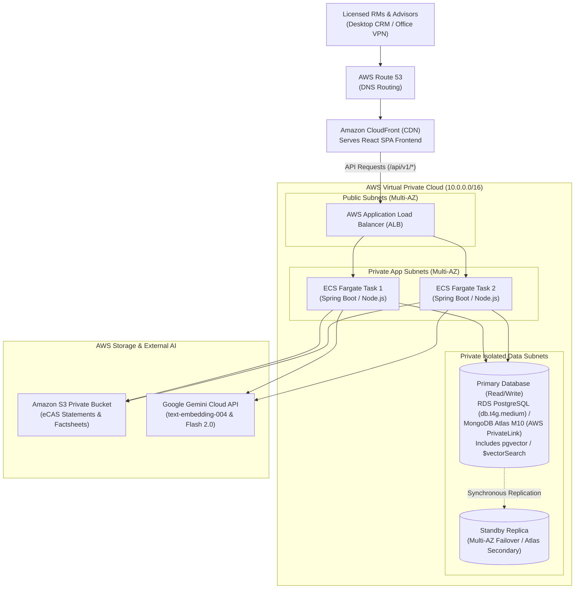
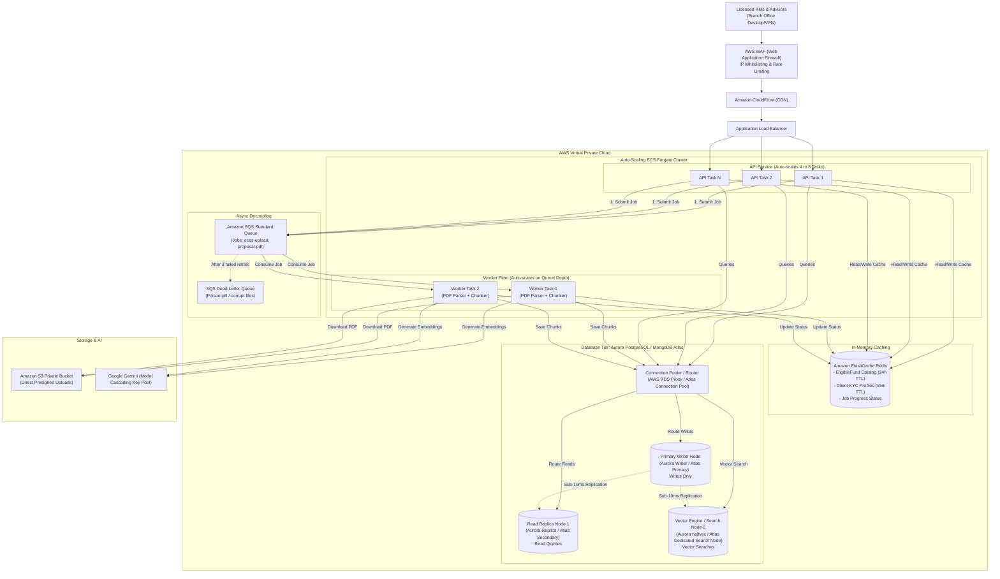
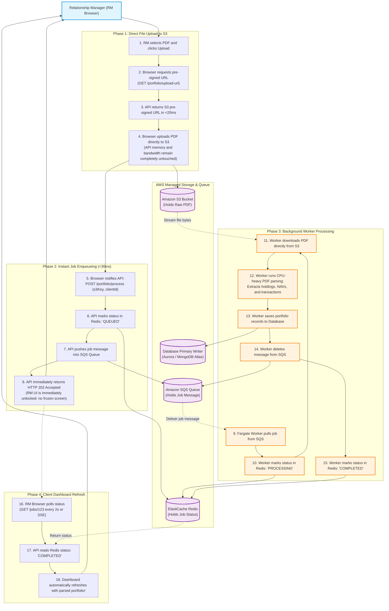
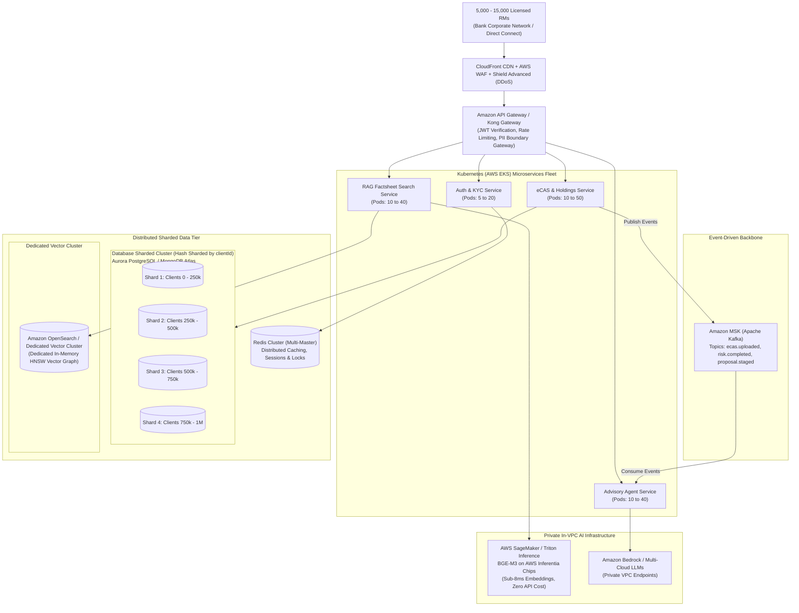
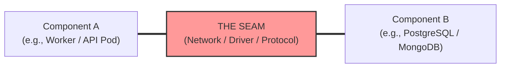
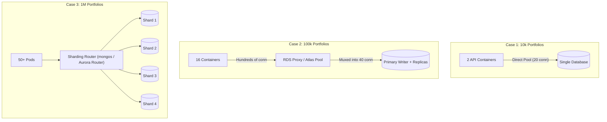
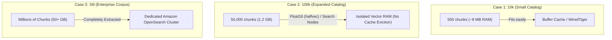
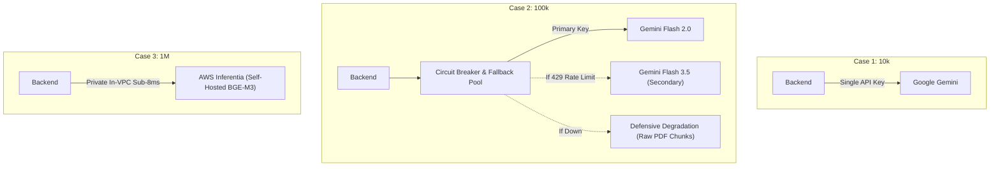
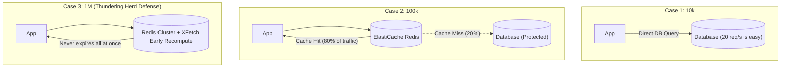

# AWS Production Scale-Up Architecture Guide
## WealthTech CRM & AI Advisory Platform (10k -> 100k -> 1 Million Managed Portfolios)

> [!NOTE]
> **Enterprise B2B Architecture Clarification:**  
> This WealthTech CRM is an **internal enterprise tool used exclusively by Relationship Managers (RMs), Wealth Advisors, Investment Committee members, and Operations/Compliance Admins**.  
> End-clients (investors) **never log into this platform**. Instead, the scale tiers (10k, 100k, 1M) represent the **number of client portfolios and statement records managed in the database** by the advisory firm.

---

## Table of Contents
1. [Scale Tier Comparison Matrix](#1-scale-tier-comparison-matrix)
2. [Case 1: 10,000 Portfolios Managed (Boutique Wealth Firm)](#case-1-10000-portfolios-managed-boutique-wealth-firm)
   - [Workload & Traffic Profile (10k)](#workload--traffic-profile-10k)
   - [Architecture Diagram (10k Portfolios)](#architecture-diagram-10k-portfolios)
   - [Component Walkthrough & Rationale](#component-walkthrough--rationale-10k)
3. [Case 2: 100,000 Portfolios Managed (National Wealth Management Firm)](#case-2-100000-portfolios-managed-national-wealth-management-firm)
   - [Workload & Traffic Profile (100k)](#workload--traffic-profile-100k)
   - [Architecture Diagram (100k Portfolios)](#architecture-diagram-100k-portfolios)
   - [What Broke in Case 1 and What Was Added](#what-broke-in-case-1-and-what-was-added)
4. [Case 3: 1,000,000 Portfolios Managed (Tier-1 Enterprise Bank Wealth Arm)](#case-3-1000000-portfolios-managed-tier-1-enterprise-bank-wealth-arm)
   - [Workload & Traffic Profile (1M)](#workload--traffic-profile-1m)
   - [Architecture Diagram (1M Portfolios)](#architecture-diagram-1m-portfolios)
   - [Enterprise Decoupling, Sharding & Private AI](#enterprise-decoupling-sharding--private-ai)
5. [The 5 Critical Seams & Failure Points Across Tiers](#5-the-5-critical-seams--failure-points-across-tiers)

---

## 1. Scale Tier Comparison Matrix

| Architectural Dimension | Case 1: 10,000 Portfolios Managed | Case 2: 100,000 Portfolios Managed | Case 3: 1,000,000 Portfolios Managed |
| :--- | :--- | :--- | :--- |
| **Firm Profile** | Boutique Wealth Firm / Multi-Family Office | National Wealth Management Firm (e.g. Kotak/IIFL) | Tier-1 Bank Wealth Arm (e.g. HDFC/SBI Wealth) |
| **Client Portfolios in DB** | **10,000 client records** | **100,000 client records** | **1,000,000 client records** |
| **Total Licensed RMs / Advisors** | **50 – 100 RMs** | **500 – 1,500 RMs across branches** | **5,000 – 15,000 RMs nationwide** |
| **Concurrent Active RMs** | **~30 – 80 active RMs online** | **~300 – 900 active RMs online** | **~2,500 – 6,000 active RMs online** |
| **Peak Throughput** | 15 – 35 requests/sec | 200 – 600 requests/sec | 1,500 – 5,000 requests/sec |
| **Daily Ingestion Batch** | 50 – 200 statements/day | 1,000 – 4,000 statements/morning | 15,000 – 50,000 statements/morning |
| **Workload Intensity** | Low concurrency; heavy per-session AI processing | RMs bulk-upload statements at 9:30 AM; high RAG fact-checking | Massive concurrent agent runs + multi-region advisory operations |
| **Compute Packaging** | 2 ECS Fargate containers (Monolith) | 4–8 Auto-scaling ECS tasks (API + Workers) | 30–60 Kubernetes Pods on EKS (Microservices) |
| **Database Architecture** | Single RDS PostgreSQL (`db.t4g.medium`) /<br/>MongoDB Atlas M10 (3-Node Replica Set) | Aurora PostgreSQL (1 Writer + 2 Read Replicas) + RDS Proxy /<br/>MongoDB Atlas M30 (`secondaryPreferred` + Dedicated Search Nodes) | Sharded Aurora Cluster /<br/>MongoDB Sharded Cluster (4 shards partitioned by `clientId`) |
| **Async Jobs & Ingestion** | In-process threads / S3 pre-signed upload | Amazon SQS + Dead-Letter Queue (DLQ) | Amazon MSK (Apache Kafka event streaming) |
| **Caching Layer** | None (PostgreSQL / MongoDB cache is sufficient) | Amazon ElastiCache Redis (Primary-Replica) | Redis Cluster (Multi-master, distributed) |
| **Vector Search (RAG)** | `pgvector` inside PostgreSQL /<br/>MongoDB Atlas native `$vectorSearch` | `pgvector` on Aurora Read Replica (using `halfvec`) /<br/>MongoDB Atlas Dedicated Search Nodes | Dedicated Amazon OpenSearch cluster /<br/>Dedicated Vector Cluster |
| **AI / Embedding Engine** | Google Gemini API (Standard Key) | Google Gemini (Multi-Key Cascading) | Self-hosted `BGE-M3` on AWS SageMaker Inferentia |
| **Estimated AWS Cost** | **$150 – $350 / month** | **$1,200 – $2,800 / month** | **$10,000 – $25,000+ / month** |

---

## Case 1: 10,000 Portfolios Managed (Boutique Wealth Firm)

### Workload & Traffic Profile (10k)
* **Client Portfolios Managed:** ~10,000 investor accounts stored in PostgreSQL / MongoDB.
* **Licensed Relationship Managers (RMs):** ~50 to 100 advisors and operations staff.
* **Concurrent Active RMs:** ~30 to 80 RMs logged in during market hours (9:00 AM to 5:30 PM IST).
* **Throughput:** ~15 to 35 requests per second.
* **Daily Ingestion:** ~50 to 200 eCAS statements uploaded per day.
* **Philosophy:** **Keep It Simple & Cheap.** Maintain high availability without operational overhead or premature microservice complexity.

### Architecture Diagram (10k Portfolios)



### Component Walkthrough & Rationale (10k)
1. **Amazon CloudFront (CDN):** Caches the React frontend bundle at AWS Edge locations across India. Static asset requests never touch our backend servers.
2. **Application Load Balancer (ALB):** Terminates HTTPS (SSL/TLS) using certificates from AWS Certificate Manager (ACM) and load-balances traffic across 2 application tasks.
3. **2 ECS Fargate Tasks (Stateless Backend):** 
   - We run 2 tasks purely for **High Availability (redundancy)**. If one container dies during a rolling deployment, the other handles 100% of traffic with zero downtime.
   - Using AWS Fargate means we do not manage EC2 operating systems or security patches.
4. **Primary Database: Amazon RDS PostgreSQL / MongoDB Atlas M10:**
   - **PostgreSQL (Java Stack):** An inexpensive `db.t4g.medium` (2 vCPU, 4GB RAM) handles 50 requests/sec with $< 20\%$ CPU utilization. Multi-AZ standby replicates data synchronously to a secondary Availability Zone for $<60$s auto-failover.
   - **MongoDB (Node.js Stack):** A 3-node replica set (1 Primary, 2 Secondaries) deployed on MongoDB Atlas via AWS PrivateLink. If the Primary fails, Secondaries elect a new Primary in $<3$ seconds.
   - **Vector Storage:** Vector embeddings (`pgvector` in PostgreSQL / native `$vectorSearch` in MongoDB Atlas) reside directly in the database. At 10k portfolios, the scheme catalog has ~500 chunks, which occupies $<50\text{ MB}$ of memory—easily fitting in RAM.
5. **Amazon S3:** Private bucket storing PDF statements with server-side encryption (SSE-S3).

---

## Case 2: 100,000 Portfolios Managed (National Wealth Management Firm)

### Workload & Traffic Profile (100k)
* **Client Portfolios in Database:** ~100,000 investor portfolios and eCAS history records.
* **Licensed Relationship Managers (RMs):** ~500 to 1,500 relationship managers across branches nationwide.
* **Concurrent Active RMs:** ~300 to 900 active RMs online simultaneously during market hours.
* **Throughput:** ~200 to 600 requests per second.
* **Daily Ingestion Batch:** 1,000 to 4,000 eCAS statements uploaded by RMs every morning (9:00 AM – 11:00 AM).

### What Broke in Case 1 and What Was Added
1. **CPU Freezes on PDF Parsing:** When 50 RMs upload 30-page statements simultaneously at 9:30 AM, running PDF parsing inside the API containers freezes the event loop/Tomcat worker threads. **Fix:** Added **Amazon SQS** to decouple parsing into asynchronous background worker tasks.
2. **Database Overloaded on Reads:** 80% of database queries are identical read operations (e.g. RMs fetching the list of approved mutual funds or checking client KYC profiles). **Fix:** Added **Amazon ElastiCache (Redis)** and split database read load:
   - *PostgreSQL (Java Stack):* Upgraded to **Amazon Aurora (1 Writer + 2 Read Replicas)**.
   - *MongoDB (Node.js Stack):* Configured Mongoose queries with `readPreference: 'secondaryPreferred'` so Secondaries handle read volume.
3. **Connection Pool Exhaustion & Vector RAM Competition:**
   - *PostgreSQL:* Auto-scaling containers multiply DB connections $\longrightarrow$ Added **AWS RDS Proxy** to pool connections. Switched vector columns to `halfvec` (float16).
   - *MongoDB:* Vector search math competes with WiredTiger document cache $\longrightarrow$ Added **Dedicated MongoDB Atlas Search Nodes** to isolate vector computations from transactional document storage.

### Architecture Diagram (100k Portfolios)



### Step-by-Step API & SQS Worker Lifecycle (Flow Diagram)

The following flow diagram illustrates the end-to-end lifecycle of an asynchronous file upload (e.g., an RM uploading an eCAS statement). It shows how the request is decoupled so the API server returns in $<30\text{ ms}$ while a background worker does the heavy processing:



---

## Case 3: 1,000,000 Portfolios Managed (Tier-1 Enterprise Bank Wealth Arm)

### Workload & Traffic Profile (1M)
* **Client Portfolios in Database:** 1,000,000+ client accounts, eCAS transactions, and SEBI compliance logs.
* **Licensed Relationship Managers (RMs):** 5,000 to 15,000 advisors and institutional wealth teams nationwide.
* **Concurrent Active RMs:** 2,500 to 6,000 active RM sessions during peak market hours.
* **Throughput:** 1,500 to 5,000 requests per second.
* **Daily Ingestion Batch:** 15,000 to 50,000 eCAS statements uploaded every morning.
* **Data Volume:** 20+ million mutual fund factsheet chunks; 50+ million portfolio holding rows.

### Enterprise Decoupling, Sharding & Private AI
1. **Microservices Fleet on AWS EKS:** The monolith is separated into independent domain services (Auth, Portfolio/eCAS, RAG Retrieval, Advisory Agent). A traffic spike in RM advisory proposal generation cannot degrade authentication or client profile lookups.
2. **Amazon MSK (Apache Kafka):** High-throughput event streaming replaces simple point-to-point queues. When a statement finishes parsing, it emits an event (`portfolio.rebalanced`) consumed in parallel by analytics, audit logging, and advisory engines.
3. **Database Sharding (Hashed by `clientId`):**
   - A single database writer cannot process the write IOPS for 1 million active portfolios.
   - **PostgreSQL (Java Stack):** Sharded across 4 Amazon Aurora shards partitioned by `clientId`.
   - **MongoDB (Node.js Stack):** Native sharded cluster with `mongos` query routers and a hashed shard key on `{ clientId: "hashed" }` distributed across 4 independent replica sets.
4. **Dedicated Amazon OpenSearch / Vector Cluster:** Vector embeddings are removed from PostgreSQL / MongoDB to eliminate memory competition with financial ACID transactions. OpenSearch / dedicated vector nodes dedicate 100% of their RAM to graph vector indices.
5. **Private Self-Hosted AI on AWS SageMaker / Inferentia:** At 1 million portfolios, public cloud LLM API calls become a multi-million-dollar cost bottleneck and trigger strict rate limits. We host open-source embedding models (`BGE-M3`) on private AWS Inferentia chips inside our VPC, slashing query latency to **under 8 milliseconds** with zero external API fees.

### Architecture Diagram (1M Portfolios)



---

## 5. The 5 Critical Seams & Failure Points Across Tiers

In distributed systems, a **"seam"** is the connecting boundary or bridge where two different software components talk to each other (for example, the network wire between your API server and your database, or the boundary between your code and an external AI service).

Systems almost never crash in the middle of clean business logic; **they break at the seams** when traffic, connections, or data volume overwhelm the bridge.

Here is a deep, plain-English breakdown of why each seam breaks as traffic grows, and the exact architectural reasons for the solutions chosen at each tier.



---

### Seam 1: Compute (API & Workers) $\longleftrightarrow$ Database (Connection Management & Sharding)

**What is this seam?**  
The network connection pool between your backend containers (Express / Spring Boot) and your database (PostgreSQL / MongoDB). Every time your code runs a query, it must talk over an open TCP "phone line" (connection).



* **Case 1 (10,000 Portfolios): Direct Connections**
  * *Setup:* 2 Fargate containers connect directly to PostgreSQL or MongoDB Atlas.
  * *The Reason (Why this works):* With 2 containers configured with a connection pool of 10 (`maxPoolSize=10` or HikariCP `maximumPoolSize=10`), there are at most $2 \times 10 = 20$ open connections. A standard database can easily support 100+ connections without any slowdown. No extra proxy is required.
* **Case 2 (100,000 Portfolios): AWS RDS Proxy (PostgreSQL) / Read Splitting (MongoDB)**
  * *The Failure Symptom:* In morning peak hours, 16 auto-scaling containers (8 API + 8 Workers) spin up. If each keeps 30 connections, that is $16 \times 30 = 480$ connections.
  * *The Reason (Why the solution is needed):*
    * **PostgreSQL:** In PostgreSQL, each open connection is a separate operating system process that consumes 5 to 10 MB of RAM just sitting idle. 480 connections waste nearly 4 GB of database memory on connection overhead alone, starving the buffer cache and causing the database to reject new queries with `"FATAL: sorry, too many clients already"`. **AWS RDS Proxy** solves this by sitting between the containers and PostgreSQL: hundreds of container connections talk to the proxy, which multiplexes and shares a small, steady pool of just 40 real connections to the database.
    * **MongoDB:** In MongoDB, the primary replica node handles writes. By configuring Mongoose queries with `readPreference: 'secondaryPreferred'`, all read traffic (viewing portfolios, checking funds) is offloaded to secondary replica nodes, keeping the primary node completely free for saving new client data.
* **Case 3 (1,000,000 Portfolios): Horizontal Sharding by `clientId`**
  * *The Failure Symptom:* Even with connection proxies and read replicas, there is still only **one single Primary Writer disk**. At 1 million portfolios with 5,000 active RMs saving transaction records, the physical disk write capacity (IOPS) hits 100% saturation. The single writer cannot write data fast enough.
  * *The Reason (Why the solution is needed):* We split the database into 4 separate database servers (**Shards**) partitioned by a hash of the client's ID (`clientId`). A client whose ID hashes to Shard 1 is written only to Shard 1; a client on Shard 2 is written only to Shard 2. This cuts the write workload per disk by 75%, allowing 4 separate servers to write in parallel.

---

### Seam 2: Vector Math $\longleftrightarrow$ Physical RAM (`pgvector` / MongoDB Atlas Vector Search)

**What is this seam?**  
The boundary between vector similarity calculations (used by the RAG advisory system to find relevant mutual funds) and the server's physical memory (RAM).



* **Case 1 (10,000 Portfolios): Vectors in the Primary Database**
  * *Setup:* Vector embeddings are stored directly in a table column (`pgvector` in PostgreSQL / `$vectorSearch` in MongoDB).
  * *The Reason (Why this works):* The firm's Approved Product List (APL) contains ~15 curated mutual funds (~500 text chunks). As calculated earlier, 500 vectors occupy less than 10 MB of memory. This fits effortlessly into the database's existing RAM without affecting normal database queries.
* **Case 2 (100,000 Portfolios): Float16 (`halfvec`) & Dedicated Atlas Search Nodes**
  * *The Failure Symptom:* The research catalog expands to cover 1,500 schemes, historical fund manager commentaries, and regulatory circulars (~50,000 chunks). Calculating cosine distances across large HNSW vector graphs requires over 1.2 GB of continuous RAM. The database operating system starts evicting normal client data and recent transaction pages from memory to make room for vector math. Normal SQL queries suddenly slow down by 10x because the database has to fetch data from slow disks instead of RAM (disk thrashing).
  * *The Reason (Why the solution is needed):*
    * **PostgreSQL:** We switch vector columns to `halfvec` (16-bit float instead of 32-bit float). This cuts memory consumption in half (from 1.2 GB to ~600 MB) with 99% retrieval accuracy retained.
    * **MongoDB:** We activate **Dedicated MongoDB Atlas Search Nodes**. This physically moves the vector search engine (Apache Lucene) onto its own independent virtual machine so its memory calculations never touch or steal RAM from the WiredTiger transactional database cache.
* **Case 3 (1,000,000 Portfolios): Dedicated Amazon OpenSearch Cluster**
  * *The Failure Symptom:* At enterprise bank scale, millions of research notes, statutory filings, and historical compliance records generate tens of gigabytes of vector graphs. Keeping this inside a transactional financial database degrades transaction throughput.
  * *The Reason (Why the solution is needed):* We completely remove vector data from the relational/document database and place it into a dedicated **Amazon OpenSearch cluster**. The transactional database does only what it does best (storing ledgers, portfolios, and client records), while OpenSearch devotes 100% of its high-RAM instances to vector and hybrid search queries.

---

### Seam 3: Web Thread $\longleftrightarrow$ Heavy Processing (PDF Parsing & Chunking)

**What is this seam?**  
The boundary between the web server thread that handles incoming HTTP requests from the RM's browser and the CPU-heavy logic that parses 30-page eCAS statement PDF files.

```mermaid
flowchart TD
    subgraph BadWay ["Case 1 Under Load (Broken)"]
        RM1["50 RMs Upload at 9:30 AM"] --> API_B["API Server (Parses In-Process)"]
        API_B -->|"100% CPU Lockup"| Freeze["Server Freezes! All other RMs get 504 Timeout"]
    end
    subgraph GoodWay ["Case 2 & 3: Async Decoupled"]
        RM2["50 RMs Upload at 9:30 AM"] --> API_G["API Server"]
        API_G -->|"Save job in 20ms"| SQS["Amazon SQS Queue"]
        API_G -->>|"202 Accepted"| RM2
        SQS -->|"Pull one-by-one"| Worker["Worker Containers (Process at safe speed)"]
    end
```

* **Case 1 (10,000 Portfolios): Synchronous In-Process Parsing**
  * *Setup:* When an RM uploads a PDF, the API container parses the text and extracts mutual fund holdings directly in the same process before replying.
  * *The Reason (Why this works):* With only 30 active RMs, an upload happens only once every few hours. A 3-page statement takes ~600 milliseconds to parse. The server has plenty of idle CPU to handle this without affecting other users.
* **Case 2 (100,000 Portfolios): Asynchronous SQS Queue + DLQ**
  * *The Failure Symptom:* At 9:15 AM on Monday morning, 50 RMs upload 30-page statements at the same time. PDF text extraction is heavily CPU-bound. In Node.js, running CPU parsing in the main thread blocks the Event Loop, causing all other incoming HTTP requests to freeze. In Java, all 200 Tomcat worker threads get stuck parsing PDFs, causing the Application Load Balancer to throw `504 Gateway Timeout` errors to every other RM in the company.
  * *The Reason (Why the solution is needed):* We decouple the upload using **Amazon SQS**. When an RM uploads a file, the API container does not parse it; it simply creates a job ticket in SQS and responds with `HTTP 202 Accepted` in less than 30 milliseconds. Independent **Worker containers** pull jobs from the queue one by one. If an RM uploads a corrupted or password-protected PDF that crashes a worker, SQS retries it 3 times and then automatically diverts it to a **Dead-Letter Queue (DLQ)**, preventing a single bad file from crashing the entire pipeline.
* **Case 3 (1,000,000 Portfolios): Event Streaming with Apache Kafka (Amazon MSK)**
  * *The Failure Symptom:* SQS is a point-to-point queue (each message is consumed by exactly one worker and deleted). At 1 million portfolios, an uploaded portfolio must trigger 5 different internal banking systems simultaneously: the Portfolio Accounting Ledger, the Tax Loss Harvesting Engine, the SEBI Compliance Audit Trail, the Risk Profiling Service, and the Advisory Agent. Trying to create 5 separate SQS queues and duplicate messages across them causes synchronization bugs and lag.
  * *The Reason (Why the solution is needed):* We use **Apache Kafka**. Kafka acts as a permanent, ordered event log (`ecas.uploaded`). All 5 microservices read the same stream of events independently at their own speed. Kafka handles millions of messages per second with microsecond latency without message loss.

---

### Seam 4: Application $\longleftrightarrow$ External AI APIs (Google Gemini / LLMs)

**What is this seam?**  
The boundary between your backend servers and external cloud AI APIs (Google Gemini, OpenAI) over the public internet.



* **Case 1 (10,000 Portfolios): Single API Key**
  * *Setup:* A single Gemini API key configured in the environment.
  * *The Reason (Why this works):* With ~50 licensed advisors, RAG research queries occur rarely (a few queries per hour). Total volume is well within Google's free/standard tier rate limit (15 to 60 requests per minute).
* **Case 2 (100,000 Portfolios): Resilient Model Cascading & Circuit Breakers**
  * *The Failure Symptom:* During morning market opening, 300 active RMs ask the RAG assistant to compare funds for client meetings. The application exhausts Google's rate limit per minute, throwing `HTTP 429 Too Many Requests`. If the AI call fails unhandled, the RM sees an unhelpful error screen during a live client meeting.
  * *The Reason (Why the solution is needed):* We implement **Resilient Model Cascading** and **Circuit Breakers**:
    1. If the primary model (Gemini 2.0 Flash) returns a 429 rate limit or 503 error, the code automatically catches it and retries using a secondary model (Gemini 1.5 Pro or Flash 3.5) with exponential backoff and randomized jitter.
    2. If external AI is completely down, the system triggers **Defensive Degradation**: instead of crashing, it displays the verified mutual fund factsheet excerpts and riskometer tables directly to the RM with a banner: *"AI summary temporarily unavailable; displaying verified regulatory disclosures."*
* **Case 3 (1,000,000 Portfolios): Private Self-Hosted AI on AWS Inferentia**
  * *The Failure Symptom:* At 1 million portfolios, calling public cloud APIs creates two critical roadblocks:
    1. **Cost:** Generating embeddings for millions of portfolio documents over external APIs costs tens of thousands of dollars each month.
    2. **Regulatory & Privacy Rules:** Tier-1 enterprise banks are legally prohibited by banking regulators from sending confidential client wealth data or customized portfolio queries over the public internet to third-party AI vendors.
  * *The Reason (Why the solution is needed):* We host our own open-source embedding model (`BGE-M3`) inside our own private AWS VPC on **AWS Inferentia (custom AI chips)**. No data ever leaves the bank's secure private network, latency drops to **under 8 milliseconds per embedding**, and third-party API costs drop to **$0**.

---

### Seam 5: Application $\longleftrightarrow$ In-Memory Cache (Redis)

**What is this seam?**  
The boundary between your application code and Redis, which holds frequently requested data in super-fast RAM so the database does not have to be queried repeatedly.



* **Case 1 (10,000 Portfolios): No Cache (Direct Database Queries)**
  * *Setup:* Every API request queries PostgreSQL or MongoDB directly.
  * *The Reason (Why this works):* Total traffic is only 15 to 35 requests per second. A properly indexed database can answer simple queries in 2 to 5 milliseconds. Adding Redis would add $15 to $30/month in cloud costs and extra code complexity for zero noticeable difference to the user.
* **Case 2 (100,000 Portfolios): Amazon ElastiCache Redis**
  * *The Failure Symptom:* 500 RMs log in and continually refresh their dashboards. Over 80% of database queries are asking for the exact same static information: *"Give me the list of 15 approved mutual funds"* or *"What are client Sharma's KYC risk answers?"* The database CPU spikes to 80%+ just answering the same repetitive queries over and over again.
  * *The Reason (Why the solution is needed):* We place **Amazon ElastiCache Redis** in front of the database.
    * The Approved Mutual Fund Catalog is saved in Redis with a **24-hour TTL** (Time-To-Live). The database answers this query only once a day; the other 100,000 times it is served from Redis in under 1 millisecond.
    * Client KYC profiles are cached for **15 minutes** while the RM is actively reviewing them. Database CPU drops from 80% down to under 20%.
* **Case 3 (1,000,000 Portfolios): Distributed Redis Cluster & Cache Stampede Protection (XFetch)**
  * *The Failure Symptom:* Two catastrophic problems occur:
    1. A single Redis instance runs out of memory holding millions of cached sessions and profiles.
    2. **The "Thundering Herd / Cache Stampede" Problem:** When the 24-hour cache for the approved fund list expires at 9:00 AM, 4,000 active RMs miss the cache at the exact same millisecond. All 4,000 requests bypass Redis and hammer the database simultaneously. The database CPU spikes to 100% and crashes instantly.
  * *The Reason (Why the solution is needed):*
    1. We upgrade to a **Redis Cluster** (data is sharded across multiple primary and replica Redis nodes so memory is never exhausted).
    2. We implement **Probabilistic Early Expiration (the XFetch algorithm)**: before the 24-hour key actually expires, a single background thread computes and refreshes the cache early while all other users continue reading the valid cached data. The key never "hard expires" for users, completely preventing the Thundering Herd database crash.
