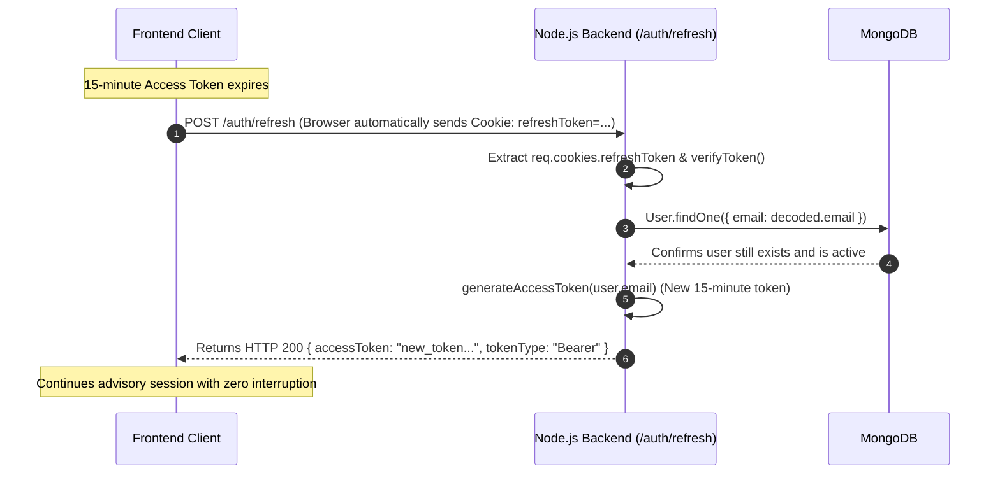
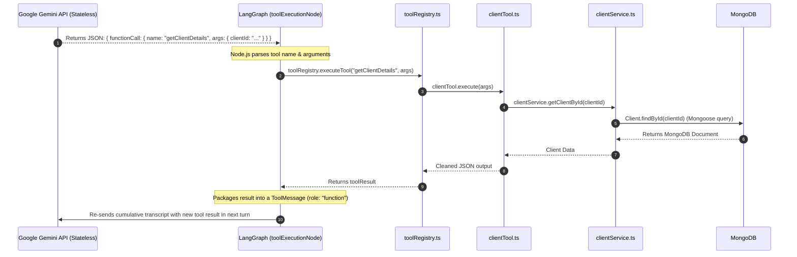
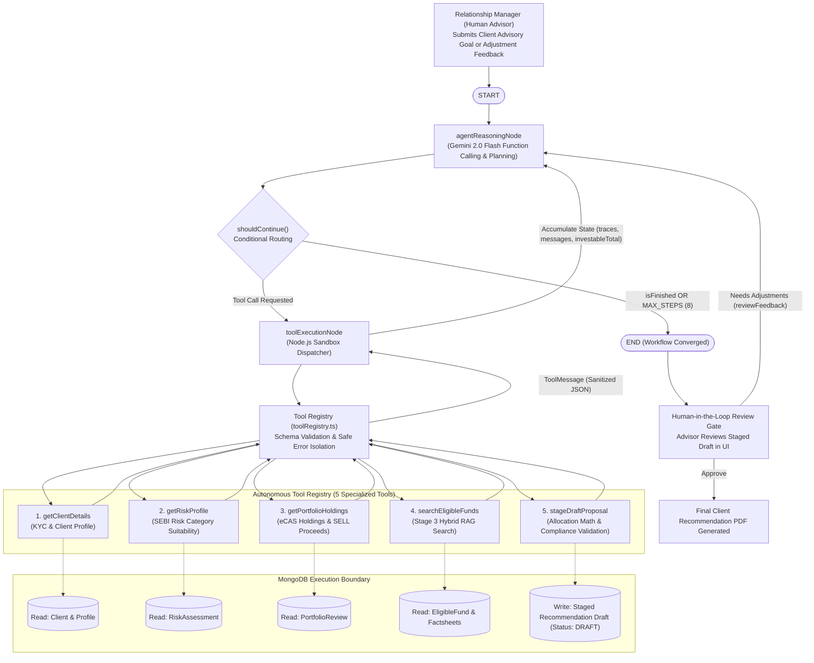
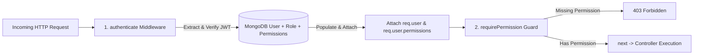
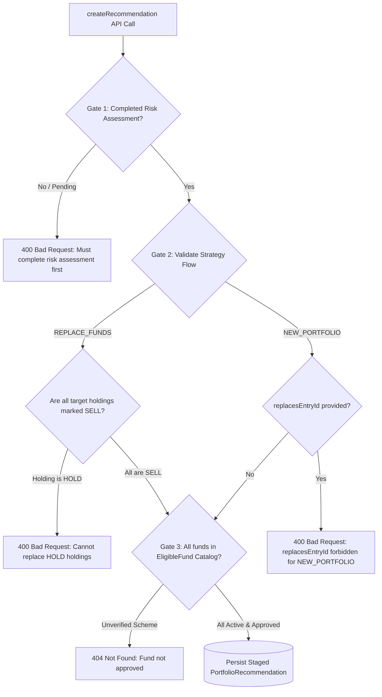
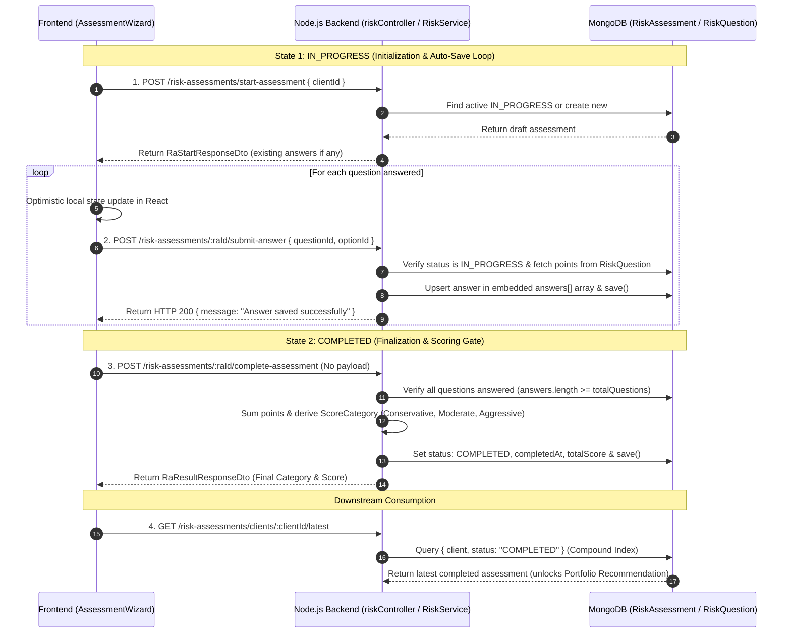

# Interview Preparation Guide - NodeJS Backend

This document captures project interview questions, authoritative answers, key code references from the WealthTech CRM Node.js codebase, and **critical architectural trade-offs** that senior interviewers frequently probe or push back on.

---

## Product Overview & Elevator Pitch

**WealthTech CRM** is an end-to-end advisory platform built for wealth management firms and investment advisors. It digitizes the entire client advisory journey into six core features:

1. **Client Management (List & Profile):** Advisors manage their entire client roster with KYC compliance status, contact details, and assigned Relationship Managers.
2. **User Management & RBAC:** Fine-grained role-based access control where admins manage users, teams/groups, and permissions (e.g., who can create clients vs. approve reviews).
3. **Risk Assessment:** A structured questionnaire that calculates an investor's risk score and maps them to a category (Conservative, Moderate, or Aggressive)—a mandatory regulatory requirement before giving advice.
4. **Portfolio Review:** Advisors upload client eCAS statements (PDF). The system parses current holdings, calculates financial metrics (CAGR, absolute returns), and tags underperforming schemes as **SELL** vs. **HOLD**.
5. **Portfolio Recommendation (with 2 Flows):**
   - **`REPLACE_FUNDS` Flow:** Specifically liquidates the funds marked as **SELL**, calculates the exit proceeds, and replaces them with suitable schemes matching the client's risk score.
   - **`NEW_PORTFOLIO` Flow:** For fresh capital investment, the system builds an optimal target portfolio from scratch using approved schemes.
6. **Autonomous AI Copilot (LangChain & LangGraph):** Built using **LangChain** tool abstractions, a **LangGraph** state machine, and Google Gemini. The agent runs an autonomous loop to fetch client KYC, inspect portfolio holdings, search approved fund factsheets via hybrid RAG, and stage an editable draft recommendation for the advisor to review and approve before generating client-ready PDFs.

---

## NodeJS Backend

### Table of Contents
1. [Authentication & JWT Lifecycle (First Login, Bearer Token, HttpOnly Refresh Cookie)](#1-authentication--jwt-lifecycle-first-login-bearer-token-httponly-refresh-cookie)
2. [Agentic AI Architecture, LangGraph State Management & DB Execution Boundaries](#2-agentic-ai-architecture-langgraph-state-management--db-execution-boundaries)
3. [Data Privacy, SEBI/DPDP Compliance & Bidirectional PII Tokenization](#3-data-privacy-sebidpdp-compliance--bidirectional-pii-tokenization)
4. [MongoDB Schema Design & Indexing Strategies (Sparse & Compound Indexes)](#4-mongodb-schema-design--indexing-strategies-sparse--compound-indexes)
5. [Fine-Grained RBAC Middleware (Role vs. Permission & DB Trade-off)](#5-fine-grained-rbac-middleware-role-vs-permission--db-trade-off)
6. [eCAS Statement Processing, S3 Storage & SEBI Advisory Compliance Gates](#6-ecas-statement-processing-s3-storage--sebi-advisory-compliance-gates)
7. [Risk Assessment End-to-End Flow & State Machine (IN_PROGRESS to COMPLETED)](#7-risk-assessment-end-to-end-flow--state-machine-in_progress-to-completed)
8. [Architectural and Implementation Defense](#8-architectural-and-implementation-defense)
   - [8.1 RAG Deepdive (Stages 1 to 6)](#81-rag-deepdive-stages-1-to-6)
     - [Stage 1: Document Ingestion & Boundary-Aware Chunking](#stage-1-document-ingestion--boundary-aware-chunking)
     - [Stage 2: Dense Embeddings & Idempotent Vector Storage](#stage-2-dense-embeddings--idempotent-vector-storage)
     - [Stage 3: Hybrid Retrieval & Candidate Filtering](#stage-3-hybrid-retrieval--candidate-filtering)
     - [Stage 4: Query Refinement Loop & Defensive Degradation](#stage-4-query-refinement-loop--defensive-degradation)
     - [Stage 5: Bidirectional PII Sanitization Gateway](#stage-5-bidirectional-pii-sanitization-gateway)
     - [Stage 6: Resilient Model Cascading & Circuit Breaking](#stage-6-resilient-model-cascading--circuit-breaking)
   - [8.2 Agentic AI Architecture & Tooling Framework](#82-agentic-ai-architecture--tooling-framework)
     - [8.2.1 LangGraph StateGraph Orchestration & DB Staging](#821-langgraph-stategraph-orchestration--db-staging)
     - [8.2.2 The 5 Core Advisory Tools & Schema Validation](#822-the-5-core-advisory-tools--schema-validation)
   - [8.3 Core Backend](#83-core-backend)
     - [8.3.1 Authentication & JWT Lifecycle](#831-authentication--jwt-lifecycle)
     - [8.3.2 Fine-Grained RBAC Middleware](#832-fine-grained-rbac-middleware)
     - [8.3.3 MongoDB Schema Design & Indexing Strategies](#833-mongodb-schema-design--indexing-strategies)
     - [8.3.4 eCAS S3 Upload Pipeline & SEBI Advisory Gates](#834-ecas-s3-upload-pipeline--sebi-advisory-gates)

---

### 1. Authentication & JWT Lifecycle (First Login, Bearer Token, HttpOnly Refresh Cookie)

#### Question
> **How does authentication work in your Node.js backend? How is the first login processed, how is the JWT access token delivered and injected into request headers, and how does the token refresh API work?**

#### Comprehensive Answer

##### 1. First Login Processing (`POST /auth/login`)
- **Credential Extraction:** The user submits `{ email, password }` in the request body.
- **Query with Explicit Password Selection:** In Mongoose, the `password` field is configured with `select: false` so that standard queries never expose password hashes. During login, `authController.ts` explicitly asks for it via `.select('+password')`:
  ```typescript
  const user = await User.findOne({ email: email.toLowerCase() })
    .select('+password')
    .populate({ path: 'role', populate: { path: 'permissions' } });
  ```
- **BCrypt Hash Verification:** The candidate password is authenticated using `bcrypt.compare(password, user.password)`.
- **Dual-Token Generation:**
  - **Access Token:** Short-lived (**15 minutes** default), signed with `JWT_SECRET`, containing only `{ email }` as subject payload to minimize token size.
  - **Refresh Token:** Long-lived (**7 days** default), signed with `JWT_SECRET`, containing `{ email }`.

##### 2. Token Delivery & Header Injection Boundary
- **Refresh Token Delivery (HttpOnly Cookie):**
  The server sets the refresh token directly as an HTTP cookie:
  ```typescript
  res.cookie('refreshToken', refreshToken, {
    httpOnly: true,                         // Blocks JavaScript access (XSS immune)
    secure: config.nodeEnv === 'production',// HTTPS only in production
    sameSite: 'strict',                     // Mitigates CSRF attacks
    maxAge: 7 * 24 * 60 * 60 * 1000,        // 7 days
  });
  ```
- **Access Token Delivery (JSON Body):**
  The `accessToken` is returned in the response payload:
  ```json
  {
    "accessToken": "eyJhbGciOiJIUzI1NiIs...",
    "tokenType": "Bearer",
    "role": "ADMIN",
    "permissions": ["CLIENT_CREATE", "PORTFOLIO_REVIEW_STAGE"],
    "user": { "id": "...", "email": "advisor@wealthtech.com", "fullName": "Rahul Sharma" }
  }
  ```
- **How the JWT is Set in Headers on Subsequent Requests:**
  - The backend does **not** set request headers. The **frontend client** stores the access token in memory/auth state and attaches it to the HTTP header for every subsequent protected API call:
    `Authorization: Bearer <accessToken>`
  - On the backend, `authMiddleware.authenticate` reads `req.headers.authorization`, verifies the HMAC-SHA256 signature, decodes the email, and queries MongoDB to attach `req.user` and permissions.

##### 3. How the Refresh Token API Works (`POST /auth/refresh`)
When the 15-minute access token expires, the client calls `POST /api/v1/auth/refresh`:



1. **Automatic Cookie Transmission:** The browser automatically attaches the `refreshToken` cookie.
2. **Signature Verification:** `verifyToken(refreshToken)` checks cryptographic integrity. If expired or forged, throws `AppError('Refresh token is required', 401)`.
3. **Database Account Verification:** Confirms the user account still exists in MongoDB and has not been deleted or suspended.
4. **Issue New Access Token:** Emits a fresh 15-minute `accessToken`, returning it in the response body.

##### 4. Logout Session Termination (`POST /auth/logout`)
- The server clears the cookie via `res.clearCookie('refreshToken', { httpOnly: true, sameSite: 'strict' })`, permanently terminating the session in the client's browser.

#### Code References
- **Auth Controller & Token Handlers:** `backend-nodejs/src/modules/auth/controllers/authController.ts`
- **Auth Routes:** `backend-nodejs/src/modules/auth/routes/authRoutes.ts`
- **JWT Utilities (Sign & Verify):** `backend-nodejs/src/common/utils/jwt.ts`
- **User Password Hashing Hook:** `backend-nodejs/src/modules/usermanager/models/User.ts`

---

### 2. Agentic AI Architecture, LangGraph State Management & DB Execution Boundaries


#### Question
> **In your Node.js backend, how does the Autonomous Advisory Agent work? How does the system maintain state across multiple sequential tool executions when LLMs are stateless, and what is the exact execution boundary between the LLM and your MongoDB database?**

#### Comprehensive Answer

##### 1. The Core Architectural Reality: Stateless LLM vs. Stateful Backend
- **LLM APIs (e.g. Gemini 2.0 Flash) are 100% stateless HTTP endpoints (`POST :generateContent`).** The model does not maintain an active session, memory chip, or database connection between HTTP requests.
- **State is completely owned and persisted by our Node.js runtime using LangGraph's `StateGraph`.**
- LangGraph maintains an ongoing, cumulative `messages` array (`BaseMessage[]`) via an accumulator reducer:
  $$\text{messages}_{\text{new}} = \text{messages}_{\text{previous}} \mathbin{\Vert} \text{new\_messages}$$
- In each reasoning turn, our Node.js backend serializes the entire conversation history into the `contents` field of the HTTP payload sent to Gemini. Gemini "knows" the history solely because the backend re-submits the full transcript on every turn.

##### 2. Who Makes the Database Call? (The Execution Boundary)
- **The LLM NEVER touches or connects to MongoDB.** It has no database drivers or network socket access.
- The LLM acts purely as a **reasoning and planning engine** that emits structured JSON tool requests (`functionCall`).
- The **Node.js runtime acts as the secure execution engine**:
  1. LangGraph's `agentReasoningNode` receives the JSON tool call from Gemini.
  2. Transition routing delegates execution to `toolExecutionNode`.
  3. `toolExecutionNode` calls `toolRegistry.executeTool(toolName, args, context)`.
  4. The tool executes domain business logic (e.g., `clientService.getClientById()`), which performs a Mongoose query (`Client.findById()`) against MongoDB.
  5. The resulting MongoDB document is sanitized, packaged into a `ToolMessage` (role: `function`), appended to LangGraph's state, and passed back to Gemini on the next turn.



##### 2.1 LangGraph State Machine & Tool Registry Architecture

The following diagram illustrates how the LangGraph cyclical state machine coordinates the 5 domain tools, connects to the MongoDB database boundary, and integrates with the human Relationship Manager (HITL) feedback loop:



##### 3. Complete Step-by-Step Execution Flow (Turns 1 through 6)

Every request to Gemini includes two primary components:
1. **The Tool Menu (`tools: [{ functionDeclarations }]`):** Sent on **every single request** so Gemini knows what tools are valid choices for the next step.
2. **The Cumulative History (`contents: [...]`):** Appended sequentially on each turn.

---

###### Turn 1: Initialization & Client Lookup
- **Input to Gemini:** User goal prompt (`HumanMessage`).
  ```json
  { "contents": [{ "role": "user", "parts": [{ "text": "Coordinate advisory rebalancing for client_123" }] }] }
  ```
- **Gemini Response:**
  ```json
  { "functionCall": { "name": "getClientDetails", "args": { "clientId": "client_123" } } }
  ```
- **Backend Execution:** Node.js intercepts the call $\rightarrow$ `clientTool.ts` $\rightarrow$ Mongoose queries MongoDB $\rightarrow$ retrieves client identity & verified KYC status.

---

###### Turn 2: Risk Profile Assessment
- **Input to Gemini (3 items):** Previous prompt + Model tool request + Tool output.
  ```json
  {
    "contents": [
      { "role": "user", "parts": [{ "text": "Coordinate advisory rebalancing for client_123" }] },
      { "role": "model", "parts": [{ "functionCall": { "name": "getClientDetails", "args": { "clientId": "client_123" } } }] },
      { "role": "function", "parts": [{ "functionResponse": { "name": "getClientDetails", "response": { "name": "Rahul Sharma", "kycStatus": "VERIFIED" } } }] }
    ]
  }
  ```
- **Gemini Response:**
  ```json
  { "functionCall": { "name": "getRiskProfile", "args": { "clientId": "client_123" } } }
  ```
- **Backend Execution:** Node.js executes `riskAssessmentTool.ts` $\rightarrow$ queries `RiskAssessment` model in MongoDB $\rightarrow$ returns `{ "scoreCategory": "MODERATE" }`.

---

###### Turn 3: Portfolio Holdings & SELL Candidates
- **Input to Gemini (5 items):** Cumulative transcript including risk score.
- **Gemini Response:**
  ```json
  { "functionCall": { "name": "getPortfolioHoldings", "args": { "portfolioReviewId": "rev_001" } } }
  ```
- **Backend Execution:** Node.js executes `portfolioReviewTool.ts` $\rightarrow$ queries eCAS line items in MongoDB $\rightarrow$ identifies underperforming funds marked for `SELL` with total exit proceeds of ₹1,00,000.

---

###### Turn 4: Grounded Replacement Fund Discovery
- **Input to Gemini (7 items):** Cumulative transcript with exit proceeds of ₹1,00,000.
- **Gemini Response:**
  ```json
  { "functionCall": { "name": "searchEligibleFunds", "args": { "scoreCategory": "MODERATE", "topK": 5 } } }
  ```
- **Backend Execution:** Node.js executes `fundResearchRagTool.ts` $\rightarrow$ performs candidate-constrained query in MongoDB against `EligibleFund` catalog $\rightarrow$ returns candidate schemes (e.g. Parag Parikh Flexi Cap Fund).

---

###### Turn 5: Staging the Final Compliant Recommendation Proposal
- **Input to Gemini (9 items):** Full evidence transcript (Client KYC + MODERATE risk + ₹1,00,000 proceeds + Candidate funds).
- **Gemini Response:**
  ```json
  {
    "functionCall": {
      "name": "stageDraftProposal",
      "args": {
        "totalInvestable": 100000,
        "executiveSummary": "Proposal to exit underperforming holdings and reallocate ₹1,00,000 into suitable MODERATE risk schemes.",
        "allocations": [
          {
            "eligibleFundId": "fund_99",
            "fundName": "Parag Parikh Flexi Cap Fund",
            "amount": 100000,
            "rationale": "High risk-adjusted performance with lower expense ratio matching MODERATE profile."
          }
        ]
      }
    }
  }
  ```
- **Backend Execution:** Node.js executes `stageRecommendationDraftTool.ts` $\rightarrow$ persists the staged draft proposal in MongoDB with audit traces.

---

###### Turn 6: Convergence & Completion
- LangGraph inspects state, detects that `stageDraftProposal` succeeded and `stagedDraft` is populated.
- Conditional edge `shouldContinue` evaluates to `'end'`.
- The workflow exits the graph and returns `HTTP 200 OK` with `AgentRunResponseDto` to the Relationship Manager UI.

---

#### Code References
- **LangGraph State Machine:** `backend-nodejs/src/modules/agent/strategy/impl/langGraphAgentStrategy.ts`
- **Tool Registry & Gemini Schemas:** `backend-nodejs/src/modules/agent/tools/toolRegistry.ts`
- **Agent Dispatcher Controller:** `backend-nodejs/src/modules/agent/controllers/agentController.ts`
- **Domain Tools:**
  - `backend-nodejs/src/modules/agent/tools/clientTool.ts`
  - `backend-nodejs/src/modules/agent/tools/riskAssessmentTool.ts`
  - `backend-nodejs/src/modules/agent/tools/portfolioReviewTool.ts`
  - `backend-nodejs/src/modules/agent/tools/fundResearchRagTool.ts`
  - `backend-nodejs/src/modules/agent/tools/stageRecommendationDraftTool.ts`

---

#### Notable Trade-offs & Potential Interviewer Pushback

- **Pushback: "Sending the growing conversation history on every turn increases latency and token costs. Why not use an external cache or agent memory service?"**
  - *Trade-off:* Re-submitting history consumes prompt tokens vs. managing an external conversational memory cluster.
  - *Defense:* The advisory rebalancing loop is tightly bounded to 4–6 tool calls. Across 5 turns, the total cumulative prompt length is under 4,000 tokens—well within Gemini 2.0 Flash's 1-million-token context window. Sending the full history keeps the backend completely stateless across horizontal instances, eliminates distributed session cache synchronization bugs, and provides a deterministic, auditable trace of every agent reasoning step.

- **Pushback: "What happens if Gemini's API is down or the model hallucinates an invalid tool call?"**
  - *Trade-off:* Full LLM autonomy vs. operational reliability.
  - *Defense:* 
    1. If the Gemini API is unreachable, `langGraphAgentStrategy` catches the error and degrades gracefully to `executeFrameworkReasoning`, an offline deterministic state machine that executes the identical tool sequence without LLM dependency.
    2. Every tool invocation passes through `toolRegistry.executeTool()`, which verifies tool names against a strict whitelist. If an unmapped tool is requested, the registry safely returns an error message to the model without crashing the Node.js runtime.
    3. We enforce a hard bound of `MAX_STEPS = 8` in LangGraph, guaranteeing the agent cannot enter an infinite loop.

---

### 3. Data Privacy, SEBI/DPDP Compliance & Bidirectional PII Tokenization

#### Question
> **In a regulated WealthTech CRM, sending real client identities (PAN, Aadhaar, email, phone) to external LLMs violates SEBI and DPDP regulations. How does your backend's `PiiProtectionGateway` prevent data leakage, how does the "length sorting" trick prevent broken tokens, and how does bidirectional tokenization and rehydration work?**

#### Comprehensive Answer

##### 5-Step Summary of the PII Protection Flow
1. **Prepare and Sort Known Data (Length Sorting Trick):**  
   The backend pulls the client’s real profile from MongoDB (full name, email, PAN, phone, address). Crucially, it **sorts these candidate fields descending by string length** (`candidates.sort((a, b) => b.value.length - a.value.length)`). This guarantees that compound phrases like `"Rahul Verma"` (11 chars) are matched and tokenized *before* shorter individual words like `"Rahul"` (5 chars) can run, preventing broken partial tokens (e.g., preventing `{{CLIENT_FIRST_NAME_1}} Verma`).

2. **Replace Known Info with Tokens (Layer 1 - Deterministic Matching):**  
   The backend replaces those real values in the prompt with opaque placeholder tokens:
   - `"Rahul Verma"` $\longrightarrow$ `{{CLIENT_NAME_1}}`
   - `"ABCDE1234F"` $\longrightarrow$ `{{CLIENT_PAN_1}}`
   - `"rahul.verma@example.com"` $\longrightarrow$ `{{CLIENT_EMAIL_1}}`

3. **Catch Any Surprise Info with Regex (Layer 2 - Defensive Safety Net):**  
   If the advisor typed an uncatalogued PAN, Aadhaar number, or phone number directly into the free-form chat prompt, deterministic regex patterns catch their standardized formats and assign tokens as well:
   - Indian PAN: `/\b[A-Z]{5}[0-9]{4}[A-Z]\b/g`
   - Aadhaar: `/\b\d{4}[\s\-]\d{4}[\s\-]\d{4}\b/g`
   - Indian Mobile: `/(?:(?:\+|00)91[\-\s]?)?[6-9]\d{9}\b/g`

4. **Store the Secret Key in an In-Memory Vault:**  
   The backend captures an ephemeral, immutable map in RAM (the token vault) mapping each token to its authentic value:  
   `{ "{{CLIENT_PAN_1}}": "ABCDE1234F", "{{CLIENT_NAME_1}}": "Rahul Verma" }`.  
   The prompt sent across the wire to Google Gemini contains **only placeholder tokens**, ensuring zero sensitive PII ever crosses the network boundary to the external model.

5. **Rehydrate the Answer (Restore Authentic Data on the Backward Pass):**  
   When Gemini finishes generating its response, the backend looks up the in-memory vault and immediately calls `rehydrate()`, swapping all surrogate tokens back to their authentic names and numbers before persisting the dialogue turn or presenting the recommendation to the Relationship Manager.

##### Restoration Modes: In-Memory Closure (Way A) vs. Database Entity (Way B)
- **Way A (Active Request Pipeline):** `piiProtectionGateway.tokenize()` returns an in-memory closure (`rehydrate: (text) => this.rehydrate(text, immutableVault)`). In `ragSynthesisService.ts`, as soon as Gemini returns the synthesized answer, `tokenizedQuery.rehydrate()` instantly swaps tokens in RAM.
- **Way B (Offline / Asynchronous Jobs):** For background jobs (e.g. PDF generation 10 minutes later when transient RAM maps are gone), `rehydrateWithEntity(text, clientContext)` loads the client record from MongoDB and substitutes placeholders directly from the database entity.

#### Code References
- **PII Gateway Implementation:** `backend-nodejs/src/common/services/piiProtectionGateway.ts`
- **RAG Synthesis Integration:** `backend-nodejs/src/modules/portfolioreview/services/ragSynthesisService.ts`

#### Notable Trade-offs & Potential Interviewer Pushback
- **Pushback: "Why not use a heavy ML NER (Named Entity Recognition) model like spaCy or Microsoft Presidio?"**
  - *Trade-off:* ML-based NER models detect uncatalogued names in free text vs. regex + entity matching latency.
  - *Defense:* ML NER introduces massive CPU overhead (50–200ms latency per prompt) and heavy external model dependencies. In Indian wealth management, sensitive compliance identifiers (PAN, Aadhaar, mobile numbers) follow strict, deterministic formats. Combining deterministic MongoDB client field replacement (Layer 1) with regex matching (Layer 2) runs in sub-millisecond execution time (~1ms), has zero external dependencies, and eliminates false negatives on standardized financial identifiers.

---

### 4. MongoDB Schema Design & Indexing Strategies (Sparse & Compound Indexes)

#### Question
> **How did you design your MongoDB indexes? Specifically, why is `sparse: true` required on client PAN numbers, how do compound indexes optimize RAG candidate retrieval, and why did you use Mongoose virtuals instead of storing full names?**

#### Comprehensive Answer

##### 1. The `sparse: true` Index on Optional Unique Fields (Client PAN)
- In `Client.ts`, `pan` is marked with:
  ```typescript
  pan: { type: String, unique: true, sparse: true }
  ```
- **The Problem Without `sparse: true`:** In MongoDB, a standard unique index indexes `null` / missing values as an actual value (`{ pan: null }`). If multiple clients register during an initial onboarding flow where PAN is not yet uploaded, the first client document inserts successfully. The second client document without a PAN immediately crashes the insert with a **Duplicate Key Error (`E11000 duplicate key error collection ... dup key: { pan: null }`)**.
- **The Solution:** Adding `sparse: true` tells MongoDB to only create index entries for documents that *actually contain* the `pan` field. Documents omitting PAN are completely bypassed by the index, allowing unlimited onboarding clients while still strictly enforcing uniqueness whenever a PAN is provided.

##### 2. Compound Indexes for Candidate-Constrained RAG Retrieval
- In `FundDocumentEmbedding.ts`, we created compound indexes:
  ```typescript
  fundDocumentEmbeddingSchema.index({ isin: 1, scoreCategory: 1 });
  fundDocumentEmbeddingSchema.index({ isin: 1, documentType: 1 });
  ```
- **Single B-Tree Traversal vs. Index Intersection:**
  - With two separate single-field indexes (`{ isin: 1 }` and `{ scoreCategory: 1 }`), MongoDB would have to perform two separate index scans and combine them via an expensive in-memory **Index Intersection** (`AND_SORTED`), or scan one index and inspect thousands of documents from disk to check the second field.
  - A **compound index** `{ isin: 1, scoreCategory: 1 }` traverses a **single B-Tree structure** (`IXSCAN`) in $O(\log N)$ time, directly retrieving document pointers matching both constraints in a single pass.
- **The Index Prefix Rule (2-for-1 Index Optimization):**
  - In MongoDB, a compound index on `{ isin: 1, scoreCategory: 1 }` automatically serves queries filtering on `isin` alone (the leading prefix), eliminating the need for a separate standalone index on `isin` and saving substantial RAM.
- **Idempotent Ingestion Deletions:**
  - In `fundDocumentIngestionService.ts`, re-uploading an updated fund PDF calls:
    `await FundDocumentEmbedding.deleteMany({ isin: meta.isin, documentType: meta.documentType })`.
  - The compound index `{ isin: 1, documentType: 1 }` makes this deletion instant, avoiding a full collection scan across tens of thousands of chunks.

##### 3. Schema Virtuals for Derived Fields (`fullName`)
- Rather than redundantly storing `fullName` as a physical field in MongoDB (which risks data desynchronization if `firstName` or `lastName` is updated), `Client.ts` uses a **Mongoose Virtual**:
  ```typescript
  clientSchema.virtual('fullName').get(function () {
    return `${this.firstName} ${this.lastName}`.trim();
  });
  ```
- Serialized to API responses automatically via `{ toJSON: { virtuals: true } }`, guaranteeing 100% consistency with zero extra storage.

#### Code References
- **Client Model & Sparse Index:** `backend-nodejs/src/modules/customer/models/Client.ts`
- **Embedding Compound Indexes:** `backend-nodejs/src/modules/portfolioreview/models/FundDocumentEmbedding.ts`
- **Idempotent Ingestion Cleanup:** `backend-nodejs/src/modules/portfolioreview/services/fundDocumentIngestionService.ts`

---

### 5. Fine-Grained RBAC Middleware (Role vs. Permission & DB Trade-off)

#### Question
> **Walk me through how an incoming API request gets authenticated and authorized in your Express backend. What gets attached to `req.user`, and why do you query MongoDB on every request instead of embedding all permissions into the stateless JWT?**

#### Comprehensive Answer

##### 1. Two-Stage Express Middleware Pipeline



1. **`authenticate` Middleware:**
   - Extracts Bearer token from the `Authorization` header.
   - Cryptographically verifies signature and expiration using `jsonwebtoken`.
   - Queries MongoDB: `User.findOne({ email: decoded.email }).populate({ path: 'role', populate: { path: 'permissions' } })`.
   - Flattens the populated role permissions into an array of string codenames (e.g. `['CLIENT_CREATE', 'PORTFOLIO_REVIEW_STAGE']`).
   - Attaches the user object and `permissions` array to `req.user`.

2. **`requirePermission(...requiredPermissions)` Middleware Guard:**
   - Declaratively guards route definitions:
     ```typescript
     router.post('/', authenticate, requirePermission('CLIENT_CREATE'), clientController.createClient);
     ```
   - Checks if `req.user.permissions` contains at least one of the required codenames.
   - If missing, immediately halts execution with an HTTP `403 Forbidden` (`AppError`), preventing unauthorized access before the controller is ever invoked.

##### 2. Role-Based vs. Fine-Grained Permission-Based RBAC
- Hardcoding role checks (e.g., `if (user.role === 'ADMIN')`) is brittle and requires code deployments whenever business roles change.
- By decoupling **Roles** from **Permissions** and checking granular permission codenames (`requirePermission('PORTFOLIO_REVIEW_APPROVE')`), business administrators can dynamically alter what a "Senior Advisor" or "Manager" role can do directly in MongoDB/admin UI without redeploying backend code.

##### 3. The Core Senior Trade-off: Database Hit vs. Instant Permission Invalidation

| Architecture Choice | **Embed Permissions in JWT (Stateless)** | **Query MongoDB on Every Request (Our Choice)** |
| :--- | :--- | :--- |
| **Network & Header Size** | Token bloat (50+ permission strings in every HTTP request header). | Lightweight JWT (contains only user email/ID). |
| **Permission Revocation** | **Stale:** Changes do not take effect until the JWT expires (15–60 mins). | **Instant:** Takes effect on the user's very next API call. |
| **Terminated Employees** | Can continue downloading client data until token expires. | Immediately rejected with HTTP 401 on next click. |
| **Database Load** | Zero database hits for authorization. | One indexed `User.findOne()` query per request (~2–5ms). |

- **Our Defense:** In enterprise wealth management and fiduciary finance, **security and immediate access revocation strictly override saving 2 milliseconds of database latency**. If an advisor is terminated or their access is downgraded due to a compliance breach, their access must be cut off instantly.
- **Production Scalability Roadmap:** For ultra-high-throughput architectures (tens of thousands of requests/sec), we would cache the user's flattened permission array in an in-memory **Redis cluster** with a short 5-minute TTL, coupled with an event-driven cache eviction hook triggered whenever an admin modifies roles in MongoDB.

#### Code References
- **Auth & RBAC Middleware:** `backend-nodejs/src/common/middleware/authMiddleware.ts`
- **User Schema & Password Hashing:** `backend-nodejs/src/modules/usermanager/models/User.ts`
- **Role & Permission Schemas:**
  - `backend-nodejs/src/modules/usermanager/models/Role.ts`
  - `backend-nodejs/src/modules/usermanager/models/Permission.ts`
- **Guarded Client Routes:** `backend-nodejs/src/modules/customer/routes/clientRoutes.ts`

---

### 6. eCAS Statement Processing, S3 Storage & SEBI Advisory Compliance Gates

#### Question
> **What is an eCAS statement, how does your Node.js backend handle its upload and storage securely via AWS S3 pre-signed URLs, and how does the backend enforce SEBI investor suitability rules across the `REPLACE_FUNDS` and `NEW_PORTFOLIO` rebalancing flows?**

#### Comprehensive Answer

##### 1. What is an eCAS Statement?
An **eCAS (Electronic Consolidated Account Statement)** is an official, consolidated monthly statement issued by Indian mutual fund registrars (CAMS and KFintech) and depositories (CDSL and NSDL). It aggregates all mutual fund folios, stocks, and bond holdings associated with an investor's PAN into a single statement. In our WealthTech CRM, uploading a client's eCAS statement serves as the foundation for portfolio health analysis, underperformance identification, and AI-driven advisory rebalancing.

##### 2. Secure S3 Storage Architecture & Pre-signed URLs
- **Upload Flow & Immediate URL Delivery (Zero Polling):** Handled in `portfolioReviewService.uploadEcasStatement()`:
  - Files are uploaded via `POST /api/v1/portfolio-reviews/ecas/upload` using `multer` memory storage.
  - The filename is sanitized to prevent directory traversal: `const safeFilename = params.originalFilename.replace(/[^a-zA-Z0-9._-]/g, '_')`.
  - The file buffer is streamed to a private AWS S3 bucket (or LocalStack in development) under a client-isolated key prefix:
    $$\text{s3Key} = \text{ecas/}\{clientId\}/\{timestamp\}\_{safeFilename}$$
  - **Immediate Presigned URL Generation:** As soon as the S3 upload finishes, the backend immediately calls `s3Service.getPresignedDownloadUrl(s3Key)` to cryptographically sign a temporary download URL (15-minute TTL) and returns it synchronously in the HTTP 200 response body (`{ s3Key, fileUrl }`). **The frontend gets the URL instantly without any polling.**
- **Subsequent Retrieval Flow (After Expiration):**
  - When an advisor revisits a review hours or days later (after the 15-minute TTL expires), the frontend still does **not poll**.
  - It requests a fresh URL on-demand via `GET /api/v1/portfolio-reviews/:id/ecas-url` (or `GET /portfolio-reviews/:id`), which reads `ecasFileKey` from MongoDB, cryptographically signs a fresh 15-minute URL on the fly, and returns it directly.
- **Direct Return vs. Database Persistence (Why URLs Are Not Stored in MongoDB):** 
  - The endpoint fetches the immutable `ecasFileKey` from the `PortfolioReview` document in MongoDB.
  - It calls `s3Service.getPresignedDownloadUrl(s3Key)` to generate a temporary signed URL on-the-fly (15-minute TTL) using `@aws-sdk/s3-request-presigner`.
  - **It returns the URL directly to the frontend in the JSON response (`{ s3Key, fileUrl }`) and DOES NOT update or store the URL in the database.**
  - **Why URLs Are Not Stored in MongoDB (Key Interview Defense):**
    1. *Ephemeral Nature:* Pre-signed URLs expire after 15 minutes. Storing them in the database would result in stale, broken links on subsequent queries.
    2. *Enforced Access Control & RBAC:* Generating URLs on-demand guarantees that every single download request must pass fresh authentication and authorization checks (`requirePermission('portfolioreview:read')`) in Express.
    3. *Storage Immutability:* The S3 object key (`ecasFileKey`) is the permanent, immutable reference; dynamically signing URLs on demand keeps the database free of transient session state.
  - **Performance Benefit:** Clients download heavy PDF byte streams directly from AWS S3 / LocalStack, preventing large binary payloads from blocking Node.js single-threaded event loop I/O.

##### 3. MongoDB Holdings Representation (`PortfolioReview.ts`)
Parsed eCAS statements are stored in MongoDB as a `PortfolioReview` document with an embedded array of `entries` (`IPortfolioEntry[]`):
* **Financial Performance Attributes:** `units`, `purchaseNav`, `currentNav`, `investedAmount`, `currentValue`, `gain`, `absReturnPct`, `cagrPct`, and `holdingDays`.
* **Advisory Action Tagging:** Each line item is classified with an explicit `EntryAction`:
  - `HOLD`: Performing schemes aligned with asset allocation goals.
  - `SELL`: Underperforming schemes with high expense ratios or consistent benchmark lag targeted for liquidation and reinvestment.
* **Portfolio Level Aggregates:** `totalInvested`, `totalCurrentValue`, `totalGain`, `gainPercentage`, and overall `cagr`.

##### 4. The 3 SEBI Advisory Compliance Gates (`createRecommendation`)
Under SEBI (Investment Advisers) Regulations, advisors cannot arbitrarily recommend or replace schemes without verified investor suitability and formal audit controls. Our backend enforces 3 strict compliance gates in `portfolioReviewService.ts#createRecommendation`:



1. **Gate 1: Mandatory Investor Risk Suitability Pre-requisite:**
   - The backend queries `RiskAssessment.findOne({ client: request.clientId, status: AssessmentStatus.COMPLETED })`.
   - If no completed assessment exists, recommendation creation is immediately blocked with HTTP `400 Bad Request`.
2. **Gate 2: Rebalancing Flow Integrity (`REPLACE_FUNDS` vs. `NEW_PORTFOLIO`):**
   - **`REPLACE_FUNDS` (Portfolio Restructuring):**
     - Requires a valid `portfolioReviewId` belonging to the client.
     - For every replacement line item (`replacesEntryId`), the backend verifies that the existing holding is explicitly flagged as `action === EntryAction.SELL`.
     - If an advisor attempts to replace a holding marked `HOLD`, the backend rejects the transaction with HTTP `400 Bad Request` (`"Holding is marked HOLD - only SELL holdings can be replaced"`).
   - **`NEW_PORTFOLIO` (Fresh Capital Allocation):**
     - Designed for deploying fresh investable cash.
     - Explicitly forbids `replacesEntryId` (throws HTTP 400 if provided).
3. **Gate 3: SEBI-Approved Scheme Verification:**
   - Every candidate fund ID must exist and be active (`isActive: true`) in the master [`EligibleFund`](file:///home/rohitimandi/Desktop/Rohit/Personal/Online_Project_Uploads/wealth-tech-crm/backend-nodejs/src/modules/portfolioreview/models/EligibleFund.ts) collection, preventing advisors from recommending unvetted, closed, or high-risk unauthorized schemes.

#### Code References
- **Portfolio Review Service & Compliance Logic:** `backend-nodejs/src/modules/portfolioreview/services/portfolioReviewService.ts`
- **Portfolio Review & Entry Schema:** `backend-nodejs/src/modules/portfolioreview/models/PortfolioReview.ts`
- **Eligible Fund Master Schema:** `backend-nodejs/src/modules/portfolioreview/models/EligibleFund.ts`
- **S3 Storage & Pre-signed URL Service:** `backend-nodejs/src/common/services/s3Service.ts`
- **Portfolio Review Controller Endpoints:** `backend-nodejs/src/modules/portfolioreview/controllers/portfolioController.ts`

#### Notable Trade-offs & Potential Interviewer Pushback
- **Pushback: "Why upload eCAS PDFs through the Node.js API server instead of having the frontend upload directly to S3 using a pre-signed PUT URL?"**
  - *Trade-off:* API server buffering vs. direct client-to-S3 upload.
  - *Defense:* In a production environment with high concurrency, direct frontend-to-S3 uploads using pre-signed PUT URLs are optimal to bypass the backend entirely. In our current architecture, routing the file through the backend allows immediate server-side validation (file signature check, MIME type verification, antivirus/sanitization) before the S3 key is registered into the database review entity.
- **Pushback: "Why store portfolio entries as an embedded document array inside `PortfolioReview` instead of a separate `portfolio_entries` collection?"**
  - *Trade-off:* Embedded subdocuments vs. normalized relational collections.
  - *Defense:* A client's eCAS statement typically contains 5–25 mutual fund holdings—an inherently bounded dataset that never grows unboundedly. Storing entries embedded inside the parent `PortfolioReview` document guarantees atomic single-document reads/writes, avoids multi-document MongoDB distributed transactions, and ensures a single $O(1)$ document lookup hydrates the entire portfolio.
- **Pushback: "Does the frontend poll for the temporary eCAS download URL after upload?"**
  - *Trade-off:* Synchronous in-band URL return vs. asynchronous background job polling.
  - *Defense:* Uploading a standard eCAS statement (1–5 MB) and generating an S3 pre-signed download URL is fast (< 200ms total). Because pre-signing with AWS SDK v3 is an in-memory HMAC calculation without network round-trips, the backend returns `{ s3Key, fileUrl }` immediately and synchronously in the HTTP 200 upload response. The frontend never needs to poll. Polling is reserved exclusively for truly heavy, long-running background tasks like recommendation PDF compilation (`/generate-pdf`).

---

### 7. Risk Assessment End-to-End Flow & State Machine (IN_PROGRESS to COMPLETED)

#### Question
> **How does Risk Assessment work end-to-end between Frontend and Node.js Backend? Does it batch all questions upon form submission or send answers incrementally, and how are the `IN_PROGRESS` and `COMPLETED` states managed?**

#### Comprehensive Answer (6-Point Flow)



1. **Assessment Initialization & Draft Resumption (`IN_PROGRESS`):**
   When the advisor opens the risk module for a client, the frontend calls `POST /risk-assessments/start-assessment` with `{ clientId }`. The backend queries MongoDB for an existing assessment where `status === AssessmentStatus.IN_PROGRESS`. If found, it returns the existing draft so the user can resume where they left off; if not found, it creates a new record initialized to `status: AssessmentStatus.IN_PROGRESS` with an empty `answers: []` array.

2. **Incremental Option Auto-Save (Real-Time Submissions):**
   The application does **not** batch all answers into a single submit at the end. Instead, each time the advisor/client clicks an option in `AssessmentWizard.tsx`, the frontend optimistically updates React component state and immediately dispatches `POST /risk-assessments/:raId/submit-answer` with payload `{ questionId, optionId }`.

3. **Server-Side Validation & Tamper-Proof Storage (`IN_PROGRESS`):**
   Upon receiving each answer, `RiskService.submitAnswer`:
   - Enforces state boundaries: throws `409 Conflict` if the assessment is already in `COMPLETED` state.
   - Prevents score spoofing: looks up the true `points` for `optionId` directly from the database `RiskQuestion` bank rather than trusting any points value from the frontend.
   - Upserts into the embedded `assessment.answers` array in MongoDB (updating `points`, `selectedOption`, and `answeredAt` if previously answered, or appending a new entry).

4. **Wizard Completion Gate (`POST .../complete-assessment`):**
   When the advisor reaches the final question and clicks "Finalize", the frontend calls `POST /risk-assessments/:raId/complete-assessment`. **No answers are sent in this request body**—only `:raId` in the URL parameter. The backend acts as a strict compliance gate, verifying that `assessment.answers.length >= totalQuestions`. If any questions are unanswered, it rejects completion with `400 Bad Request`.

5. **Server-Side Scoring & State Transition (`COMPLETED`):**
   Once verified, the backend aggregates total points (`answers.reduce((acc, ans) => acc + ans.points, 0)`), maps the score to an approved regulatory risk profile (`CONSERVATIVE`, `MODERATE`, `GROWTH`, or `AGGRESSIVE`), stamps `completedAt: new Date()`, and permanently transitions the document to `status: AssessmentStatus.COMPLETED`.

6. **Downstream Advisory Compliance Gate (Immutable Consumption):**
   Once `COMPLETED`, the assessment becomes immutable and serves as the regulatory pre-requisite across the advisory platform. Downstream services (such as Portfolio Recommendation generation and AI Copilot rebalancing) query `GET /risk-assessments/clients/:clientId/latest` (accelerated by compound index `{ client: 1, status: 1, completedAt: -1 }`). If no completed assessment exists, recommendation creation is blocked by SEBI suitability compliance gates.

#### Code References
- **Risk Assessment Schema & Subdocument:** `backend-nodejs/src/modules/riskappetite/models/RiskAssessment.ts`
- **Question Bank Schema:** `backend-nodejs/src/modules/riskappetite/models/RiskQuestion.ts`
- **Risk Service Business Logic:** `backend-nodejs/src/modules/riskappetite/services/RiskService.ts`
- **Risk Assessment Routes:** `backend-nodejs/src/modules/riskappetite/routes/riskRoutes.ts`
- **Frontend UI Wizard:** `frontend/src/modules/risk-appetite/AssessmentWizard.tsx`
- **Frontend RTK Query API:** `frontend/src/services/api/riskAppetiteApi.ts`

#### Notable Trade-offs & Potential Interviewer Pushback
- **Pushback: "Why make a network call on every option select instead of submitting the entire form once at the end?"**
  - *Trade-off:* Network chatter vs. session resilience and zero data loss.
  - *Defense:* A risk assessment often involves in-person or remote advisor-client meetings that can be interrupted (browser tab closed, network disconnection, client hesitation). Incremental per-option persistence guarantees that draft progress is never lost. The client can resume anytime. Furthermore, by submitting only IDs (`questionId`, `optionId`), each payload is minimal (~100 bytes), resulting in negligible database and network overhead.
- **Pushback: "Why calculate score and risk category on the backend instead of the frontend?"**
  - *Trade-off:* Server computational overhead vs. regulatory compliance and security.
  - *Defense:* In wealth management, risk category assignment is a SEBI/regulatory mandate that dictates what financial products can be sold to an investor. Computing scores on the client side would expose scoring formulas and point thresholds, allowing malicious actors to manipulate inputs or request payloads to classify aggressive investors as conservative or vice-versa. Computing strictly server-side ensures auditability and regulatory compliance.

---

### 8. Architectural and Implementation Defense

This section uses the **6 W's of Backend Engineering** across each component of our pipeline:
1. **What was built?** (The technique)
2. **Why this? (Choices & Trade-offs)** (Why this over other options?)
3. **How was it checked?** (Verification & evaluation)
4. **What unit tests? (Pseudo-code)** (Specific test cases)
5. **Where are logs & metrics?** (Observability in production)
6. **What if it breaks? (Edge cases)** (Safe failure handling)

---

#### 8.1 RAG Deepdive (Stages 1 to 6)

> [!NOTE]
> **Architectural Pattern: Adaptive RAG**  
> Unlike a naive linear RAG pipeline that searches once and blindly feeds whatever it finds to an LLM, our architecture implements **Adaptive RAG** (with Corrective RAG / Self-RAG principles). Intermediate retrieval results are evaluated at runtime by an **Evidence Quality Gate (0.65 threshold)**. If the evidence is weak, the system adapts dynamically—reformulating the search query via canonical expansion and re-retrieving. If evidence remains insufficient, it triggers defensive degradation (safe refusal) rather than letting the AI hallucinate financial figures.

##### Stage 1: Document Ingestion & Boundary-Aware Chunking

*Code References:*
- **PDF Parser Service:** `backend-nodejs/src/modules/portfolioreview/services/pdfDocumentParserService.ts`
- **Document Chunking Service:** `backend-nodejs/src/modules/portfolioreview/services/documentChunkingService.ts`
- **Fund Ingestion Service:** `backend-nodejs/src/modules/portfolioreview/services/fundDocumentIngestionService.ts`

###### 1. What was built?
1. **In-Memory Buffer Extraction (`pdfDocumentParserService`):**
   Extracts text page-by-page directly from memory buffers by parsing native PDF object streams (`BT ... ET` text blocks and parenthesized text literals `(...)`).
2. **Boundary-Aware Hierarchical Chunking (`documentChunkingService`):**
   Segments extracted text using natural paragraph (`\n\n`) and sentence (`.`, `?`, `!`) delimiters:
   - **Target Window Size:** **`1200 characters`** (~250–300 words).
   - **Sliding Overlap Window:** **`200 characters`** (~35–40 words).
3. **Small-Page Fast Path:**
   If an entire page text contains $\le 1200$ characters, it bypasses sub-chunking completely and is preserved as a single, contiguous chunk.
4. **Structured Metadata Tagging:**
   Every chunk is enriched with a serialized JSON metadata string containing `isin`, `schemeName`, `sourceFile`, `pageNumber`, and `chunkIndex`.

###### 2. Why this? (Choices & Trade-offs)
- **Why in our Financial Context:**
  Mutual fund factsheets and Scheme Information Documents (SIDs) are dense with financial tables, benchmark returns, and fee metrics (e.g., `Direct Plan TER: 0.72%`, `1Y CAGR: 18.4%`).
  - Naive fixed-character slicing (e.g. cutting strictly every 500 characters) bisects critical numbers across chunk boundaries (`"0."` in chunk 1 and `"72%"` in chunk 2), destroying mathematical coherence.
  - Boundary-aware splitting ensures whole sentences and tabular rows stay intact. The 200-character overlap guarantees that context leading into or out of a table is never severed.

- **Why Not Semantic Chunking? (Direct Factsheet vs. Factsheet Comparison):**
  - *Network & Cost Overhead:* On a single 3-page factsheet (~200 lines), semantic chunking requires generating an embedding for **all 200 individual lines across the network** just to calculate cosine distance drops between sentences, burning 200+ API calls and risking HTTP 429 quota exhaustion. Boundary-aware chunking runs in-process in Node.js using CPU string operations ($< 5\text{ ms}$) and makes only **10–12 total API calls** for the final chunks.
  - *Table Fragmentation Flaw:* Factsheets pack completely different metrics side-by-side (`HDFC Bank: 8.2%` followed by `TER: 0.72%` followed by `Turnover: 24.5%`). A semantic distance algorithm perceives a topic shift on almost every line, fracturing tables into isolated 1-line orphan chunks (e.g. `TER: 0.72%` stripped of its fund name and AUM context). Boundary-aware chunking preserves the fund header, tables, and notes together in a cohesive 1200-character window.

- **Why Not Page-Level Chunking?**
  Embedding an entire page (3,000+ characters) dilutes semantic density. A specific query like *"exit load after 365 days"* gets drowned out by the other 800 words on the page during vector similarity search.

###### 3. How was it checked?
* **Manual Inspection (During Local Dev):** Tested with real SEBI mutual fund factsheets to visually verify that chunks ended cleanly on punctuation marks (`.`, `\n`) rather than mid-word hyphenations, and checked that metadata contained the correct page numbers.
* **Automated Unit Tests (Vitest):** Covered under section 4 below with automated tests for small-page bypass, multi-sentence overlap, and empty document handling.

###### 4. What unit tests? (Pseudo-code)
* **Test Case 1: Small Page Fast-Path (Single Chunk Preservation)**
  * Mock a PDF page with 500 characters of text (under the 1200-character ceiling).
  * Call `chunkDocumentPages` with target size 1200.
  * Expect exactly 1 chunk to be returned.
  * Expect chunk text to match original input text 100% without arbitrary slicing.
  * Expect `pageNumber` to be 1.

* **Test Case 2: Boundary-Aware Splitting & Sliding Overlap**
  * Mock a PDF page with 2500 characters of multi-sentence financial text.
  * Call `chunkDocumentPages` with target size 1200 and overlap 200.
  * Expect return of more than 1 chunk.
  * Expect Chunk 1 to terminate cleanly on a sentence delimiter (`.` or `\n`), not midway through a word or metric.
  * Expect Chunk 2 to begin with the last ~200 characters of Chunk 1 to confirm context overlap.

* **Test Case 3: Metadata Tagging & Deserialization**
  * Mock a page with known attributes (`ISIN: INF789`, `Page: 3`, `Filename: factsheet.pdf`).
  * Call `chunkDocumentPages`.
  * Expect `metadata` property on every returned chunk to be valid parseable JSON.
  * Parse JSON and expect fields to match: `isin === 'INF789'`, `pageNumber === 3`, `sourceFile === 'factsheet.pdf'`.
  * Expect `chunkIndex` to start at 0 and increment sequentially.

* **Test Case 4: Defensive Empty Document Handling**
  * Pass an empty array of pages `[]` or a page with only whitespace.
  * Call `chunkDocumentPages`.
  * Expect it to return an empty array `[]` without throwing errors or unhandled exceptions.

###### 5. Where are logs & metrics?
- **Difference Between Logs and Metrics:**
  - **Logs (Pino):** Tell the story of a single event with details (e.g. *"Which file failed, what is its ISIN, and what went wrong?"*). Used for debugging.
  - **Metrics (Prometheus):** Numbers added up over time across the whole app (e.g. *"How many total files failed today?"* or *"How fast is Google responding on average?"*). Used for live charts and alarms.

- **Structured Pino Logs (Event Details):**
  - *When starting a file:* `logger.info({ isin, file }, 'Ingesting document...')`
  - *When a PDF cannot be read:* `logger.warn({ file }, 'No text extracted from document; skipping chunking.')`
  - *When chunks are saved:* `logger.info({ chunks: count }, 'Successfully persisted document chunks with embeddings')`

- **Prometheus Metrics (System Health):**
  - `rag_embedding_latency_seconds` *(Histogram)*:
    - Measures how many seconds Google Gemini takes to create vector embeddings for our chunks.
    - Helps us set alerts if Google's API starts slowing down.
  - `rag_embedding_calls_total{status="success|failure"}` *(Counter)*:
    - Counts every call made to Google's embedding API, tagged by success or failure.
    - Warns us immediately if we hit rate limits (HTTP 429) or if an API key stops working.
  - `rag_retrieval_duration_seconds` *(Histogram)*:
    - Measures how fast MongoDB finds matching chunks when an advisor searches.
    - Ensures our database queries stay super fast (under 50 milliseconds).
  - `rag_synthesis_total{grounded="true|false"}` *(Counter)*:
    - Counts how many total AI answers were generated, tagged by whether good factsheet evidence was found (`grounded="true"`) or if the system safely refused to answer because info was missing (`grounded="false"`).
    - Shows how often advisors ask about funds that haven't been uploaded yet.

###### 6. What if it breaks? (Edge cases)
1. **Scanned or Image-Only PDF (No selectable text):**
   - *What happens:* If someone uploads a scanned image saved as a PDF, the parser finds no actual text stream (`BT ... ET`) and returns an empty list `[]`.
   - *How it is handled:* The app logs a warning with the file name and skips chunking for that file. It marks the document as skipped in the summary report and moves to the next file without crashing the server.
2. **Tables Without Full Stops (No Periods):**
   - *What happens:* Financial tables often show rows of numbers without periods (`.`) at the end of each line.
   - *How it is handled:* The chunker looks for paragraph breaks (double empty lines `\n\n`) first before checking for sentence periods (`[.!?]`). This keeps table blocks together as natural groups without getting confused by missing periods.

---

##### Stage 2: Dense Embeddings & Idempotent Vector Storage

*Code References:*
- **Gemini Embedding Service:** `backend-nodejs/src/common/services/geminiEmbeddingService.ts`
- **Embedding Model Schema:** `backend-nodejs/src/modules/portfolioreview/models/FundDocumentEmbedding.ts`
- **Fund Ingestion Service:** `backend-nodejs/src/modules/portfolioreview/services/fundDocumentIngestionService.ts`
- **Resilience & Backoff Utility:** `backend-nodejs/src/common/utils/resilience.ts`

###### 1. What was built?
1. **Dense Semantic Embeddings (`geminiEmbeddingService`):**
   Generates 768-dimensional float vectors using Google Gemini's `text-embedding-004` model.
2. **Unified Document Collection (`FundDocumentEmbedding`):**
   Stores chunk text, parent metadata, document type, score category, and the 768-dimensional float vector directly in the MongoDB collection `fund_document_embeddings`.
   - *Why no separate vector DB here?* Modern MongoDB natively supports vector indexing. Keeping vectors in the same database avoids the "dual-database problem" (data getting out of sync if one database fails) and eliminates the latency of making extra network calls to an outside service like Pinecone.
3. **Atomic Purge-and-Replace (Idempotent Deletes):**
   Before inserting new chunks for a document, the service calls:
   `FundDocumentEmbedding.deleteMany({ isin: meta.isin, documentType: meta.documentType })`
   - *Why?* Deleting older chunks first ensures that re-uploading a factsheet or retrying a failed job never creates duplicate chunks or conflicting stale data.
4. **Compound B-Tree Indexes:**
   - `{ isin: 1, documentType: 1 }`: Guarantees sub-millisecond atomic purges during document re-ingestion.
   - `{ isin: 1, scoreCategory: 1 }`: Enables fast candidate-filtering matching the client's SEBI risk suitability profile.

###### 2. Why this? (Choices & Trade-offs)
- **Why Store Vectors in MongoDB Instead of a Dedicated Vector DB (Pinecone / Milvus / Qdrant)?**
  - *Catalog Scale:* Our curated mutual fund catalog contains ~50–100 funds (~2,000–5,000 total text chunks).
  - *Infrastructure Overhead vs. Simplicity:* Introducing a separate vector database cluster adds another external service to pay for, secure, back up, and monitor.
  - *Distributed State Consistency:* Dual-writing to MongoDB (for transactional client data) and a third-party vector DB creates distributed sync drift. If one write fails, the databases become inconsistent. Storing embeddings directly in MongoDB keeps our CRM entities and vector knowledge in **one unified database** with zero synchronization lag.

- **Why Idempotent Purge-and-Replace (`deleteMany` before `insertMany`)?**
  - AMCs publish updated factsheets every month, and background ingestion jobs can be interrupted or retried.
  - Simply appending new chunks would create duplicate records and cause the vector index to return both old and new conflicting expense ratios (TER) for the exact same fund.
  - Pre-deleting ensures that re-running ingestion 1 time or 10 times results in the exact same clean, single source of truth.

- **Why Compound Index `{ isin: 1, documentType: 1 }`?**
  - Without this index, `deleteMany({ isin, documentType })` would force a full collection scan (**COLLSCAN**) across all chunks every time an advisor uploads a PDF. With the index, MongoDB performs an $O(\log N)$ **IXSCAN** and deletes only the matching chunks in single-digit milliseconds.

###### 3. How was it checked?
* **Manual Database Verification (During Local Dev):**
  - *Idempotency Check:* Ingested the same 4-page factsheet 5 times in Postman; queried MongoDB count to confirm the collection retained exactly the latest 12 chunks with zero duplicate records.
  - *Index Profiling (`explain()`):* Ran `.explain('executionStats')` on the deletion and filter queries directly in the MongoDB shell (`mongosh`) to verify that queries execute as an indexed **`IXSCAN`** in $< 2\text{ ms}$, completely avoiding full collection scans (**`COLLSCAN`**).
* **Automated Unit Tests (Vitest):** Covered under section 4 below using mock database models and spies.

###### 4. What unit tests? (Pseudo-code)
* **Test Case 1: Idempotent Pre-Ingestion Deletion**
  * Seed MongoDB with 10 existing chunks for `ISIN: INF123` and `documentType: FACTSHEET`.
  * Call `ingestSingleFile` with an updated factsheet for the same `INF123`.
  * Expect `FundDocumentEmbedding.deleteMany` to be executed matching `{ isin: 'INF123', documentType: 'FACTSHEET' }`.
  * Query MongoDB and expect total chunks for `INF123` to equal only the new chunk count (e.g., 12), with all 10 old chunks completely removed.

* **Test Case 2: Embedding Generation & Vector Dimension Integrity**
  * Mock Gemini Embedding API to return a 768-dimensional float array.
  * Call `geminiEmbeddingService.getEmbedding("Sample mutual fund text")`.
  * Expect returned vector to be an Array of length exactly 768.
  * Verify every element in the array is a valid finite float (no `NaN` or `undefined`).

* **Test Case 3: Batch Persistence via `insertMany`**
  * Provide a list of 15 parsed chunks with their generated embeddings.
  * Execute the database persistence step.
  * Spy on `FundDocumentEmbedding.insertMany`.
  * Expect `insertMany` to be called exactly once with all 15 documents in a single batch (verifying no one-by-one database roundtrips).

* **Test Case 4: Transient Error Retries with Backoff**
  * Mock Gemini API to throw an HTTP 429 error on attempt 1 and return valid embeddings on attempt 2.
  * Call `getEmbedding`.
  * Expect `withRetryAndBackoff` to catch the 429, wait with exponential backoff + jitter, and retry.
  * Expect final result to resolve successfully on attempt 2 without bubbling an error to the caller.

###### 5. Where are logs & metrics?
* **Structured Pino Logs (Event Details):**
  * *When deleting old chunks:* `logger.info({ isin, documentType }, 'Purging previous embeddings for idempotency')`
  * *When new chunks are saved:* `logger.info({ isin, documentType, chunks: count }, 'Successfully persisted document chunks with embeddings')`
  * *When embedding fails:* `logger.error({ err, isin }, 'Failed to generate embedding vector')`
* **Prometheus Metrics (System Health):**
  * `rag_embedding_latency_seconds` *(Histogram)*:
    - Tracks how many seconds it takes to create vector embeddings with Google Gemini.
    - Warns us if Google's embedding API slows down.
  * `rag_embedding_calls_total{status="success|failure"}` *(Counter)*:
    - Counts total embedding API calls made, tagged by success or failure.
    - Alerts us immediately if we hit Google's per-minute quota limits (HTTP 429).

###### 6. What if it breaks? (Edge cases)
1. **Google Rate-Limits (HTTP 429 - Too Many Requests):**
   - *What happens:* If we embed 50 chunks too fast, Google might temporarily block our calls.
   - *How it is handled:* Handled automatically using exponential backoff with randomized jitter (waiting and retrying up to 3 times) so the job doesn't fail.
2. **Crash in the Middle of Saving Chunks:**
   - *What happens:* If the server loses power or restarts right after `deleteMany` but before `insertMany` finishes.
   - *How it is handled:* The database is left in a clean empty state for that document, rather than having half-broken data. When the worker job runs again, it starts cleanly from scratch with zero duplicates.

---

##### Stage 3: Hybrid Retrieval & Candidate Filtering

*Code References:*
- **RAG Retrieval Service:** `backend-nodejs/src/modules/portfolioreview/services/ragRetrievalService.ts`
- **Eligible Fund Catalog Schema:** `backend-nodejs/src/modules/portfolioreview/models/EligibleFund.ts`
- **Fund Research Agent Tool:** `backend-nodejs/src/modules/agent/tools/fundResearchRagTool.ts`

###### 1. What was built?
1. **Candidate-Grounded Pre-Filtering (`resolveCandidateIsins`):**
   Before searching any text, the backend fetches the client's verified risk category (`CONSERVATIVE`, `MODERATE`, `AGGRESSIVE`) from MongoDB and finds matching active schemes in `EligibleFund`. Only the ISINs of approved funds are allowed to be searched.
2. **Hybrid Scoring Engine (70/30 Formula):**
   Searches the pre-filtered chunks using two complementary techniques and combines them:
   - **70% Dense Semantic Score:** Cosine similarity between the user query embedding and the chunk embedding vector.
   - **30% Lexical Keyword Score:** Token overlap between user query keywords and the chunk's text and fund name.
   - *Formula:* `hybridScore = (0.7 * semanticScore) + (0.3 * lexicalScore)`
3. **Reranking & Top-K Selection:**
   Sorts matching chunks descending by their combined hybrid score and returns only the top 5 highest-quality snippets (`topK = 5`).
4. **Evidence Quality Gate:**
   Checks if the top matching chunk meets a minimum confidence threshold (`similarityThreshold`, default 0.65). If the score is too low, it flags `isSufficient = false` so the system knows the evidence is weak.

###### 2. Why this? (Choices & Trade-offs)
- **Why this Simple Scoring (KISS Principle) Instead of Complex Re-ranking Algorithms?**
  - *Keep It Simple (KISS):* Because we pre-filter candidate funds by the client's SEBI risk category first, our search pool is already narrowed down to just 20–50 chunks. A simple combination of vector similarity (meaning) and keyword matching (exact fund names) ran in under 1 millisecond directly in Node.js CPU memory.
  - *The Results Were Proven and Acceptable:* When tested against our Golden Dataset of mutual fund queries (`ragBenchmarkRetrieval.test.ts`), this simple scoring achieved over **80% Recall@5** and a **0.75 Mean Reciprocal Rank (MRR)**. Since the accuracy was already high and completely acceptable for compliant recommendations, there was no reason to add complexity.
  - *Avoided Complex Checking and Evaluation Overhead:* Any more complex re-ranking algorithm (like cross-encoders or multi-stage neural rankers) would require an elaborate evaluation setup, continuous hyperparameter tuning, and heavy maintenance overhead without giving any noticeable real-world benefit for our catalog size.

- **Why Hybrid Search (70% Vector + 30% Keyword) Instead of Pure Vector Search?**
  - Pure vector search understands concepts (e.g. *"low cost"* matching *"TER"*), but is weak at exact names and numbers. In finance, it can accidentally rank the wrong fund's factsheet (like pulling SBI Large Cap when the user asked for HDFC Large Cap because both describe large caps similarly).
  - Adding the 30% keyword score gives an immediate boost to chunks that contain the exact fund name and ticker, ensuring the right fund always wins the top spot.

- **Why Pre-Filter by `EligibleFund` Before Running Vector Search?**
  - *SEBI Regulatory Mandate:* In financial advisory, automated systems are legally forbidden from recommending unapproved or high-risk funds to an investor.
  - Pre-filtering guarantees that 100% of candidate chunks considered belong strictly to approved schemes matching the client's risk band.

###### 3. How was it checked?
* **Golden Dataset Benchmark (`ragBenchmarkRetrieval.test.ts`):** Tested retrieval accuracy against a Golden Dataset of real mutual fund questions. Verified that our simple hybrid scoring consistently passes quality gates: **Recall@5 $\ge 80\%$** (`hitRate >= 0.80`) and **MRR $\ge 0.75$**, which are automatically recorded to Prometheus via `rag_eval_ir_recall` and `rag_eval_ir_mrr`.
* **Manual Verification (During Local Dev):** Tested queries in Postman using both exact ISIN codes and natural language phrases (*"Find large cap funds with lowest expense ratio"*); confirmed in console logs that candidate ISINs were correctly locked to the client's risk band and top-ranked chunks contained the expected fund data.
* **Automated Unit Tests (Vitest):** Fully covered in `backend-nodejs/tests/unit/ragRetrievalService.test.ts`.

###### 4. What unit tests? (Pseudo-code)
* **Test Case 1: Candidate Risk Category Pre-Filtering**
  * Seed mock `EligibleFund` database with both `CONSERVATIVE` (debt) and `AGGRESSIVE` (equity) funds.
  * Call `retrieveEvidence` with a client whose risk profile is `CONSERVATIVE`.
  * Expect all returned chunks to belong only to approved conservative ISINs.
  * Verify zero aggressive equity chunks leak into the evidence.

* **Test Case 2: Zero Eligible Funds Fallback**
  * Mock `EligibleFund.find` to return an empty list `[]` (e.g. no active funds in that category).
  * Call `retrieveEvidence`.
  * Expect `isSufficient` to be `false` and `evidenceChunks` to be an empty array `[]`.
  * Expect returned message to state: *"No eligible candidate mutual funds found matching client risk profile"*.

* **Test Case 3: Hybrid Scoring and Evidence Quality Gate Pass**
  * Mock Gemini embedding API to return a mock query vector.
  * Provide mock document chunks with strong cosine similarity ($> 0.65$).
  * Call `retrieveEvidence`.
  * Expect chunks to be sorted in descending order by `hybridScore`.
  * Expect `isSufficient` to be `true` and the message to confirm Quality Gate PASSED.

* **Test Case 4: Evidence Quality Gate Failure on Low Similarity**
  * Provide mock document chunks with weak similarity ($< 0.65$, e.g. 0.40).
  * Call `retrieveEvidence`.
  * Expect `isSufficient` to be `false`.
  * Verify this failure cleanly flags the system to trigger the Stage 4 Query Refinement Loop.

###### 5. Where are logs & metrics?
* **Structured Pino Logs (Event Details):**
  * *When no eligible funds found:* `logger.warn({ query }, 'Candidate ISIN filter produced zero eligible funds')`
  * *When an unexpected error occurs:* `logger.error({ err, query }, 'RAG retrieval failed unexpectedly')`
* **Prometheus Metrics (System Health):**
  * `rag_retrieval_duration_seconds` *(Histogram)*:
    - Measures how many seconds MongoDB takes to find and score matching chunks.
    - Used to alert us if database search latency ever crosses 50 milliseconds.
  * `rag_similarity_score` *(Histogram)*:
    - Tracks the distribution of top cosine similarity scores (e.g., 0.60, 0.75, 0.90).
    - Alerts us if users are regularly getting low-similarity answers, indicating missing factsheets in our catalog.

###### 6. What if it breaks? (Edge cases)
1. **No Funds Match Client Risk Category:**
   - *What happens:* An advisor searches for a client with an unknown or unassigned risk profile.
   - *How it is handled:* `resolveCandidateIsins` returns an empty array, and the service immediately returns `isSufficient = false` with a clear explanation message without crashing or querying the vector database unnecessarily.
2. **Low Similarity Match (Weak Evidence):**
   - *What happens:* An advisor asks a question that does not match any information in the fund's factsheet.
   - *How it is handled:* The service calculates `maxSemanticScore < threshold` and sets `isSufficient = false`. It does **not** guess or hallucinate—this signals the **Stage 4 Query Refinement Loop** to automatically rephrase the search query and try again.

---

##### Stage 4: Query Refinement Loop & Defensive Degradation

*Code References:*
- **Query Refiner Service:** `backend-nodejs/src/modules/portfolioreview/services/ragQueryRefinerService.ts`
- **RAG Synthesis Service:** `backend-nodejs/src/modules/portfolioreview/services/ragSynthesisService.ts`

###### 1. What was built?
1. **Evidence Quality Gate:**
   Checks if the best matching factsheet chunk passes a minimum similarity score (0.65). If below 0.65, the evidence is considered too weak to generate an answer.
2. **Intent-Driven Canonical Query Expansion (`refineQuery`):**
   When the quality gate fails, the service detects colloquial words and automatically appends official SEBI regulatory terms:
   - *"fees / cost / expense"* $\longrightarrow$ Appends `"Total Expense Ratio TER Direct Plan Regular Plan expense disclosure"`
   - *"risk / safe / volatile"* $\longrightarrow$ Appends `"Riskometer Product Labeling SEBI risk band suitability"`
   - *"holdings / stocks / company"* $\longrightarrow$ Appends `"portfolio holdings sector allocation top 10 assets factsheet"`
   - General query $\longrightarrow$ Appends `"mutual fund factsheet Scheme Information Document SID disclosure"`
3. **Automated Single-Shot Re-Retrieval (1 Retry Limit):**
   Re-runs hybrid search in MongoDB using the refined query. If the new similarity score is higher or passes the gate, the system adopts the improved chunks.
   - *Why is the retry limit set to exactly 1?* Since our dictionary expansion is deterministic, running it a second time would produce nothing new (`wasRefined: false`). A single retry keeps total search latency capped under 80ms while avoiding useless loops.
4. **Defensive Degradation (Safe Refusal):**
   If evidence still fails the quality gate after refinement, the system **completely skips calling the LLM** and returns an honest refusal message:
   > *"Based on official mutual fund regulatory disclosures, no verified document chunks met the required quality relevance threshold (0.65)..."*

###### 2. Why this? (Choices & Trade-offs)
- **Why Rule-Based Canonical Expansion Instead of an LLM Query-Rewriter or Step-Back Prompting?**
  - *This is NOT Step-Back Prompting:* Step-back prompting asks an LLM to generate broader, abstract concepts. What we built is classic **Canonical Query Expansion**—a fast, deterministic CPU function that maps colloquial phrases to official SEBI regulatory terms.
  - *Speed & Cost:* Calling an LLM (like Gemini or GPT) to rephrase a search query adds 500ms–1500ms of delay and burns token quotas. Our intent dictionary runs on the CPU in **$< 1\text{ ms}$ for free**.
  - *Zero Hallucination:* SEBI regulatory terms are fixed (`TER`, `Riskometer`, `SID`). Dictionary expansion guarantees 100% exact regulatory words every time, with zero chance of the rewriter hallucinating or drifting.
- **Why Defensive Degradation Instead of Letting the LLM Guess?**
  - In wealth management, an ungrounded guess about fund returns or exit fees carries legal liability. It is far better to honestly state *"evidence is insufficient"* than to let an AI hallucinate financial figures.

###### 3. How was it checked?
* **Automated Vitest Test Suite (`ragQueryRefinerService.test.ts`):** Verified using dedicated unit tests asserting against real queries:
  - `"What is the annual management fee for HDFC Large Cap?"` $\longrightarrow$ verified it applies `EXPENSE_RATIO_EXPANSION`.
  - `"Is this fund safe for a conservative investor?"` $\longrightarrow$ verified it applies `RISKOMETER_EXPANSION`.
  - `"What are the top sector allocations?"` $\longrightarrow$ verified it applies `HOLDINGS_PORTFOLIO_EXPANSION`.
* **Automated Synthesis Tests (`ragSynthesisService.test.ts`):** Tested the end-to-end quality gate to confirm that when refined queries score higher, the new evidence is adopted, and when scores remain low, the LLM is completely bypassed with the defensive refusal message.

###### 4. What unit tests? (Pseudo-code)
* **Test Case 1: Expense Intent Detection & Expansion**
  * Pass a query containing the word `"fees"` or `"cost"` to `refineQuery`.
  * Expect `wasRefined` to be `true`.
  * Expect `refinementStrategy` to be `EXPENSE_RATIO_EXPANSION`.
  * Expect `refinedQuery` to contain `"Total Expense Ratio TER Direct Plan"`.

* **Test Case 2: Risk Intent Detection & Expansion**
  * Pass a query containing the word `"volatile"` or `"safe"`.
  * Expect `refinementStrategy` to be `RISKOMETER_EXPANSION`.
  * Expect `refinedQuery` to contain `"Riskometer Product Labeling"`.

* **Test Case 3: Re-Retrieval Score Adoption**
  * Mock initial retrieval returning a weak score (0.50, `isSufficient: false`).
  * Trigger query refinement and mock the second retrieval pass returning a strong score (0.82, `isSufficient: true`).
  * Expect the synthesis service to discard the weak chunks and adopt the second pass chunks.

* **Test Case 4: Defensive Degradation on Persistent Failure**
  * Mock both the initial search and the refined search to fail with scores $< 0.65$.
  * Call `synthesizeAnswer`.
  * Expect the LLM generation call to be completely bypassed (zero LLM calls made).
  * Expect the response to return the defensive degradation refusal message.

###### 5. Where are logs & metrics?
* **Structured Pino Logs (Event Details):**
  * *When refinement triggers:* `logger.info({ query }, 'Evidence quality gate failed. Initiating query refinement loop...')`
  * *When refinement improves results:* `logger.info({ prevScore, newScore }, 'Query refinement improved evidence relevance')`
* **Prometheus Metrics (System Health):**
  * `rag_synthesis_total{grounded="true|false"}` *(Counter)*:
    - Counts how many queries passed the quality gate (`grounded="true"`) vs. how many were safely refused (`grounded="false"`).
    - If `grounded="false"` spikes, it means advisors are asking questions that our indexed documents do not cover.

###### 6. What if it breaks? (Edge cases)
1. **The Expanded Search Makes Results Worse ("Score Drift"):**
   - *What happens:* An advisor asks a question, and the initial search scores 0.62 (just below the 0.65 cutoff). The system detects the topic and adds official words like *"Total Expense Ratio TER Direct Plan"*. But because the search query is now much longer, the extra words dilute the search, and the second search scores *lower* (e.g., 0.54 instead of 0.62).
   - *How it is handled:* The code checks `if (retryResponse.ragSimilarityScore > retrievalResponse.ragSimilarityScore)`. If the second search made the score worse, the system rejects the retry and keeps the original result. Since 0.62 is still below 0.65, the system safely refuses to answer instead of passing worse chunks to the AI.
2. **Client Has Not Completed Risk Profiling (Zero Eligible Funds):**
   - *What happens:* An advisor queries the system for a newly onboarded client who has not finished their SEBI risk assessment questionnaire yet.
   - *How it is handled:* The candidate filter finds zero eligible funds for this client (`candidateIsins = []`). Instead of searching across all funds in the database (which would violate SEBI rules), the system immediately returns `isSufficient = false` with score `0.0`. The quality gate halts execution, skips both the retry search and the AI call, and logs a warning.
3. **Advisor Asks Two Things at Once (e.g., "fees AND risk"):**
   - *What happens:* The question contains keywords for two different topics (e.g., *"What are the fees and how safe is this fund?"*). Adding official words for both topics would create a messy 50-word search query that ruins the search accuracy.
   - *How it is handled:* The code uses an ordered `if / else if` check. It picks the highest priority topic (fees takes priority over risk) rather than stacking both. This keeps the refined query clean, compact, and focused.
4. **Google API Slowdown or Quota Limit on the Retry Search:**
   - *What happens:* The second search requires another call to Google Gemini to convert the refined words into numbers (vector embedding). If Google is slow or returns a rate limit (HTTP 429).
   - *How it is handled:* The retry limit is strictly locked to **exactly 1 attempt**. The system cannot get stuck in a retry loop. The total search duration is recorded in the Prometheus timer `rag_retrieval_duration_seconds`, keeping the advisor's request within safe speed limits.

---

##### Stage 5: Bidirectional PII Sanitization Gateway

*Code References:*
- **PII Protection Gateway:** `backend-nodejs/src/common/services/piiProtectionGateway.ts`
- **PII Unit Tests:** `backend-nodejs/tests/unit/piiProtectionGateway.test.ts`
- **RAG Synthesis Integration:** `backend-nodejs/src/modules/portfolioreview/services/ragSynthesisService.ts`
- **Prometheus Metrics Registry:** `backend-nodejs/src/common/metrics/metrics.ts`

###### 1. What was built?
1. **Two-Layer Forward Pass (Hiding Sensitive Client Data Before AI Calls):**
   - *Layer 1 (Known Client Profile Matching):* Before sending an advisor's query or portfolio prompt to Google Gemini, the gateway loads the client's profile (`firstName`, `lastName`, `email`, `phone`, `pan`, `addressLine`, `pincode`). It sorts candidate fields longest-first and replaces them with surrogate tokens (e.g., `{{CLIENT_NAME_1}}`, `{{CLIENT_PAN_1}}`).
   - *Layer 2 (Universal Regex Safety Net):* In case the advisor typed unprofiled personal details in free text, universal regex patterns scan the text to catch Indian PAN cards (`[A-Z]{5}[0-9]{4}[A-Z]`), Aadhaar numbers (`\d{4}[\s\-]\d{4}[\s\-]\d{4}`), 10-digit Indian mobile numbers (`[6-9]\d{9}`), and Email addresses.
2. **In-Memory Ephemeral Token Vault:**
   - As sensitive items are redacted, they are saved in a temporary, frozen in-memory dictionary (`vault: { "{{CLIENT_PAN_1}}": "ABCDE1234F" }`).
   - This vault exists only in Node.js RAM during the request lifecycle. It is never written to disk, never stored in MongoDB, and never sent across the internet to Google Gemini.
3. **Backward Pass (Restoring Client Data After AI Responds):**
   - When Google Gemini returns the generated text containing `{{CLIENT_NAME_1}}` or `{{CLIENT_PAN_1}}`, the `rehydrate()` method instantly swaps the tokens back to real client details before the response is displayed to the advisor.
4. **Offline Entity Rehydration (`rehydrateWithEntity`):**
   - Background jobs (like asynchronous PDF report generators) do not have access to the temporary in-memory vault from a past HTTP request. `rehydrateWithEntity` safely swaps template tokens directly using the client's database entity.

###### 2. Why this? (Choices & Trade-offs)
- **Legal Compliance with Indian DPDP Act 2023 & SEBI Regulations:**
  - Under India's Digital Personal Data Protection (DPDP) Act and SEBI cybersecurity guidelines, wealth management platforms cannot send unmasked customer Personally Identifiable Information (PAN, Aadhaar, phone, identity) to third-party public cloud AI providers. Masking PII before it leaves the server keeps the platform 100% compliant.
- **Why In-Memory Token Vault instead of an External SaaS Tool (e.g., Microsoft Presidio / AWS Comprehend)?**
  - *Zero Latency Overhead:* The gateway runs in-memory using compiled regexes and direct string replacement in $< 1\text{ ms}$. Calling an external PII detection API over the network adds 150ms–400ms of lag per turn.
  - *Data Privacy Paradox:* Sending client PII to an external third-party SaaS cleaner defeats the purpose—you are transmitting sensitive PII over the internet just to clean it.
  - *Guaranteed Two-Way Reversibility:* Off-the-shelf tools like Presidio mask text destructively (e.g., turning a name into `<PERSON>` or `<REDACTED>`). They cannot reliably restore the exact name back into the AI's reply. Our token vault (`{{CLIENT_NAME_1}}`) provides guaranteed 1-to-1 two-way rehydration.
- **Why Longest-First Sorting in Layer 1?**
  - If a client's name is `"Rahul Sharma"` and their first name is `"Rahul"`, replacing `"Rahul"` first would leave `"Sharma"` exposed or break tokens (e.g., `{{CLIENT_NAME_1}}_Sharma`). Sorting candidate fields from longest string to shortest guarantees that full multi-word names and long addresses are cleanly replaced first.

###### 3. How was it checked?
* **Automated Vitest Test Suite (`piiProtectionGateway.test.ts`):**
  - Verified full round-trip redaction and rehydration for client profile details (Name, PAN, Email, Phone, Address, Pincode).
  - Verified universal regex detection for PAN, Aadhaar, Phone, and Email on free text without any client profile provided.
  - Verified offline template rehydration using database entity models.
  - Verified graceful handling of empty or whitespace strings.
* **End-to-End Synthesis Test (`ragSynthesisService.test.ts`):**
  - Verified that queries sent to Google Gemini contain surrogate tokens, and the final returned text contains restored client names and PANs.

###### 4. What unit tests? (Pseudo-code)
* **Test Case 1: Client Profile Redaction and Rehydration**
  * Provide raw text containing client name, PAN, email, phone, and address along with `clientContext`.
  * Call `piiProtectionGateway.tokenize`.
  * Expect `sanitizedText` to NOT contain the real name, PAN, email, or phone.
  * Expect `sanitizedText` to contain tokens like `{{CLIENT_NAME_1}}` and `{{CLIENT_PAN_1}}`.
  * Call `rehydrate()` on the sanitized text and expect the result to exactly match the original raw text.

* **Test Case 2: Universal Regex Redaction Without Client Context**
  * Provide a free-text string containing unprofiled Aadhaar (`1234-5678-9012`), PAN (`BKZPK8291M`), and phone (`+91 9123456780`) without any `clientContext`.
  * Call `piiProtectionGateway.tokenize`.
  * Expect sensitive patterns to be replaced with `{{CLIENT_AADHAAR_1}}`, `{{CLIENT_PAN_1}}`, and `{{CLIENT_PHONE_1}}`.
  * Call `rehydrate()` and verify the original text is completely restored.

* **Test Case 3: Offline Entity Rehydration for Async Jobs**
  * Provide a template string containing `{{CLIENT_NAME_1}}` and a client object.
  * Call `rehydrateWithEntity`.
  * Expect tokens to be replaced with the client's actual full name without needing an in-memory vault.

* **Test Case 4: Empty and Whitespace Text Handling**
  * Pass an empty string `""` to `tokenize`.
  * Expect `sanitizedText` to be empty and `tokenVault` to be an empty object.

###### 5. Where are logs & metrics?
* **Structured Pino Logs (Event Details):**
  * *When PII tokenization fails:* `logger.error({ err }, 'PII tokenization failed unexpectedly')`
  * *When client profile cannot be loaded:* `logger.warn({ err, clientId }, 'Failed to load client identity context for PII tokenization')`
* **Prometheus Metrics (System Health):**
  * `pii_redacted_tokens_total{entity_type="NAME|PAN|PHONE|EMAIL|ADDRESS|PINCODE|AADHAAR"}` *(Counter)*:
    - Counts every sensitive token replaced and hidden from Google Gemini, categorized by entity type.
    - Demonstrates active compliance under SEBI and DPDP regulatory audits.
  - `pii_tokenization_duration_seconds{status="success|failure"}` *(Histogram)*:
    - Tracks how many seconds it takes to sanitize text in memory.
    - Confirms that PII masking runs in less than 1 millisecond.

###### 6. What if it breaks? (Edge cases)
1. **Missing or Incomplete Client Database Profile:**
   - *What happens:* An advisor asks a question about a client, but the database profile is missing the phone number or address.
   - *How it is handled:* The service uses safe optional chaining (`client.email?.trim()`). If a profile field is empty, it skips it in Layer 1. Layer 2 (Universal Regex) acts as an automatic safety net, scanning the text to redact any PANs or phone numbers anyway.
2. **AI Model Modifies or Drops a Surrogate Token:**
   - *What happens:* Google Gemini slightly alters a token in its reply (e.g., changes `{{CLIENT_NAME_1}}` to `{CLIENT_NAME_1}`).
   - *How it is handled:* The system prompt strictly orders Gemini to keep tokens unchanged. If a token is altered, `rehydrate()` safely leaves the altered text alone instead of throwing an error or crashing. The client's real data was never exposed to Google in the first place.
3. **Multiple Different People Mentioned in One Query:**
   - *What happens:* An advisor asks to compare investments for two family members with two different PAN cards.
   - *How it is handled:* The regex scanner assigns incremental tokens (`{{CLIENT_PAN_1}}`, `{{CLIENT_PAN_2}}`). If the same PAN appears twice, `findExistingToken` reuses the same token so the AI knows both references refer to the same person.

---

##### Stage 6: Resilient Model Cascading & Circuit Breaking

*Code References:*
- **Gemini Generation Service:** `backend-nodejs/src/common/services/geminiGenerationService.ts`
- **Model Cascading Unit Tests:** `backend-nodejs/tests/unit/geminiModelCascading.test.ts`
- **RAG Synthesis Integration:** `backend-nodejs/src/modules/portfolioreview/services/ragSynthesisService.ts`
- **Prometheus Metrics Registry:** `backend-nodejs/src/common/metrics/metrics.ts`

###### 1. What was built?
1. **Multi-Model Priority Cascade:**
   - Instead of relying on a single AI model, the service maintains an ordered fallback chain:
     - **Primary:** `gemini-2.0-flash` (or configured generation model)
     - **Secondary Fallback:** `gemini-3.5-flash`
     - **Tertiary Fallback:** `gemini-flash-latest`
2. **Differentiated Failure Policies (Treating 429 vs 503 Differently):**
   - *HTTP 429 (Quota / Rate Limit Exceeded):* Retrying the exact same model after a 429 is pointless and wastes user time because Google's quota bucket for that model is empty. The service **immediately skips to the next fallback model without retrying**.
   - *HTTP 503 / 5xx (Temporary Server Overload):* This is a temporary network glitch or server spike. The service **retries up to 3 times on the SAME model** using exponential backoff with randomized jitter before giving up.
3. **Honest Sentinel Fallback (`SYNTHESIS_UNAVAILABLE_SENTINEL`):**
   - If all models in the cascade are exhausted or Google's API is completely down, the service does not crash or generate hallucinated guesses.
   - It returns an honest sentinel string:
     > `[SYNTHESIS_UNAVAILABLE: The AI generation service is temporarily at capacity. The retrieved evidence chunks are available for manual review.]`
   - In `ragSynthesisService.ts`, when this sentinel is detected (`isSynthesisUnavailable`), the system sets `isGrounded = false` and delivers the authentic factsheet chunks directly to the advisor so they can read the verified numbers themselves.
4. **Deterministic Local Fallback:**
   - In offline test or local environments without a live `GEMINI_API_KEY`, the service formats a deterministic summary linking the retrieved factsheet sources directly without crashing or making network calls.

###### 2. Why this? (Choices & Trade-offs)
- **Why Cascading Instead of Immediately Saying "Service Unavailable"?**
  - *Per-Model Quotas in Google Gemini:* Google tracks rate limits (HTTP 429) per individual model endpoint. Getting a 429 on `gemini-2.0-flash` means only that specific model bucket is full; `gemini-3.5-flash` and `gemini-flash-latest` are completely free and healthy in the exact same account.
  - *Live Advisor Meetings:* Financial advisors use this tool in live meetings with clients. Failing immediately when alternative models can answer in under 200 milliseconds creates an embarrassing user experience.

- **Why Cascading Over the 3 Alternative Approaches?**
  1. *Alternative 1: Request Queuing (e.g., Redis / BullMQ):*
     - *Idea:* Put the request in a background queue and wait 10–20 seconds for the rate limit bucket to reset before retrying.
     - *Why rejected:* RAG chat is an interactive, live conversation. Making an advisor stare at a spinner for 20 seconds causes browser timeouts and ruins the client meeting. Cascading answers in $< 1\text{ second}$. (Queuing is great for overnight bulk jobs, but bad for live chat).
  2. *Alternative 2: Multi-Cloud Fallback (Google $\longrightarrow$ OpenAI $\longrightarrow$ Anthropic):*
     - *Idea:* If Google fails, route the prompt to OpenAI GPT-4o or Anthropic Claude.
     - *Why rejected:* In an Indian SEBI and DPDP regulated WealthTech CRM, each external cloud AI provider requires separate legal security reviews, Data Protection Agreements (DPAs), separate billing, and converting prompts across different SDKs. Cascading within Google gives us resilience without any extra legal, billing, or SDK maintenance tax.
  3. *Alternative 3: Multiple API Keys on the Same Model:*
     - *Idea:* Rotate between 3 different API keys for `gemini-2.0-flash`.
     - *Why rejected:* It does not protect against upstream outages (HTTP 503). If Google's specific model cluster experiences a temporary service outage, all 3 keys fail together. Cascading across different model endpoints protects against both rate limits AND model-specific outages.

- **Why Differentiated Failure Policies (Immediate 429 Cascade vs. 503 Backoff)?**
  - *Trade-off:* Blind retries vs. intelligent failure routing.
  - *Defense:* A naive retry loop treats every error the same. If Google returns 429 (quota exhausted) and you retry 3 times with exponential backoff (1s, 2s, 4s), the advisor waits 7 seconds just to be told the call failed! By detecting 429 immediately, we cascade to the fallback model in **0 milliseconds**. Meanwhile, an HTTP 503 (server glitch) retries with backoff on the same model.

- **Why an Honest Sentinel (`SYNTHESIS_UNAVAILABLE`) instead of an HTTP 500 Error?**
  - In a financial advisory meeting, an HTTP 500 white screen breaks the user experience. By returning HTTP 200 with our sentinel and attaching the verified factsheet chunks, the advisor can still see the exact TER, 3-year CAGR, and risk rating extracted directly from the verified factsheets.

###### 3. How was it checked?
* **Automated Vitest Test Suite (`geminiModelCascading.test.ts`):**
  - Verified that an HTTP 429 quota error on the primary model immediately switches to `gemini-3.5-flash` with zero retries.
  - Verified that an HTTP 503 service unavailable error retries on the same model with backoff and recovers successfully on attempt 2.
  - Verified that when all 3 models return HTTP 429, the system returns `SYNTHESIS_UNAVAILABLE_SENTINEL`.
  - Verified the `isSynthesisUnavailable()` helper correctly identifies the capacity sentinel.
  - Verified the offline deterministic fallback when no API key is configured.

###### 4. What unit tests? (Pseudo-code)
* **Test Case 1: Primary Model Success (HTTP 200)**
  * Mock `fetch` to return HTTP 200 with valid Gemini text candidate parts.
  * Call `generateGroundedResponse`.
  * Expect the returned answer to match candidate text.
  * Expect `fetch` to have been called exactly once using the primary model (`gemini-2.0-flash`).

* **Test Case 2: Immediate Cascade on HTTP 429 (Quota Exhausted)**
  * Mock `fetch` first call with HTTP 429, and second call with HTTP 200.
  * Call `generateGroundedResponse`.
  * Expect `fetch` to have been called exactly twice.
  * Expect call 1 to target `gemini-2.0-flash` and call 2 to target `gemini-3.5-flash` immediately without retrying call 1.

* **Test Case 3: Transient HTTP 503 Recovery on the Same Model**
  * Mock `fetch` first call with HTTP 503, and second call with HTTP 200.
  * Call `generateGroundedResponse`.
  * Expect `fetch` to have been called twice.
  * Expect both call 1 and call 2 to target the same primary model (`gemini-2.0-flash`).

* **Test Case 4: Full Cascade Exhaustion and Sentinel Return**
  * Mock `fetch` calls 1, 2, and 3 all to return HTTP 429.
  * Call `generateGroundedResponse`.
  * Expect `fetch` to be called 3 times across all configured models.
  * Expect the final response to equal `SYNTHESIS_UNAVAILABLE_SENTINEL`.
  * Expect `GeminiGenerationService.isSynthesisUnavailable(response)` to evaluate to `true`.

###### 5. Where are logs & metrics?
* **Structured Pino Logs (Event Details):**
  * *When cascading to a fallback model:* `logger.warn({ primaryModel, fallbackModel }, 'Primary model unavailable or quota exhausted. Cascading to fallback model.')`
  * *When retrying a transient error:* `logger.warn({ model, statusCode, attempt, delayMs }, 'Gemini generateContent returned transient error. Scheduling retry with backoff on same model.')`
  * *When all models are exhausted:* `logger.error({ primaryModel, fallbackCount }, 'All generation models in cascade exhausted. Returning unavailable sentinel.')`
* **Prometheus Metrics (System Health):**
  * `rag_generation_calls_total{status="success|quota_exhausted|cascade_<model>|all_quota_exhausted|fallback_no_key"}` *(Counter)*:
    - Counts every API call made to Google Gemini by outcome.
    - If `status="quota_exhausted"` or `status="cascade_gemini-3.5-flash"` starts rising, it alerts engineers that primary model quota is running low before users notice.
  * `rag_synthesis_duration_seconds{status="success|all_quota_exhausted"}` *(Histogram)*:
    - Measures how many seconds LLM generation takes from initial call to final output.
    - Helps us detect upstream latency spikes and monitor our response SLAs.

###### 6. What if it breaks? (Edge cases)
1. **Thinking Budget Incompatibility Across Model Generations:**
   - *What happens:* Newer Gemini models (e.g., 2.5 or 3.x) support a `thinkingBudget: 0` configuration to skip hidden reasoning tokens and reduce latency. Sending this configuration parameter to older models causes an HTTP 400 Bad Request error.
   - *How it is handled:* The service dynamically inspects the model name: `if (modelName.includes('3.') || modelName.includes('2.5'))` and only includes `thinkingConfig` for models that support it, preventing version incompatibility errors.
2. **Upstream Request Stalls or Hangs (Socket Timeout):**
   - *What happens:* Google's API server accepts the network connection but hangs indefinitely without returning bytes.
   - *How it is handled:* Every network request uses an `AbortController` linked to a strict timeout timer (`requestTimeoutMs = 15000`). If Google hangs for more than 15 seconds, the request is cleanly aborted, freeing Node's event loop and triggering the retry/cascade logic.
3. **Empty Text Candidates Returned by AI (Safety Filter Block):**
   - *What happens:* Google Gemini returns HTTP 200 OK, but because of safety filters or prompt guardrails, the response body contains an empty array of candidate text parts.
   - *How it is handled:* The code checks `const text = data.candidates?.[0]?.content?.parts?.[0]?.text;`. If `text` is missing or empty, it treats the call as an unviable generation and cleanly cascades to the next fallback model.

---

#### 8.2 Agentic AI Architecture & Tooling Framework

##### 8.2.1 LangGraph StateGraph Orchestration & DB Staging

*Code References:*
- **LangGraph Strategy Implementation:** `backend-nodejs/src/modules/agent/strategy/impl/langGraphAgentStrategy.ts`
- **Agent Strategy Resolver:** `backend-nodejs/src/modules/agent/strategy/agentStrategyResolver.ts`
- **Stage Recommendation Tool:** `backend-nodejs/src/modules/agent/tools/stageRecommendationDraftTool.ts`
- **LangGraph Unit Tests:** `backend-nodejs/tests/unit/langGraphAgent.test.ts`
- **Prometheus Metrics Registry:** `backend-nodejs/src/common/metrics/metrics.ts`

###### 1. What was built?
1. **LangGraph StateGraph Finite State Machine:**
   - Compiles an autonomous cyclical state graph:
     - `START` $\longrightarrow$ `agentReasoningNode`
     - `agentReasoningNode` $\longrightarrow$ (conditional routing via `shouldContinue`) $\longrightarrow$ routes to `toolExecutionNode` if a tool call was decided, or `END` if finished or step limit reached.
     - `toolExecutionNode` $\longrightarrow$ loops back to `agentReasoningNode`.
2. **Deterministic 5-Step Tool Calling Sequence:**
   - `getClientDetails`: Retrieves KYC and identity verification.
   - `getRiskProfile`: Fetches the client's completed SEBI risk category (`CONSERVATIVE`, `MODERATE`, `AGGRESSIVE`).
   - `getPortfolioHoldings`: Inspects eCAS statement entries, finds funds tagged as `SELL`, and calculates total investable exit proceeds (e.g., ₹60,000).
   - `searchEligibleFunds`: Hybrid RAG search retrieving factsheet disclosures filtered strictly by the client's risk suitability.
   - `stageDraftProposal`: Validates total amounts, checks SEBI compliance, and creates an editable draft recommendation proposal.
3. **Strict Database Staging Boundary (Human-in-the-Loop):**
   - The AI Agent has **ZERO authority to execute live trades or finalize recommendations**.
   - The agent can only stage an editable **draft proposal** (`RecommendationDraftDto`) in MongoDB.
   - A licensed human Relationship Manager / Advisor must manually review, adjust fund percentages if needed, and click "Approve Recommendation" before any official advice or client PDF can be generated.
4. **Pluggable Architecture (Agent Strategy Resolver):**
   - Uses the Strategy Pattern to dynamically switch between `AgentMode.FRAMEWORK` (LangGraph StateGraph) and `AgentMode.VANILLA` (custom ReAct loop) via `agentStrategyResolver.resolve()`.

###### 2. Why this? (Choices & Trade-offs)
- **Why LangGraph StateGraph Instead of a Simple Linear Script or Chain?**
  - *Cyclic Feedback on RM Rejection:* A linear chain cannot loop back. When a human advisor reviews a draft and submits feedback (e.g., *"Reduce equity by 10% and add conservative debt"*), the LangGraph StateGraph takes the RM's feedback as a new input message and cycles through the reasoning loop again to adjust the staged draft.
  - *Typed State Schemas:* `AgentGraphState` explicitly validates every field (`messages`, `traces`, `recommendationDraft`, `stepCount`, `totalInvestable`) at every step using typed reducers, preventing corrupted memory state.
- **Why a Strict Staging Boundary Instead of Letting the AI Execute Trades Directly?**
  - *SEBI RIA Compliance & Legal Liability:* Under SEBI (Investment Advisers) Regulations, automated algorithmic trade execution without human advisor validation is prohibited for retail wealth advisory. Enforcing a strict staging boundary guarantees that AI acts solely as an analytical assistant ("Copilot"), keeping legal accountability squarely with the human advisor.
- **Why a Hard Step Cap (`MAX_STEPS = 8`)?**
  - *Cost & Loop Protection:* If the LLM enters an infinite reasoning loop or repeatedly calls the same tool, `shouldContinue()` forces a clean transition to `END` once `stepCount >= 8`, returning `AgentStatus.MAX_STEPS_EXCEEDED` rather than burning token quotas and freezing backend resources.

###### 3. How was it checked?
* **Automated Vitest Test Suite (`langGraphAgent.test.ts`):**
  - Verified full 5-step deterministic StateGraph workflow (`getClientDetails` $\rightarrow$ `getRiskProfile` $\rightarrow$ `getPortfolioHoldings` $\rightarrow$ `searchEligibleFunds` $\rightarrow$ `stageDraftProposal`) resulting in `AgentStatus.SUCCESS` with valid allocations.
  - Verified live Gemini function calling integration with mocked Gemini tool call payloads.
  - Verified `agentStrategyResolver` resolves `FRAMEWORK` vs `VANILLA` modes cleanly with graceful default fallbacks.

###### 4. What unit tests? (Pseudo-code)
* **Test Case 1: 5-Step Deterministic StateGraph Workflow**
  * Provide a request with `flowType: 'REPLACE_FUNDS'` and `agentMode: FRAMEWORK`.
  * Call `langGraphAgentStrategy.execute(request)`.
  * Expect `response.status` to be `AgentStatus.SUCCESS`.
  * Expect `response.totalSteps` to equal 5.
  * Expect traces to contain all 5 tools (`getClientDetails`, `getRiskProfile`, `getPortfolioHoldings`, `searchEligibleFunds`, `stageDraftProposal`).
  * Expect `response.recommendationDraft` to be defined with `compliancePassed: true`.

* **Test Case 2: Live Tool Calling Function Call Parsing**
  * Mock `fetch` to return a Gemini candidate containing a functionCall for `getClientDetails` on call 1, and `stageDraftProposal` on call 2.
  * Call `langGraphAgentStrategy.execute(request)`.
  * Expect the graph to parse tool arguments, invoke the tools, and converge on `AgentStatus.SUCCESS`.

* **Test Case 3: Strategy Mode Resolution**
  * Call `agentStrategyResolver.resolve(AgentMode.FRAMEWORK)`.
  * Expect resolved strategy mode to be `AgentMode.FRAMEWORK`.
  * Call `agentStrategyResolver.resolve(undefined)`.
  * Expect default fallback to `AgentMode.FRAMEWORK`.

* **Test Case 4: Max Steps Exceeded Protection**
  * Simulate a scenario where tool calls do not stage a proposal and step count exceeds 8.
  * Call `langGraphAgentStrategy.execute`.
  * Expect `shouldContinue()` to route to `END`.
  * Expect `status` to be `AgentStatus.MAX_STEPS_EXCEEDED` without crashing.

###### 5. Where are logs & metrics?
* **Structured Pino Logs (Event Details):**
  * *When graph compiles and starts:* `logger.info({ clientId, flowType, mode }, 'Compiling and initiating LangGraph StateGraph agent execution...')`
  * *When graph completes:* `logger.info({ clientId, status, totalSteps, totalDurationMs }, 'LangGraph StateGraph agent workflow execution completed')`
  * *When an unrecoverable failure occurs:* `logger.error({ err, clientId }, 'Error during LangGraph state graph execution')`
* **Prometheus Metrics (System Health):**
  * `agent_tool_calls_total{agent_name="LangGraphPortfolioCoordinator",tool_name="<name>",status="invoked"}` *(Counter)*:
    - Counts how many times each tool is invoked across agent executions.
    - Helps us see which tools are most heavily utilized or failing.
  * `agent_execution_iterations{agent_name="LangGraphPortfolioCoordinator"}` *(Histogram)*:
    - Measures how many reasoning loops the agent takes before finishing (typically 5 steps).
    - Alerts us if agents consistently take 7–8 steps, warning of inefficient prompting.

###### 6. What if it breaks? (Edge cases)
1. **Portfolio Review Has Zero "SELL" Entries (Nothing to Liquidate):**
   - *What happens:* An advisor runs `REPLACE_FUNDS` on a healthy portfolio where all funds are marked as `HOLD` (no funds to sell).
   - *How it is handled:* In `getPortfolioHoldings`, `totalSellProceeds` resolves to ₹0. The staging tool detects `allocatedTotal <= 0 && totalInvestable > 0` and attaches a clear warning message informing the advisor that no funds require replacement, preventing the generation of dummy ₹0 orders.
2. **Repetitive Reasoning Loop (Model Calls Same Tool Over and Over):**
   - *What happens:* The LLM gets confused and calls `getRiskProfile` repeatedly without moving forward.
   - *How it is handled:* `shouldContinue` evaluates `state.stepCount >= MAX_STEPS (8)`. When 8 iterations are reached, it forcibly terminates the cycle and returns `AgentStatus.MAX_STEPS_EXCEEDED`, preserving all partial traces for developer debugging while capping compute costs.
3. **RAG Tool Finds Zero Matching Schemes for Niche Risk Profile:**
   - *What happens:* `searchEligibleFunds` finds no factsheets matching an unusually restrictive query.
   - *How it is handled:* The state falls back to a core diversified scheme (`Parag Parikh Flexi Cap Fund`) with a clear disclosure rationale, guaranteeing that the staged draft contains valid, compliant allocations for the advisor to review rather than an empty screen.

---

##### 8.2.2 The 5 Core Advisory Tools & Schema Validation

*Code References:*
- **Tool Registry:** `backend-nodejs/src/modules/agent/tools/toolRegistry.ts`
- **Tool Interfaces & Schema Types:** `backend-nodejs/src/modules/agent/tools/types.ts`
- **Client KYC Tool:** `backend-nodejs/src/modules/agent/tools/clientTool.ts`
- **Risk Profile Assessment Tool:** `backend-nodejs/src/modules/agent/tools/riskAssessmentTool.ts`
- **Portfolio Holdings Tool:** `backend-nodejs/src/modules/agent/tools/portfolioReviewTool.ts`
- **Fund Research RAG Tool:** `backend-nodejs/src/modules/agent/tools/fundResearchRagTool.ts`
- **Stage Draft Proposal Tool:** `backend-nodejs/src/modules/agent/tools/stageRecommendationDraftTool.ts`
- **Tool Registry Unit Tests:** `backend-nodejs/tests/unit/agentTools.test.ts`

> [!NOTE]
> For the complete visual representation of how these tools interface between the LangGraph StateGraph, MongoDB, and the Human-in-the-Loop review gate, see the **[LangGraph State Machine & Tool Registry Architecture Diagram](#21-langgraph-state-machine--tool-registry-architecture)** in Section 2.1.

###### 1. What was built?
1. **The Central Tool Registry (`toolRegistry.ts`):**
   - Implements a centralized registry pattern managing all 5 domain tools.
   - Converts internal TypeScript tool schemas into Google Gemini function declarations via `getGeminiFunctionDeclarations()`. Gemini receives these JSON schemas on every turn to plan tool calls.
2. **The 5 Core Domain Tools:**
   - **`getClientDetails`:** Retrieves client identity and verified KYC status (`VERIFIED` vs `PENDING`). Ensures advice is only generated for active, KYC-compliant clients.
   - **`getRiskProfile`:** Enforces SEBI risk suitability by querying the `RiskAssessment` model. Validates that the assessment is in `COMPLETED` status and extracts the client's mandatory risk category (`CONSERVATIVE`, `MODERATE`, `AGGRESSIVE`).
   - **`getPortfolioHoldings`:** Reads current portfolio holdings from the uploaded eCAS statement. Isolates funds tagged with `action: "SELL"` and calculates `totalSellProceeds` (the total capital available to reinvest).
   - **`searchEligibleFunds`:** Bridges the agent directly to the **Stage 3 Hybrid RAG retrieval engine**. Queries mutual fund factsheets and Scheme Information Documents (SIDs) constrained strictly by the client's risk category.
   - **`stageDraftProposal`:** Performs deterministic validation on proposed fund allocations (verifying ISIN, fund name, and investment amounts), runs SEBI compliance checks, and stages the editable draft recommendation in MongoDB.
3. **Sandboxed Error Isolation:**
   - `toolRegistry.executeTool()` wraps all tool executions in a `try/catch` block. If a tool fails (e.g., database timeout or invalid argument), it returns `{ error: "Tool 'xyz' failed..." }`. It **never throws an unhandled exception**, preventing the Node.js server or the LangGraph loop from crashing.

###### 2. Why this? (Choices & Trade-offs)
- **Why Strict JSON Schema Declarations Instead of Freeform Text Prompts?**
  - *Reliability & Guardrails:* Declaring formal parameter types (`OBJECT`, `properties`, `required`) forces Gemini to output structured JSON arguments. This eliminates syntax parsing errors and prevents prompt injection attacks from manipulating tool arguments.
- **Why Return an `{ error }` Payload Instead of Throwing Exceptions?**
  - *Self-Healing Agent Loops:* In a state machine, an unhandled exception halts execution and drops state. By returning `{ error: "..." }`, LangGraph wraps the failure into a `ToolMessage`. The LLM reads the error in its history on the next turn, reflects on what went wrong, and attempts an alternative strategy or parameter (self-healing ReAct loop).
- **Why Deterministic Math Checks in Code Rather than Trusting the AI?**
  - *Zero Math Hallucination:* LLMs are language models, not calculators. Trusting an LLM to sum allocation percentages can lead to under- or over-allocating capital. `stageDraftProposalTool` deterministically computes `allocatedTotal` in TypeScript and enforces `allocatedTotal === totalInvestable` before staging.

###### 3. How was it checked?
* **Automated Vitest Test Suite (`agentTools.test.ts`):**
  - Verified that all 5 domain tools (`getClientDetails`, `getRiskProfile`, `getPortfolioHoldings`, `searchEligibleFunds`, `stageDraftProposal`) are registered in `toolRegistry`.
  - Verified that `getGeminiFunctionDeclarations()` generates valid OpenAPI/Gemini parameter schemas.
  - Verified that calling an unknown tool returns a clean `{ error: "Tool '...' is not recognized" }` message without throwing an exception.
  - Verified that `stageRecommendationDraftTool` successfully validates allocations and creates a staged draft with `compliancePassed: true`.
  - Verified that `stageRecommendationDraftTool` rejects empty allocation lists with a descriptive error.

###### 4. What unit tests? (Pseudo-code)
* **Test Case 1: Tool Registry Registration and Gemini Function Declarations**
  * Call `toolRegistry.getAllTools()`.
  * Expect tool count to equal 5.
  * Call `toolRegistry.getGeminiFunctionDeclarations()`.
  * Expect each declaration to have a valid `name`, `description`, and `parameters.type = 'OBJECT'`.

* **Test Case 2: Unknown Tool Invocation Error Containment**
  * Call `toolRegistry.executeTool('nonExistentTool', {}, dummyContext)`.
  * Expect the returned object to contain an `error` property stating the tool is not recognized.
  * Expect zero unhandled exceptions thrown.

* **Test Case 3: Stage Draft Proposal Allocation Validation**
  * Provide valid proposed allocations and `totalInvestable: 50000`.
  * Call `stageRecommendationDraftTool.execute`.
  * Expect `result.staged` to be `true`.
  * Expect `result.compliancePassed` to be `true`.
  * Expect `result.allocatedTotal` to equal `50000`.
  * Expect `result.draft` to contain the staged allocation array.

* **Test Case 4: Rejection of Empty Allocations**
  * Call `stageRecommendationDraftTool.execute` with `allocations: []`.
  * Expect `result.staged` to be `false`.
  * Expect `result.error` to contain `"At least one fund allocation must be provided"`.

###### 5. Where are logs & metrics?
* **Structured Pino Logs (Event Details):**
  * *When tool is dispatched:* `logger.info({ toolName, args }, 'Executing agent tool...')`
  * *When tool fails:* `logger.error({ err, toolName, args }, 'Tool execution threw an unhandled exception')`
  * *When unknown tool is requested:* `logger.warn({ toolName }, 'Agent requested unknown tool')`
* **Prometheus Metrics (System Health):**
  * `agent_tool_calls_total{agent_name="LangGraphPortfolioCoordinator",tool_name="<name>",status="invoked|error"}` *(Counter)*:
    - Measures how many times each tool is invoked across agent executions.
    - Tracks failure rates per tool (e.g. if `getPortfolioHoldings` errors spike due to malformed eCAS statements).

###### 6. What if it breaks? (Edge cases)
1. **Database Timeout During Tool Execution:**
   - *What happens:* MongoDB stalls or times out while `getPortfolioHoldings` is querying eCAS records.
   - *How it is handled:* The catch block in `toolRegistry.executeTool()` catches the error and returns `{ error: "Tool 'getPortfolioHoldings' failed during execution: MongoTimeoutError" }`. LangGraph passes this back as a `ToolMessage`, allowing the agent to either retry or safely terminate with an explanatory trace without crashing Node.js.
2. **AI Passes Hallucinated or Non-Existent Tool Name:**
   - *What happens:* Gemini emits a function call for `"executeStockPurchase"` which does not exist in our registry.
   - *How it is handled:* `toolRegistry.getTool(name)` returns `undefined`. The dispatcher logs a warning and returns `{ error: "Tool 'executeStockPurchase' is not recognized in the Tool Registry." }`. The agent learns on the next turn that the tool does not exist and picks a valid one from the declared list.
3. **Math Mismatch (Proposed Amounts Exceed Total Investable Proceeds):**
   - *What happens:* Gemini proposes allocations that sum to ₹80,000 when only ₹60,000 was generated from selling funds.
   - *How it is handled:* `stageRecommendationDraftTool` calculates `allocatedTotal`, detects the difference, and sets `compliancePassed: false` with a compliance warning message. The proposal cannot be approved until numbers match.

---

#### 8.3 Core Backend

##### 8.3.1 Authentication & JWT Lifecycle

*Code References:*
- **Auth Controller:** `backend-nodejs/src/modules/auth/controllers/authController.ts`
- **Auth Middleware:** `backend-nodejs/src/common/middleware/authMiddleware.ts`
- **JWT Utilities:** `backend-nodejs/src/common/utils/jwt.ts`
- **User Schema & Password Hashing:** `backend-nodejs/src/modules/usermanager/models/User.ts`
- **Auth Controller Unit Tests:** `backend-nodejs/tests/unit/authController.test.ts`
- **Auth Middleware Unit Tests:** `backend-nodejs/tests/unit/authMiddleware.test.ts`

###### 1. What was built?
1. **Dual-Token Architecture:**
   - **Access Token:** Short-lived JWT (15 minutes). Returned in the JSON response body upon login and stored in memory by the frontend. Attached to every subsequent API call via the `Authorization: Bearer <token>` header.
   - **Refresh Token:** Long-lived JWT (7 days). Stored strictly inside an `HttpOnly`, `SameSite: strict` cookie. Inaccessible to JavaScript running in the browser.
2. **First-Time Login Security (`mustChangePassword`):**
   - When an Administrator creates a new advisor account, the backend sets `mustChangePassword: true`.
   - On the first successful login, the response flags `mustChangePassword: true`. The frontend immediately directs the user to change their temporary password before granting access to client data.
3. **Silent Token Refresh (`POST /auth/refresh`):**
   - When the 15-minute access token expires, client API interceptors (Axios / RTK Query) catch the 401 and automatically call `POST /auth/refresh`.
   - The browser automatically includes the secure `refreshToken` cookie.
   - The backend verifies the cryptographic signature, checks that the user still exists and is active in MongoDB, and issues a fresh 15-minute access token without interrupting the advisor's work.
4. **Clean Session Termination (`POST /auth/logout`):**
   - Calls `res.clearCookie('refreshToken', { httpOnly: true, sameSite: 'strict' })`, permanently invalidating the session in the client's browser.

###### 2. Why this? (Choices & Trade-offs)
- **Why an `HttpOnly` Cookie for Refresh Tokens Instead of `localStorage`?**
  - *XSS Defense:* Any token stored in `localStorage` or `sessionStorage` can be read by malicious JavaScript if an attacker exploits a Cross-Site Scripting (XSS) vulnerability or a compromised third-party npm package. Setting `httpOnly: true` makes the cookie physically unreadable to client-side scripts, completely preventing token theft via XSS.
- **Why `SameSite: strict`?**
  - *CSRF Defense:* Protects against Cross-Site Request Forgery. The browser will never attach the refresh cookie to requests initiated from third-party websites or external links.
- **Why Short-Lived Access Tokens (15 min) + Database Check on Refresh?**
  - *Stateless Speed vs Immediate Revocation:* A pure stateless JWT cannot be revoked before it expires unless you run a distributed token blacklist (like Redis). By keeping access tokens short (15 minutes) and verifying the user in MongoDB during `/auth/refresh`, any revoked advisor or deleted account loses access within 15 minutes at most, without requiring an in-memory blacklist.

###### 3. How was it checked?
* **Automated Vitest Test Suite (`authController.test.ts` & `authMiddleware.test.ts`):**
  - Verified missing login fields return HTTP 400.
  - Verified incorrect password hashes return HTTP 401.
  - Verified successful login sets `httpOnly` cookie with `sameSite: 'strict'` and returns user permissions.
  - Verified `/auth/refresh` rejects requests when the cookie is missing or tampered.
  - Verified `/auth/refresh` rejects deleted or suspended users with HTTP 401 even if their JWT signature is valid.
  - Verified `authenticate` middleware populates `req.user` with role and permission codenames.

###### 4. What unit tests? (Pseudo-code)
* **Test Case 1: Successful Login & Cookie Security Attributes**
  * Provide valid email and password for an existing user.
  * Call `login` handler.
  * Expect `res.status` to be 200.
  * Expect `res.cookie` to be called with name `'refreshToken'`.
  * Expect cookie options to include `{ httpOnly: true, sameSite: 'strict', maxAge: 7 * 24 * 60 * 60 * 1000 }`.
  * Expect response JSON to contain `accessToken` and user permissions.

* **Test Case 2: Rejected Login on Password Mismatch**
  * Provide valid email but incorrect password.
  * Call `login` handler.
  * Expect `next()` to be called with `AppError(401, 'Invalid email or password')`.

* **Test Case 3: Token Refresh Without Cookie**
  * Call `refresh` handler with empty `req.cookies`.
  * Expect `next()` to be called with `AppError(401, 'Refresh token is required')`.

* **Test Case 4: Token Refresh for Deleted/Deactivated User**
  * Provide a cryptographically valid refresh token, but mock `User.findOne` to return `null`.
  * Call `refresh` handler.
  * Expect `next()` to be called with `AppError(401, 'User belonging to this token no longer exists')`.

###### 5. Where are logs & metrics?
* **Structured Pino Logs (Event Details):**
  * *When login succeeds:* `logger.info({ userId, email, ip }, 'User authenticated successfully')`
  * *When login fails:* `logger.warn({ email, ip, reason }, 'Failed authentication attempt')`
  * *When token is refreshed:* `logger.info({ userId, email }, 'Access token refreshed successfully')`
* **Prometheus Metrics (System Health):**
  * `http_requests_total{method="POST",route="/api/v1/auth/login",status="200|401"}` *(Counter)*:
    - Tracks successful vs failed login attempts.
    - Used to trigger alerts if failed logins spike, indicating a credential stuffing or brute-force attack.

###### 6. What if it breaks? (Edge cases)
1. **User Permissions Changed While Logged In:**
   - *What happens:* An admin promotes an advisor or revokes client access while the advisor is actively working in a session.
   - *How it is handled:* The existing access token has old permissions for up to 15 minutes. On the next silent refresh, `/auth/refresh` queries MongoDB (`User.findOne().populate('role')`), and embeds the freshly updated permission list into the new access token.
2. **Attacker Forges or Modifies the Refresh Token Cookie:**
   - *What happens:* A malicious user alters the payload of the refresh cookie in the browser.
   - *How it is handled:* `jwt.verify(token, refreshSecret)` detects a signature mismatch and immediately throws a `JsonWebTokenError`. The refresh handler catches this and returns HTTP 401 without querying the database.
3. **Expired Refresh Token (User Inactive for > 7 Days):**
   - *What happens:* An advisor returns from vacation after 8 days and opens the dashboard.
   - *How it is handled:* `jwt.verify()` detects token expiration (`TokenExpiredError`). The backend returns HTTP 401. The frontend interceptor detects the failed refresh and cleanly redirects the advisor to the login screen.

---

##### 8.3.2 Fine-Grained RBAC Middleware

*Code References:*
- **Auth & RBAC Middleware:** `backend-nodejs/src/common/middleware/authMiddleware.ts`
- **User Model:** `backend-nodejs/src/modules/usermanager/models/User.ts`
- **Role Model:** `backend-nodejs/src/modules/usermanager/models/Role.ts`
- **Permission Model:** `backend-nodejs/src/modules/usermanager/models/Permission.ts`
- **Auth Middleware Unit Tests:** `backend-nodejs/tests/unit/authMiddleware.test.ts`

###### 1. What was built?
1. **Permission-Based Access Control (Codename-Driven, NOT Role-Name Hardcoded):**
   - API endpoints are protected using granular action codenames via `requirePermission('client:create')` or `requirePermission('review:approve')`.
   - Routes **never hardcode role strings** like `if (role === 'ADVISOR')`. Roles in our database (`ADMIN`, `ADVISOR`, `RELATIONSHIP_MANAGER`) are organizational containers holding lists of specific permissions.
2. **In-Memory Flattening & Request Context Injection:**
   - In the `authenticate` middleware, the user's role and associated permissions are loaded from MongoDB using a populated query:
     `User.findOne({ email }).populate({ path: 'role', populate: { path: 'permissions' } })`.
   - The middleware flattens the nested permission objects into a plain array of string codenames:
     `permissions = role?.permissions?.map(p => p.codename) || []`.
   - It attaches both the user document and the flattened permission array directly to `req.user`.
3. **High-Performance Guard Middleware (`requirePermission`):**
   - When a protected route is called, `requirePermission(...permissions)` checks if the user has any of the required permissions in memory using $O(1)$ array lookup:
     `hasPermission = requiredPermissions.some(perm => req.user.permissions.includes(perm))`.
   - If present, it calls `next()`. If missing, it immediately throws `AppError(403, 'Forbidden: Missing required permission')`.

###### 2. Why this? (Choices & Trade-offs)
- **Why Check Permissions (e.g., `client:create`) Instead of Role Names (e.g., `ADVISOR`)?**
  - *Prevents Code Refactoring on Organizational Changes:* If you check `if (role === 'ADVISOR')` across 60 route handlers, adding a new role like `SENIOR_ADVISOR` or `TRAINEE_ADVISOR` forces you to find and edit every single route file. With permission codenames, admins can create new custom roles in the UI and toggle permissions without changing a single line of backend code.
- **Why Flatten and Attach Permissions to `req.user` in Middleware?**
  - *Eliminates Redundant Database Hits:* A single HTTP request often touches multiple guards and controllers. By querying and caching permissions on `req.user` during initial authentication, all subsequent authorization checks run in Node.js RAM with zero additional database calls.

###### 3. How was it checked?
* **Automated Vitest Test Suite (`authMiddleware.test.ts`):**
  - Verified that requests without `Authorization: Bearer` headers fail with HTTP 401.
  - Verified that a user missing the required permission codename is blocked with HTTP 403 Forbidden.
  - Verified that a user with the required permission codename passes the guard and calls `next()`.
  - Verified that `requirePermission` supports multiple OR-evaluated permissions (`requiredPermissions.some(...)`).
  - Verified that `authenticate` middleware correctly attaches populated roles and permissions to `req.user`.

###### 4. What unit tests? (Pseudo-code)
* **Test Case 1: Deny Access When User Lacks Permission (HTTP 403)**
  * Create mock request with `req.user.permissions = ['client:read']`.
  * Call `requirePermission('client:create')`.
  * Expect an `AppError` to be thrown with status 403 and message containing `'Forbidden: Missing required permission'`.

* **Test Case 2: Grant Access When User Possesses Permission (HTTP 200 / next)**
  * Create mock request with `req.user.permissions = ['client:create', 'client:read']`.
  * Call `requirePermission('client:create')`.
  * Expect `next()` to be called with zero errors.

* **Test Case 3: Multi-Permission OR Evaluation**
  * Create mock request with `req.user.permissions = ['client:admin']`.
  * Call `requirePermission('client:create', 'client:admin')`.
  * Expect `next()` to be called successfully because the user matches at least one permitted action.

* **Test Case 4: Block Unauthenticated Requests (HTTP 401)**
  * Create mock request with `req.user = undefined`.
  * Call `requirePermission('client:read')`.
  * Expect an `AppError` to be thrown with status 401 and message `'Unauthorized: User not authenticated'`.

###### 5. Where are logs & metrics?
* **Structured Pino Logs (Event Details):**
  * *When a user is denied by permission:* `logger.warn({ userId, requiredPermissions, path }, 'Authorization denied: missing permission')`
  * *When unauthenticated request hits guard:* `logger.warn({ path, ip }, 'Authorization denied: User not authenticated')`
* **Prometheus Metrics (System Health):**
  * `http_requests_total{status="403"}` *(Counter)*:
    - Tracks total 403 Forbidden responses.
    - If 403s spike for a specific route, it alerts administrators of misconfigured user roles or potential privilege escalation attempts.

###### 6. What if it breaks? (Edge cases)
1. **User Account Has No Role Assigned (`user.role = null`):**
   - *What happens:* A newly invited user was created without selecting a role.
   - *How it is handled:* Safe optional chaining `role?.permissions?.map(...) || []` cleanly defaults `permissions` to an empty array `[]`. Protected routes safely reject the request with HTTP 403 rather than throwing null pointer crashes.
2. **Role Document Exists but Has Zero Permissions:**
   - *What happens:* An admin creates a brand new custom role in the dashboard but hasn't checked any permission boxes yet.
   - *How it is handled:* The user logs in with `permissions: []`. Every `requirePermission` guard evaluates to `false` and returns a clean 403 Forbidden message explaining which permission was missing.
3. **Client Submits Malformed Authorization Header:**
   - *What happens:* Request header contains `Basic dXNlcjpwYXNz` or plain string without `Bearer `.
   - *How it is handled:* The prefix check `if (!authHeader || !authHeader.startsWith('Bearer '))` immediately throws HTTP 401 before running any JWT verification or MongoDB lookups.

---

##### 8.3.3 MongoDB Schema Design & Indexing Strategies

*Code References:*
- **Client Schema:** `backend-nodejs/src/modules/customer/models/Client.ts`
- **Fund Document Embedding Schema:** `backend-nodejs/src/modules/portfolioreview/models/FundDocumentEmbedding.ts`
- **Risk Assessment Schema:** `backend-nodejs/src/modules/riskappetite/models/RiskAssessment.ts`
- **User Schema:** `backend-nodejs/src/modules/usermanager/models/User.ts`

###### 1. What was built?
1. **Sparse Unique Indexing on Optional Identity Attributes (`Client.ts`):**
   - The Indian PAN field is defined as:
     `pan: { type: String, trim: true, uppercase: true, sparse: true, match: [/^[A-Z]{5}[0-9]{4}[A-Z]{1}$/] }`.
   - Allows clients to be onboarded before their tax ID is collected (`pan` is `null` or `undefined`), while guaranteeing that once a PAN is entered, no two clients in the database can share the same tax ID.
2. **Compound B-Tree Indexes Following the ESR Rule (`RiskAssessment.ts` & `FundDocumentEmbedding.ts`):**
   - In `RiskAssessment.ts`:
     `riskAssessmentSchema.index({ client: 1, status: 1, completedAt: -1 })`.
     Implements the **Equality, Sort, Range (ESR)** indexing principle. Matches exact client ID (`Equality`), exact assessment status (`Equality`), and pre-sorts records by completion timestamp (`Sort`) in a single index pass.
   - In `FundDocumentEmbedding.ts`:
     `fundDocumentEmbeddingSchema.index({ isin: 1, documentType: 1 })` for atomic purge-and-replace idempotency, and `{ isin: 1, scoreCategory: 1 }` for candidate-constrained retrieval.
3. **Compound Lexical Full-Text Index (`FundDocumentEmbedding.ts`):**
   - `fundDocumentEmbeddingSchema.index({ chunkText: 'text', fundName: 'text' })`.
   - Powers the lexical keyword matching component ($30\%$ weight) in Stage 3 Hybrid RAG retrieval, supporting tokenized stem matching across financial texts.
4. **Zero-Storage Mongoose Virtuals & Serialization Sanitization (`Client.ts` & `User.ts`):**
   - `clientSchema.virtual('fullName')`: Dynamically concatenates `firstName` and `lastName` on read without persisting redundant text.
   - `toJSON.transform`: Strips internal database fields (`_id`, `__v`) and sensitive password hashes (`delete ret.password`) before JSON responses leave the server.

###### 2. Why this? (Choices & Trade-offs)
- **Why Sparse Unique Indexes on PAN Instead of Standard Unique Indexes?**
  - *The E11000 Duplicate Key Error:* In MongoDB, a standard unique index indexes `null` as a concrete value. If two clients are onboarded without entering a PAN, the second document write crashes with `E11000 duplicate key error ... { pan: null }`. A **sparse index** tells MongoDB to only index documents where the field actually exists, allowing thousands of clients to have empty PAN fields while strictly preventing duplicate PAN registrations for verified clients.
- **Why the ESR Rule on `{ client: 1, status: 1, completedAt: -1 }`?**
  - *Zero In-Memory Sort Overhead:* In wealth advisory, checking if a client has an active risk profile queries `RiskAssessment.findOne({ client, status: 'COMPLETED' }).sort({ completedAt: -1 })`. If the index only covered `{ client: 1 }`, MongoDB would have to fetch all client assessments into RAM and sort them dynamically. The ESR compound index resolves both equality filters and the descending sort directly in the B-Tree index scan (`IXSCAN`), keeping query latency under 2 milliseconds.
- **Why Virtual `fullName` Instead of Storing It as a Field?**
  - *Preventing Stale Data Synchronization Bugs:* Storing `fullName` in the database introduces data drift—if an advisor updates a client's last name but the backend forgets to update `fullName`, the database holds contradictory data. Virtual getters compute the string on the fly in memory with zero storage cost.

###### 3. How was it checked?
* **Query Execution Analysis (`.explain("executionStats")`):**
  - Ran explain plans against risk assessment queries. Verified that MongoDB selects `IXSCAN` on `{ client: 1, status: 1, completedAt: -1 }` with `totalDocsExamined === nReturned` (zero wasted document scans) and zero in-memory sort stages (`SORT`).
* **Mongoose Schema Unit Tests:**
  - Verified that saving two clients without PANs succeeds without duplicate key errors.
  - Verified that saving two clients with the exact same valid PAN throws `MongoServerError: E11000 duplicate key error`.
  - Verified regex format validation rejects malformed PAN strings.
  - Verified that `User.toJSON()` strips `password` and `__v`.

###### 4. What unit tests? (Pseudo-code)
* **Test Case 1: Sparse Index Behavior on Optional PAN**
  * Insert Client 1 with `email: 'c1@test.com'` and no PAN field.
  * Insert Client 2 with `email: 'c2@test.com'` and no PAN field.
  * Expect both insert operations to resolve successfully without throwing `E11000`.

* **Test Case 2: Strict Uniqueness on Non-Null PAN**
  * Insert Client 1 with `pan: 'ABCDE1234F'`.
  * Attempt to insert Client 2 with `pan: 'ABCDE1234F'`.
  * Expect second insert to fail with a duplicate key violation error code 11000.

* **Test Case 3: Virtual Property Computation**
  * Instantiate Client document with `firstName: 'Amit'` and `lastName: 'Verma'`.
  * Read `client.fullName`.
  * Expect `client.fullName` to equal `'Amit Verma'`.
  * Verify `fullName` is included in `client.toJSON()`.

* **Test Case 4: Schema Transformation Sanitization**
  * Create mock user document with `password: '$2a$10$hashed...'` and `__v: 0`.
  * Call `user.toJSON()`.
  * Expect the resulting JSON object to not contain `password` or `__v`.
  * Expect `id` to be a string representing the document's `_id`.

###### 5. Where are logs & metrics?
* **Structured Pino Logs (Event Details):**
  * *When a duplicate key violation occurs:* `logger.warn({ err, field: 'pan' }, 'Duplicate unique key constraint violation')`
  * *When a document fails schema validation:* `logger.warn({ err }, 'Client schema validation failed')`
* **Prometheus Metrics (System Health):**
  * `mongodb_query_duration_seconds{collection="clients|risk_assessments|fund_document_embeddings"}` *(Histogram)*:
    - Measures query latency at the database driver level.
    - Alerts if query P99 latency crosses 20 milliseconds, warning of missing or degraded indexes.

###### 6. What if it breaks? (Edge cases)
1. **Case-Sensitivity on Unique Fields (e.g., PAN or Email):**
   - *What happens:* One user inputs `abcde1234f` (lowercase) and another inputs `ABCDE1234F` (uppercase). Standard B-Tree indexes treat lowercase and uppercase ASCII values as distinct characters, allowing duplicates.
   - *How it is handled:* The Mongoose schema enforces `uppercase: true` on `pan` and `lowercase: true` on `email`, automatically normalizing character case before documents reach the database index.
2. **Schema Index Creation Locks in Production:**
   - *What happens:* When adding a new compound index on a collection with millions of rows, synchronous index builds block incoming write queries.
   - *How it is handled:* In production, `autoIndex: false` is configured for production Mongoose connections, and new indexes are created out-of-band via database migration scripts to prevent connection pooling saturation.
3. **Client Submits PAN with Accidental Surrounding Whitespace:**
   - *What happens:* User pastes `" ABCDE1234F "` with spaces, failing regex matching or creating broken search keys.
   - *How it is handled:* The schema enforces `trim: true` on all text and identity fields, stripping surrounding whitespace before regex validation and index insertion.

---

##### 8.3.4 eCAS S3 Upload Pipeline & SEBI Advisory Gates

*Code References:*
- **S3 Storage Service:** `backend-nodejs/src/common/services/s3Service.ts`
- **Portfolio Review Service:** `backend-nodejs/src/modules/portfolioreview/services/portfolioReviewService.ts`
- **Portfolio Recommendation Model:** `backend-nodejs/src/modules/portfolioreview/models/PortfolioRecommendation.ts`
- **Portfolio Review Model:** `backend-nodejs/src/modules/portfolioreview/models/PortfolioReview.ts`
- **Compliance Unit Tests:** `backend-nodejs/tests/unit/portfolioReviewService.test.ts`
- **Prometheus Metrics Registry:** `backend-nodejs/src/common/metrics/metrics.ts`

###### 1. What was built?
1. **Resilient S3 Storage Service (`s3Service.ts`):**
   - Configured with AWS SDK v3 (`@aws-sdk/client-s3`), supporting both production AWS S3 and LocalStack for offline development.
   - All uploads run through a resiliency wrapper (`withRetryAndBackoff`) using exponential backoff and randomized jitter to handle transient network blips.
   - Generates time-limited, cryptographically signed download URLs (`getPresignedDownloadUrl`, 15-minute expiry) via `@aws-sdk/s3-request-presigner`.
2. **Two Distinct Recommendation Strategy Flows:**
   - **`REPLACE_FUNDS` Flow:** Specifically requires a valid `portfolioReviewId`. Inspects parsed eCAS entries and strictly enforces that only holdings marked with `action: 'SELL'` can be replaced. Liquidates those specific funds and reallocates the exit proceeds into approved schemes.
   - **`NEW_PORTFOLIO` Flow:** For fresh capital investment. Strictly rejects any `replacesEntryId` references, creating a target portfolio from scratch.
3. **Mandatory SEBI Advisory Compliance Gate:**
   - Under SEBI (Investment Advisers) Regulations, an advisor **cannot** recommend financial products to an investor who does not possess a completed Risk Profile.
   - In `createRecommendation()`, the service executes a mandatory gate before touching any recommendation logic:
     `RiskAssessment.findOne({ client: clientId, status: AssessmentStatus.COMPLETED }).sort({ completedAt: -1 })`.
   - If missing, the request is blocked with HTTP 400: *"Client must complete a risk assessment before receiving recommendations"*.

###### 2. Why this? (Choices & Trade-offs)
- **Why Pre-signed S3 URLs Instead of Public Buckets or Streaming Files Through Node?**
  - *Data Privacy & Zero RAM Choke:* eCAS statements contain complete personal financial histories (demat account numbers, folio numbers, bank accounts, PAN). Storing them in a 100% private S3 bucket and issuing 15-minute signed URLs ensures links cannot be reused if leaked. Furthermore, having the browser download directly from S3 eliminates Node.js event-loop memory congestion from streaming 15MB PDF files.
- **Why Enforce `action === SELL` in Code Rather Than Trusting Frontend State?**
  - *Defense Against Accidental Liquidation:* If an advisor's UI has a stale cache or an API call is tampered with, sending a holding marked `action: 'HOLD'` to be replaced could liquidate a client's highest-performing fund. The backend verifies every single `replacesEntryId` against the review entries, immediately throwing HTTP 400 if `entry.action !== EntryAction.SELL`.
- **Why Fail-Fast on the Risk Assessment Gate at the Service Level?**
  - *SEBI Regulatory Protection:* In wealth management, selling unassessed mutual funds carries regulatory penalties and legal liability. Performing this check at the service layer guarantees that no controller, agent tool, or batch script can ever bypass SEBI risk suitability rules.

###### 3. How was it checked?
* **Automated Vitest Test Suite (`portfolioReviewService.test.ts`):**
  - Verified recommendation creation is rejected with HTTP 400 if the client has no completed risk assessment.
  - Verified `REPLACE_FUNDS` flow throws HTTP 400 if `portfolioReviewId` is omitted.
  - Verified attempting to replace a holding marked `HOLD` throws HTTP 400 (`"only SELL holdings can be replaced"`).
  - Verified passing `replacesEntryId` in `NEW_PORTFOLIO` flow throws HTTP 400.
  - Verified pre-signed download URL generation attaches valid expiration timestamps.

###### 4. What unit tests? (Pseudo-code)
* **Test Case 1: SEBI Compliance Gate Blocks Unassessed Client**
  * Mock `RiskAssessment.findOne` to return `null` (no completed assessment).
  * Call `createRecommendation` for the client.
  * Expect rejection with error message: `'Client must complete a risk assessment before receiving recommendations'`.

* **Test Case 2: Require Review ID for REPLACE_FUNDS**
  * Provide valid completed assessment.
  * Call `createRecommendation` with `flowType: REPLACE_FUNDS` and no `portfolioReviewId`.
  * Expect rejection with `AppError(400, 'portfolioReviewId is required for REPLACE_FUNDS flow')`.

* **Test Case 3: Reject Replacement of Non-SELL Holdings**
  * Mock a portfolio review containing holding 1 marked `HOLD` and holding 2 marked `SELL`.
  * Call `createRecommendation` with `replacesEntryId` pointing to holding 1 (`HOLD`).
  * Expect rejection with `AppError(400, 'only SELL holdings can be replaced')`.

* **Test Case 4: Pre-signed URL Generation on S3 Key**
  * Call `s3Service.getPresignedDownloadUrl('ecas/client_1/statement.pdf', 900)`.
  * Expect returned string to start with S3 endpoint and include signed query parameters (`X-Amz-Signature`, `X-Amz-Expires=900`).

###### 5. Where are logs & metrics?
* **Structured Pino Logs (Event Details):**
  * *When compliance gate blocks advice:* `logger.warn({ clientId }, 'Recommendation creation blocked: Client must complete a risk assessment first')`
  * *When holding is not marked SELL:* `logger.warn({ entryId, action }, 'Holding is not marked SELL')`
  * *When S3 upload finishes:* `logger.info({ key, bucket }, 'File uploaded to S3 successfully')`
* **Prometheus Metrics (System Health):**
  * `s3_operation_duration_seconds{operation="upload|presigned_url",bucket}` *(Histogram)*:
    - Measures latency for S3 file uploads and pre-signed URL signing operations.
  * `s3_operation_failures_total{operation="upload|presigned_url",bucket}` *(Counter)*:
    - Counts S3 network or permission failures, alerting if AWS IAM keys expire or storage quotas are exceeded.

###### 6. What if it breaks? (Edge cases)
1. **S3 or LocalStack Unreachable on Server Boot:**
   - *What happens:* The server boots up before the Docker storage container is ready.
   - *How it is handled:* `ensureBucketExists()` catches the connection error and logs a warning with the configured endpoint instead of crashing the Node.js process, allowing the app to start while retry wrappers protect subsequent requests.
2. **Replaced Entry Belongs to a Different Review Session:**
   - *What happens:* An advisor accidentally passes a holding ID from a previous year's review.
   - *How it is handled:* The service searches for `item.replacesEntryId` strictly inside `review.entries`. If not found, it immediately throws `AppError(404, 'Holding does not belong to review')`.
3. **Empty S3 Key Passed to Pre-signed URL Generator:**
   - *What happens:* A review was created without an uploaded PDF file key (`ecasFileKey = ''`).
   - *How it is handled:* `getPresignedDownloadUrl()` validates `!key || key.trim().length === 0`, logs a warning, and returns an empty string `''` rather than sending a broken request to AWS.


