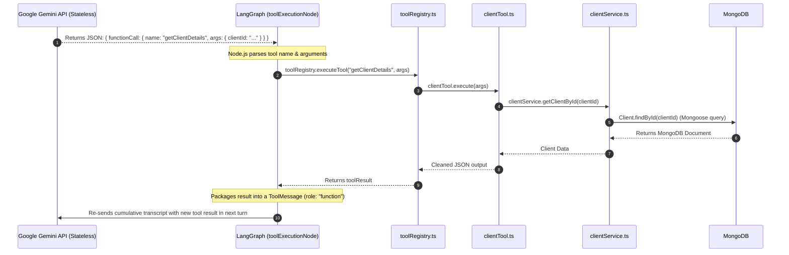
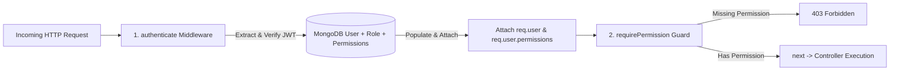
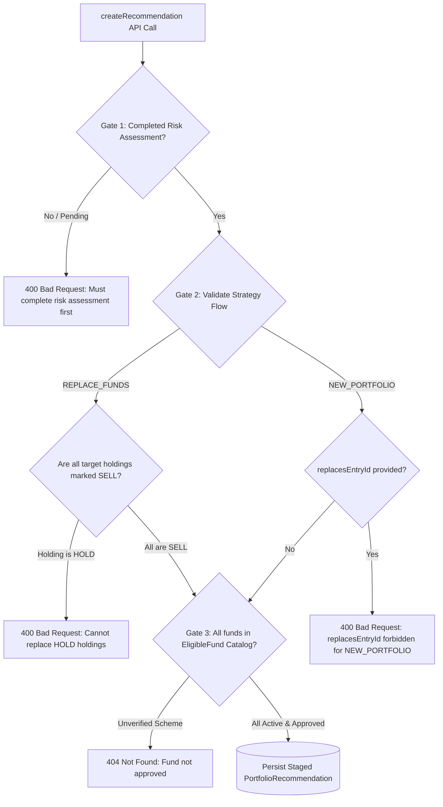

# Interview Preparation Guide - NodeJS Backend

This document captures project interview questions, authoritative answers, key code references from the WealthTech CRM Node.js codebase, and **critical architectural trade-offs** that senior interviewers frequently probe or push back on.

---

## Product Overview & Elevator Pitch

**WealthTech CRM** is an end-to-end advisory platform built for wealth management firms and investment advisors. It digitizes the entire client advisory journey into six core features:

1. **Client Management (List & Profile):** Advisors manage their entire client roster with KYC compliance status, contact details, and assigned Relationship Managers.
2. **User Management & RBAC:** Fine-grained role-based access control where admins manage users, teams/groups, and permissions (e.g., who can create clients vs. approve reviews).
3. **Risk Assessment:** A structured questionnaire that calculates an investor's risk score and maps them to a category (Conservative, Moderate, or Aggressive)—a mandatory regulatory requirement before giving advice.
4. **Portfolio Review:** Advisors upload client eCAS statements (PDF). The system parses current holdings, calculates financial metrics (CAGR, absolute returns), and tags underperforming schemes as **SELL** vs. **HOLD**.
5. **Portfolio Recommendation (with 2 Flows):**
   - **`REPLACE_FUNDS` Flow:** Specifically liquidates the funds marked as **SELL**, calculates the exit proceeds, and replaces them with suitable schemes matching the client's risk score.
   - **`NEW_PORTFOLIO` Flow:** For fresh capital investment, the system builds an optimal target portfolio from scratch using approved schemes.
6. **Autonomous AI Copilot (LangChain & LangGraph):** Built using **LangChain** tool abstractions, a **LangGraph** state machine, and Google Gemini. The agent runs an autonomous loop to fetch client KYC, inspect portfolio holdings, search approved fund factsheets via hybrid RAG, and stage an editable draft recommendation for the advisor to review and approve before generating client-ready PDFs.

---

## NodeJS Backend

### Table of Contents
1. [Agentic AI Architecture, LangGraph State Management & DB Execution Boundaries](#1-agentic-ai-architecture-langgraph-state-management--db-execution-boundaries)
2. [Data Privacy, SEBI/DPDP Compliance & Bidirectional PII Tokenization](#2-data-privacy-sebidpdp-compliance--bidirectional-pii-tokenization)
3. [MongoDB Schema Design & Indexing Strategies (Sparse & Compound Indexes)](#3-mongodb-schema-design--indexing-strategies-sparse--compound-indexes)
4. [Authentication & Fine-Grained RBAC Middleware (JWT vs. Database Trade-off)](#4-authentication--fine-grained-rbac-middleware-jwt-vs-database-trade-off)
5. [eCAS Statement Processing, S3 Storage & SEBI Advisory Compliance Gates](#5-ecas-statement-processing-s3-storage--sebi-advisory-compliance-gates)

---

### 1. Agentic AI Architecture, LangGraph State Management & DB Execution Boundaries

#### Question
> **In your Node.js backend, how does the Autonomous Advisory Agent work? How does the system maintain state across multiple sequential tool executions when LLMs are stateless, and what is the exact execution boundary between the LLM and your MongoDB database?**

#### Comprehensive Answer

##### 1. The Core Architectural Reality: Stateless LLM vs. Stateful Backend
- **LLM APIs (e.g. Gemini 2.0 Flash) are 100% stateless HTTP endpoints (`POST :generateContent`).** The model does not maintain an active session, memory chip, or database connection between HTTP requests.
- **State is completely owned and persisted by our Node.js runtime using LangGraph's `StateGraph`.**
- LangGraph maintains an ongoing, cumulative `messages` array (`BaseMessage[]`) via an accumulator reducer:
  $$\text{messages}_{\text{new}} = \text{messages}_{\text{previous}} \mathbin{\Vert} \text{new\_messages}$$
- In each reasoning turn, our Node.js backend serializes the entire conversation history into the `contents` field of the HTTP payload sent to Gemini. Gemini "knows" the history solely because the backend re-submits the full transcript on every turn.

##### 2. Who Makes the Database Call? (The Execution Boundary)
- **The LLM NEVER touches or connects to MongoDB.** It has no database drivers or network socket access.
- The LLM acts purely as a **reasoning and planning engine** that emits structured JSON tool requests (`functionCall`).
- The **Node.js runtime acts as the secure execution engine**:
  1. LangGraph's `agentReasoningNode` receives the JSON tool call from Gemini.
  2. Transition routing delegates execution to `toolExecutionNode`.
  3. `toolExecutionNode` calls `toolRegistry.executeTool(toolName, args, context)`.
  4. The tool executes domain business logic (e.g., `clientService.getClientById()`), which performs a Mongoose query (`Client.findById()`) against MongoDB.
  5. The resulting MongoDB document is sanitized, packaged into a `ToolMessage` (role: `function`), appended to LangGraph's state, and passed back to Gemini on the next turn.



##### 3. Complete Step-by-Step Execution Flow (Turns 1 through 6)

Every request to Gemini includes two primary components:
1. **The Tool Menu (`tools: [{ functionDeclarations }]`):** Sent on **every single request** so Gemini knows what tools are valid choices for the next step.
2. **The Cumulative History (`contents: [...]`):** Appended sequentially on each turn.

---

###### Turn 1: Initialization & Client Lookup
- **Input to Gemini:** User goal prompt (`HumanMessage`).
  ```json
  { "contents": [{ "role": "user", "parts": [{ "text": "Coordinate advisory rebalancing for client_123" }] }] }
  ```
- **Gemini Response:**
  ```json
  { "functionCall": { "name": "getClientDetails", "args": { "clientId": "client_123" } } }
  ```
- **Backend Execution:** Node.js intercepts the call $\rightarrow$ `clientTool.ts` $\rightarrow$ Mongoose queries MongoDB $\rightarrow$ retrieves client identity & verified KYC status.

---

###### Turn 2: Risk Profile Assessment
- **Input to Gemini (3 items):** Previous prompt + Model tool request + Tool output.
  ```json
  {
    "contents": [
      { "role": "user", "parts": [{ "text": "Coordinate advisory rebalancing for client_123" }] },
      { "role": "model", "parts": [{ "functionCall": { "name": "getClientDetails", "args": { "clientId": "client_123" } } }] },
      { "role": "function", "parts": [{ "functionResponse": { "name": "getClientDetails", "response": { "name": "Rahul Sharma", "kycStatus": "VERIFIED" } } }] }
    ]
  }
  ```
- **Gemini Response:**
  ```json
  { "functionCall": { "name": "getRiskProfile", "args": { "clientId": "client_123" } } }
  ```
- **Backend Execution:** Node.js executes `riskAssessmentTool.ts` $\rightarrow$ queries `RiskAssessment` model in MongoDB $\rightarrow$ returns `{ "scoreCategory": "MODERATE" }`.

---

###### Turn 3: Portfolio Holdings & SELL Candidates
- **Input to Gemini (5 items):** Cumulative transcript including risk score.
- **Gemini Response:**
  ```json
  { "functionCall": { "name": "getPortfolioHoldings", "args": { "portfolioReviewId": "rev_001" } } }
  ```
- **Backend Execution:** Node.js executes `portfolioReviewTool.ts` $\rightarrow$ queries eCAS line items in MongoDB $\rightarrow$ identifies underperforming funds marked for `SELL` with total exit proceeds of ₹1,00,000.

---

###### Turn 4: Grounded Replacement Fund Discovery
- **Input to Gemini (7 items):** Cumulative transcript with exit proceeds of ₹1,00,000.
- **Gemini Response:**
  ```json
  { "functionCall": { "name": "searchEligibleFunds", "args": { "scoreCategory": "MODERATE", "topK": 5 } } }
  ```
- **Backend Execution:** Node.js executes `fundResearchRagTool.ts` $\rightarrow$ performs candidate-constrained query in MongoDB against `EligibleFund` catalog $\rightarrow$ returns candidate schemes (e.g. Parag Parikh Flexi Cap Fund).

---

###### Turn 5: Staging the Final Compliant Recommendation Proposal
- **Input to Gemini (9 items):** Full evidence transcript (Client KYC + MODERATE risk + ₹1,00,000 proceeds + Candidate funds).
- **Gemini Response:**
  ```json
  {
    "functionCall": {
      "name": "stageDraftProposal",
      "args": {
        "totalInvestable": 100000,
        "executiveSummary": "Proposal to exit underperforming holdings and reallocate ₹1,00,000 into suitable MODERATE risk schemes.",
        "allocations": [
          {
            "eligibleFundId": "fund_99",
            "fundName": "Parag Parikh Flexi Cap Fund",
            "amount": 100000,
            "rationale": "High risk-adjusted performance with lower expense ratio matching MODERATE profile."
          }
        ]
      }
    }
  }
  ```
- **Backend Execution:** Node.js executes `stageRecommendationDraftTool.ts` $\rightarrow$ persists the staged draft proposal in MongoDB with audit traces.

---

###### Turn 6: Convergence & Completion
- LangGraph inspects state, detects that `stageDraftProposal` succeeded and `stagedDraft` is populated.
- Conditional edge `shouldContinue` evaluates to `'end'`.
- The workflow exits the graph and returns `HTTP 200 OK` with `AgentRunResponseDto` to the Relationship Manager UI.

---

#### Code References
- **LangGraph State Machine:** `backend-nodejs/src/modules/agent/strategy/impl/langGraphAgentStrategy.ts`
- **Tool Registry & Gemini Schemas:** `backend-nodejs/src/modules/agent/tools/toolRegistry.ts`
- **Agent Dispatcher Controller:** `backend-nodejs/src/modules/agent/controllers/agentController.ts`
- **Domain Tools:**
  - `backend-nodejs/src/modules/agent/tools/clientTool.ts`
  - `backend-nodejs/src/modules/agent/tools/riskAssessmentTool.ts`
  - `backend-nodejs/src/modules/agent/tools/portfolioReviewTool.ts`
  - `backend-nodejs/src/modules/agent/tools/fundResearchRagTool.ts`
  - `backend-nodejs/src/modules/agent/tools/stageRecommendationDraftTool.ts`

---

#### Notable Trade-offs & Potential Interviewer Pushback

- **Pushback: "Sending the growing conversation history on every turn increases latency and token costs. Why not use an external cache or agent memory service?"**
  - *Trade-off:* Re-submitting history consumes prompt tokens vs. managing an external conversational memory cluster.
  - *Defense:* The advisory rebalancing loop is tightly bounded to 4–6 tool calls. Across 5 turns, the total cumulative prompt length is under 4,000 tokens—well within Gemini 2.0 Flash's 1-million-token context window. Sending the full history keeps the backend completely stateless across horizontal instances, eliminates distributed session cache synchronization bugs, and provides a deterministic, auditable trace of every agent reasoning step.

- **Pushback: "What happens if Gemini's API is down or the model hallucinates an invalid tool call?"**
  - *Trade-off:* Full LLM autonomy vs. operational reliability.
  - *Defense:* 
    1. If the Gemini API is unreachable, `langGraphAgentStrategy` catches the error and degrades gracefully to `executeFrameworkReasoning`, an offline deterministic state machine that executes the identical tool sequence without LLM dependency.
    2. Every tool invocation passes through `toolRegistry.executeTool()`, which verifies tool names against a strict whitelist. If an unmapped tool is requested, the registry safely returns an error message to the model without crashing the Node.js runtime.
    3. We enforce a hard bound of `MAX_STEPS = 8` in LangGraph, guaranteeing the agent cannot enter an infinite loop.

---

### 2. Data Privacy, SEBI/DPDP Compliance & Bidirectional PII Tokenization

#### Question
> **In a regulated WealthTech CRM, sending real client identities (PAN, Aadhaar, email, phone) to external LLMs violates SEBI and DPDP regulations. How does your backend's `PiiProtectionGateway` prevent data leakage, how does the "length sorting" trick prevent broken tokens, and how does bidirectional tokenization and rehydration work?**

#### Comprehensive Answer

##### 5-Step Summary of the PII Protection Flow
1. **Prepare and Sort Known Data (Length Sorting Trick):**  
   The backend pulls the client’s real profile from MongoDB (full name, email, PAN, phone, address). Crucially, it **sorts these candidate fields descending by string length** (`candidates.sort((a, b) => b.value.length - a.value.length)`). This guarantees that compound phrases like `"Rahul Verma"` (11 chars) are matched and tokenized *before* shorter individual words like `"Rahul"` (5 chars) can run, preventing broken partial tokens (e.g., preventing `{{CLIENT_FIRST_NAME_1}} Verma`).

2. **Replace Known Info with Tokens (Layer 1 - Deterministic Matching):**  
   The backend replaces those real values in the prompt with opaque placeholder tokens:
   - `"Rahul Verma"` $\longrightarrow$ `{{CLIENT_NAME_1}}`
   - `"ABCDE1234F"` $\longrightarrow$ `{{CLIENT_PAN_1}}`
   - `"rahul.verma@example.com"` $\longrightarrow$ `{{CLIENT_EMAIL_1}}`

3. **Catch Any Surprise Info with Regex (Layer 2 - Defensive Safety Net):**  
   If the advisor typed an uncatalogued PAN, Aadhaar number, or phone number directly into the free-form chat prompt, deterministic regex patterns catch their standardized formats and assign tokens as well:
   - Indian PAN: `/\b[A-Z]{5}[0-9]{4}[A-Z]\b/g`
   - Aadhaar: `/\b\d{4}[\s\-]\d{4}[\s\-]\d{4}\b/g`
   - Indian Mobile: `/(?:(?:\+|00)91[\-\s]?)?[6-9]\d{9}\b/g`

4. **Store the Secret Key in an In-Memory Vault:**  
   The backend captures an ephemeral, immutable map in RAM (the token vault) mapping each token to its authentic value:  
   `{ "{{CLIENT_PAN_1}}": "ABCDE1234F", "{{CLIENT_NAME_1}}": "Rahul Verma" }`.  
   The prompt sent across the wire to Google Gemini contains **only placeholder tokens**, ensuring zero sensitive PII ever crosses the network boundary to the external model.

5. **Rehydrate the Answer (Restore Authentic Data on the Backward Pass):**  
   When Gemini finishes generating its response, the backend looks up the in-memory vault and immediately calls `rehydrate()`, swapping all surrogate tokens back to their authentic names and numbers before persisting the dialogue turn or presenting the recommendation to the Relationship Manager.

##### Restoration Modes: In-Memory Closure (Way A) vs. Database Entity (Way B)
- **Way A (Active Request Pipeline):** `piiProtectionGateway.tokenize()` returns an in-memory closure (`rehydrate: (text) => this.rehydrate(text, immutableVault)`). In `ragSynthesisService.ts`, as soon as Gemini returns the synthesized answer, `tokenizedQuery.rehydrate()` instantly swaps tokens in RAM.
- **Way B (Offline / Asynchronous Jobs):** For background jobs (e.g. PDF generation 10 minutes later when transient RAM maps are gone), `rehydrateWithEntity(text, clientContext)` loads the client record from MongoDB and substitutes placeholders directly from the database entity.

#### Code References
- **PII Gateway Implementation:** `backend-nodejs/src/common/services/piiProtectionGateway.ts`
- **RAG Synthesis Integration:** `backend-nodejs/src/modules/portfolioreview/services/ragSynthesisService.ts`

#### Notable Trade-offs & Potential Interviewer Pushback
- **Pushback: "Why not use a heavy ML NER (Named Entity Recognition) model like spaCy or Microsoft Presidio?"**
  - *Trade-off:* ML-based NER models detect uncatalogued names in free text vs. regex + entity matching latency.
  - *Defense:* ML NER introduces massive CPU overhead (50–200ms latency per prompt) and heavy external model dependencies. In Indian wealth management, sensitive compliance identifiers (PAN, Aadhaar, mobile numbers) follow strict, deterministic formats. Combining deterministic MongoDB client field replacement (Layer 1) with regex matching (Layer 2) runs in sub-millisecond execution time (~1ms), has zero external dependencies, and eliminates false negatives on standardized financial identifiers.

---

### 3. MongoDB Schema Design & Indexing Strategies (Sparse & Compound Indexes)

#### Question
> **How did you design your MongoDB indexes? Specifically, why is `sparse: true` required on client PAN numbers, how do compound indexes optimize RAG candidate retrieval, and why did you use Mongoose virtuals instead of storing full names?**

#### Comprehensive Answer

##### 1. The `sparse: true` Index on Optional Unique Fields (Client PAN)
- In `Client.ts`, `pan` is marked with:
  ```typescript
  pan: { type: String, unique: true, sparse: true }
  ```
- **The Problem Without `sparse: true`:** In MongoDB, a standard unique index indexes `null` / missing values as an actual value (`{ pan: null }`). If multiple clients register during an initial onboarding flow where PAN is not yet uploaded, the first client document inserts successfully. The second client document without a PAN immediately crashes the insert with a **Duplicate Key Error (`E11000 duplicate key error collection ... dup key: { pan: null }`)**.
- **The Solution:** Adding `sparse: true` tells MongoDB to only create index entries for documents that *actually contain* the `pan` field. Documents omitting PAN are completely bypassed by the index, allowing unlimited onboarding clients while still strictly enforcing uniqueness whenever a PAN is provided.

##### 2. Compound Indexes for Candidate-Constrained RAG Retrieval
- In `FundDocumentEmbedding.ts`, we created compound indexes:
  ```typescript
  fundDocumentEmbeddingSchema.index({ isin: 1, scoreCategory: 1 });
  fundDocumentEmbeddingSchema.index({ isin: 1, documentType: 1 });
  ```
- **Single B-Tree Traversal vs. Index Intersection:**
  - With two separate single-field indexes (`{ isin: 1 }` and `{ scoreCategory: 1 }`), MongoDB would have to perform two separate index scans and combine them via an expensive in-memory **Index Intersection** (`AND_SORTED`), or scan one index and inspect thousands of documents from disk to check the second field.
  - A **compound index** `{ isin: 1, scoreCategory: 1 }` traverses a **single B-Tree structure** (`IXSCAN`) in $O(\log N)$ time, directly retrieving document pointers matching both constraints in a single pass.
- **The Index Prefix Rule (2-for-1 Index Optimization):**
  - In MongoDB, a compound index on `{ isin: 1, scoreCategory: 1 }` automatically serves queries filtering on `isin` alone (the leading prefix), eliminating the need for a separate standalone index on `isin` and saving substantial RAM.
- **Idempotent Ingestion Deletions:**
  - In `fundDocumentIngestionService.ts`, re-uploading an updated fund PDF calls:
    `await FundDocumentEmbedding.deleteMany({ isin: meta.isin, documentType: meta.documentType })`.
  - The compound index `{ isin: 1, documentType: 1 }` makes this deletion instant, avoiding a full collection scan across tens of thousands of chunks.

##### 3. Schema Virtuals for Derived Fields (`fullName`)
- Rather than redundantly storing `fullName` as a physical field in MongoDB (which risks data desynchronization if `firstName` or `lastName` is updated), `Client.ts` uses a **Mongoose Virtual**:
  ```typescript
  clientSchema.virtual('fullName').get(function () {
    return `${this.firstName} ${this.lastName}`.trim();
  });
  ```
- Serialized to API responses automatically via `{ toJSON: { virtuals: true } }`, guaranteeing 100% consistency with zero extra storage.

#### Code References
- **Client Model & Sparse Index:** `backend-nodejs/src/modules/customer/models/Client.ts`
- **Embedding Compound Indexes:** `backend-nodejs/src/modules/portfolioreview/models/FundDocumentEmbedding.ts`
- **Idempotent Ingestion Cleanup:** `backend-nodejs/src/modules/portfolioreview/services/fundDocumentIngestionService.ts`

---

### 4. Authentication & Fine-Grained RBAC Middleware (JWT vs. Database Trade-off)

#### Question
> **Walk me through how an incoming API request gets authenticated and authorized in your Express backend. What gets attached to `req.user`, and why do you query MongoDB on every request instead of embedding all permissions into the stateless JWT?**

#### Comprehensive Answer

##### 1. Two-Stage Express Middleware Pipeline



1. **`authenticate` Middleware:**
   - Extracts Bearer token from the `Authorization` header.
   - Cryptographically verifies signature and expiration using `jsonwebtoken`.
   - Queries MongoDB: `User.findOne({ email: decoded.email }).populate({ path: 'role', populate: { path: 'permissions' } })`.
   - Flattens the populated role permissions into an array of string codenames (e.g. `['CLIENT_CREATE', 'PORTFOLIO_REVIEW_STAGE']`).
   - Attaches the user object and `permissions` array to `req.user`.

2. **`requirePermission(...requiredPermissions)` Middleware Guard:**
   - Declaratively guards route definitions:
     ```typescript
     router.post('/', authenticate, requirePermission('CLIENT_CREATE'), clientController.createClient);
     ```
   - Checks if `req.user.permissions` contains at least one of the required codenames.
   - If missing, immediately halts execution with an HTTP `403 Forbidden` (`AppError`), preventing unauthorized access before the controller is ever invoked.

##### 2. Role-Based vs. Fine-Grained Permission-Based RBAC
- Hardcoding role checks (e.g., `if (user.role === 'ADMIN')`) is brittle and requires code deployments whenever business roles change.
- By decoupling **Roles** from **Permissions** and checking granular permission codenames (`requirePermission('PORTFOLIO_REVIEW_APPROVE')`), business administrators can dynamically alter what a "Senior Advisor" or "Manager" role can do directly in MongoDB/admin UI without redeploying backend code.

##### 3. The Core Senior Trade-off: Database Hit vs. Instant Permission Invalidation

| Architecture Choice | **Embed Permissions in JWT (Stateless)** | **Query MongoDB on Every Request (Our Choice)** |
| :--- | :--- | :--- |
| **Network & Header Size** | Token bloat (50+ permission strings in every HTTP request header). | Lightweight JWT (contains only user email/ID). |
| **Permission Revocation** | **Stale:** Changes do not take effect until the JWT expires (15–60 mins). | **Instant:** Takes effect on the user's very next API call. |
| **Terminated Employees** | Can continue downloading client data until token expires. | Immediately rejected with HTTP 401 on next click. |
| **Database Load** | Zero database hits for authorization. | One indexed `User.findOne()` query per request (~2–5ms). |

- **Our Defense:** In enterprise wealth management and fiduciary finance, **security and immediate access revocation strictly override saving 2 milliseconds of database latency**. If an advisor is terminated or their access is downgraded due to a compliance breach, their access must be cut off instantly.
- **Production Scalability Roadmap:** For ultra-high-throughput architectures (tens of thousands of requests/sec), we would cache the user's flattened permission array in an in-memory **Redis cluster** with a short 5-minute TTL, coupled with an event-driven cache eviction hook triggered whenever an admin modifies roles in MongoDB.

#### Code References
- **Auth & RBAC Middleware:** `backend-nodejs/src/common/middleware/authMiddleware.ts`
- **User Schema & Password Hashing:** `backend-nodejs/src/modules/usermanager/models/User.ts`
- **Role & Permission Schemas:**
  - `backend-nodejs/src/modules/usermanager/models/Role.ts`
  - `backend-nodejs/src/modules/usermanager/models/Permission.ts`
- **Guarded Client Routes:** `backend-nodejs/src/modules/customer/routes/clientRoutes.ts`

---

### 5. eCAS Statement Processing, S3 Storage & SEBI Advisory Compliance Gates

#### Question
> **What is an eCAS statement, how does your Node.js backend handle its upload and storage securely via AWS S3 pre-signed URLs, and how does the backend enforce SEBI investor suitability rules across the `REPLACE_FUNDS` and `NEW_PORTFOLIO` rebalancing flows?**

#### Comprehensive Answer

##### 1. What is an eCAS Statement?
An **eCAS (Electronic Consolidated Account Statement)** is an official, consolidated monthly statement issued by Indian mutual fund registrars (CAMS and KFintech) and depositories (CDSL and NSDL). It aggregates all mutual fund folios, stocks, and bond holdings associated with an investor's PAN into a single statement. In our WealthTech CRM, uploading a client's eCAS statement serves as the foundation for portfolio health analysis, underperformance identification, and AI-driven advisory rebalancing.

##### 2. Secure S3 Storage Architecture & Pre-signed URLs
- **Upload Flow:** Handled in `portfolioReviewService.uploadEcasStatement()`:
  - Files are uploaded via `POST /api/v1/portfolio-reviews/ecas/upload` using `multer` memory storage.
  - The filename is sanitized to prevent directory traversal: `const safeFilename = params.originalFilename.replace(/[^a-zA-Z0-9._-]/g, '_')`.
  - The file buffer is streamed to a private AWS S3 bucket (or LocalStack in development) under a client-isolated key prefix:
    $$\text{s3Key} = \text{ecas/}\{clientId\}/\{timestamp\}\_{safeFilename}$$
- **Time-Bound Pre-signed URLs:**
  - The S3 bucket remains **completely private** (no public read permissions).
  - When an advisor requests the document, `s3Service.getPresignedDownloadUrl(s3Key)` generates a time-bound cryptographic pre-signed URL (15-minute TTL) using `@aws-sdk/s3-request-presigner`.
  - **Performance Benefit:** Clients download heavy PDF byte streams directly from AWS S3, preventing large binary payloads from blocking Node.js single-threaded event loop I/O.

##### 3. MongoDB Holdings Representation (`PortfolioReview.ts`)
Parsed eCAS statements are stored in MongoDB as a `PortfolioReview` document with an embedded array of `entries` (`IPortfolioEntry[]`):
* **Financial Performance Attributes:** `units`, `purchaseNav`, `currentNav`, `investedAmount`, `currentValue`, `gain`, `absReturnPct`, `cagrPct`, and `holdingDays`.
* **Advisory Action Tagging:** Each line item is classified with an explicit `EntryAction`:
  - `HOLD`: Performing schemes aligned with asset allocation goals.
  - `SELL`: Underperforming schemes with high expense ratios or consistent benchmark lag targeted for liquidation and reinvestment.
* **Portfolio Level Aggregates:** `totalInvested`, `totalCurrentValue`, `totalGain`, `gainPercentage`, and overall `cagr`.

##### 4. The 3 SEBI Advisory Compliance Gates (`createRecommendation`)
Under SEBI (Investment Advisers) Regulations, advisors cannot arbitrarily recommend or replace schemes without verified investor suitability and formal audit controls. Our backend enforces 3 strict compliance gates in `portfolioReviewService.ts#createRecommendation`:



1. **Gate 1: Mandatory Investor Risk Suitability Pre-requisite:**
   - The backend queries `RiskAssessment.findOne({ client: request.clientId, status: AssessmentStatus.COMPLETED })`.
   - If no completed assessment exists, recommendation creation is immediately blocked with HTTP `400 Bad Request`.
2. **Gate 2: Rebalancing Flow Integrity (`REPLACE_FUNDS` vs. `NEW_PORTFOLIO`):**
   - **`REPLACE_FUNDS` (Portfolio Restructuring):**
     - Requires a valid `portfolioReviewId` belonging to the client.
     - For every replacement line item (`replacesEntryId`), the backend verifies that the existing holding is explicitly flagged as `action === EntryAction.SELL`.
     - If an advisor attempts to replace a holding marked `HOLD`, the backend rejects the transaction with HTTP `400 Bad Request` (`"Holding is marked HOLD - only SELL holdings can be replaced"`).
   - **`NEW_PORTFOLIO` (Fresh Capital Allocation):**
     - Designed for deploying fresh investable cash.
     - Explicitly forbids `replacesEntryId` (throws HTTP 400 if provided).
3. **Gate 3: SEBI-Approved Scheme Verification:**
   - Every candidate fund ID must exist and be active (`isActive: true`) in the master [`EligibleFund`](file:///home/rohitimandi/Desktop/Rohit/Personal/Online_Project_Uploads/wealth-tech-crm/backend-nodejs/src/modules/portfolioreview/models/EligibleFund.ts) collection, preventing advisors from recommending unvetted, closed, or high-risk unauthorized schemes.

#### Code References
- **Portfolio Review Service & Compliance Logic:** `backend-nodejs/src/modules/portfolioreview/services/portfolioReviewService.ts`
- **Portfolio Review & Entry Schema:** `backend-nodejs/src/modules/portfolioreview/models/PortfolioReview.ts`
- **Eligible Fund Master Schema:** `backend-nodejs/src/modules/portfolioreview/models/EligibleFund.ts`
- **S3 Storage & Pre-signed URL Service:** `backend-nodejs/src/common/services/s3Service.ts`
- **Portfolio Review Controller Endpoints:** `backend-nodejs/src/modules/portfolioreview/controllers/portfolioController.ts`

#### Notable Trade-offs & Potential Interviewer Pushback
- **Pushback: "Why upload eCAS PDFs through the Node.js API server instead of having the frontend upload directly to S3 using a pre-signed PUT URL?"**
  - *Trade-off:* API server buffering vs. direct client-to-S3 upload.
  - *Defense:* In a production environment with high concurrency, direct frontend-to-S3 uploads using pre-signed PUT URLs are optimal to bypass the backend entirely. In our current architecture, routing the file through the backend allows immediate server-side validation (file signature check, MIME type verification, antivirus/sanitization) before the S3 key is registered into the database review entity.
- **Pushback: "Why store portfolio entries as an embedded document array inside `PortfolioReview` instead of a separate `portfolio_entries` collection?"**
  - *Trade-off:* Embedded subdocuments vs. normalized relational collections.
  - *Defense:* A client's eCAS statement typically contains 5–25 mutual fund holdings—an inherently bounded dataset that never grows unboundedly. Storing entries embedded inside the parent `PortfolioReview` document guarantees atomic single-document reads/writes, avoids multi-document MongoDB distributed transactions, and ensures a single $O(1)$ document lookup hydrates the entire portfolio.
